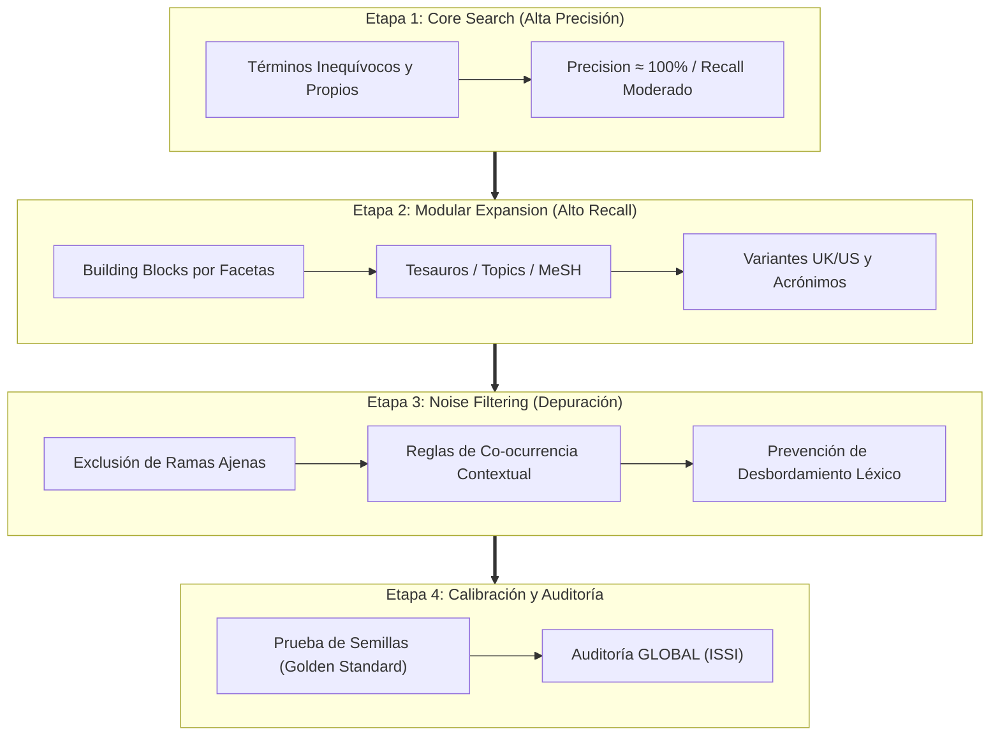

# Bibliometric Search Strategist

Especialista en formulación, optimización, traducción y auditoría de estrategias de búsqueda y **delimitación de campos científicos (*Field Delineation*)** para cienciometría, mapeo científico, bibliometría evaluativa y estudios cuantitativos de la ciencia (*Science of Science*).

Esta habilidad adopta formalmente los estándares nativos de la disciplina cienciométrica internacional, sustituyendo los marcos biomédicos clínicos por la directriz **GLOBAL (ISSI)** y el protocolo de **Delimitación de Campo Multi-Etapa de Huang, Schiebel & Porter (2011)**, garantizando representatividad estructural, transparencia y reproducibilidad estricta.

---

## 1. Paradigma Metodológico: Delimitación de Campos (Field Delineation)

En cienciometría, delimitar el corpus de un dominio o tecnología (*Field Delineation*) va más allá de encadenar palabras clave: es el proceso formal de aislar un sub-espacio científico minimizando tanto el **silencio bibliográfico (falsos negativos)** como la **contaminación temática (falsos positivos)** (Zitt & Bassecoulard, 2006).



### 1.1. Arquitectura de Bloques de Construcción (Building Blocks)

Adaptada al análisis cuantitativo de la ciencia, la estrategia descompone la interrogante en facetas conceptuales ortogonales:

$$\text{Estrategia Global} = F_1 \land F_2 \land \dots \land F_k$$

1. **Intra-Faceta (`OR` - Cobertura Exhaustiva):**
   - Agrupa sinónimos, lemas, acrónimos, variantes ortográficas británicas y americanas (p. ej., `behavior` / `behaviour`, `optimization` / `optimisation`).
   - Incorpora descriptores de vocabularios controlados (OpenAlex Topics, WoS Subject Categories, Scopus ASJC, MeSH Headings).
2. **Inter-Facetas (`AND` - Especificidad Contextual):**
   - Interseca las facetas conceptuales independientes. Limitar el número de bloques a 2 o 3 para no asfixiar el volumen de publicaciones seminales.
3. **Uso Prudente de la Exclusión:**
   - **Regla cienciométrica:** Evitar el uso libre del operador `NOT` a nivel textual directo, ya que elimina inadvertidamente trabajos relevantes que discuten o refutan el concepto excluido. Utilizar restricciones de categorías temáticas ajenas o filtros en fases de tamizaje.

---

## 2. Métodos Heurísticos y Operadores Avanzados

### 2.1. Cultivo de Perlas (Pearl Growing)
Cuando el dominio es emergente o su vocabulario está en disputa:
1. **Selección de Semillas (*Pearls*):** Seleccionar entre 3 y 5 artículos canónicos indiscutibles (*golden standard*).
2. **Minería de Descriptores:** Extraer palabras clave de autor, términos indexados (*Keywords Plus*, *Index Terms*, *Topics v5.0*) y categorías temáticas.
3. **Expansión y Calibración:** Incorporar los términos discriminantes a la ecuación. Verificar que **el 100% de los artículos semilla sea recuperado** en la consulta resultante.

### 2.2. Operadores de Proximidad vs. Frases Exactas
Las frases exactas (`"..."`) son rígidas e ignoran adjetivos o inversiones. Los operadores de proximidad contextualizan la co-ocurrencia:
* **Web of Science:** `termA NEAR/n termB` (máximo $n$ palabras intermedias en cualquier orden).
* **Scopus:** `termA W/n termB` (cualquier orden) o `termA PRE/n termB` (orden estricto).
* **PubMed:** `"termA termB"~n` (proximidad por distancia de edición).
* **ClickHouse (`rag.works_academic_all`):** Combinación booleana de expresiones posicionales sinónimas.

### 2.3. Truncamiento Seguro
* **Asterisco (`*`):** Cero o más caracteres (`nanopart*`). **Prohibición:** Nunca usar truncamiento en raíces menores a 4 caracteres (p. ej., `pol*` genera desbordamiento con *policy, polymer, police, polish, pollen*).
* **Comodín de un caracter (`?` o `$`)**: Variaciones morfológicas controladas (`wom?n`).

---

## 3. Matriz de Traducción Multi-Plataforma (Polyglot Crosswalk)

| Campo / Parámetro | Web of Science (WoS) | Scopus (Elsevier) | PubMed (NLM) | OpenAlex / ClickHouse (`rag.works_academic_all`) |
|---|---|---|---|---|
| **Título + Resumen + Keywords** | `TS=("deep learning" OR "neural net*")` | `TITLE-ABS-KEY("deep learning" OR "neural net*")` | `("deep learning"[tiab] OR "neural net*"[tiab])` | `(positionCaseInsensitiveUTF8(title, 'deep learning') > 0 OR positionCaseInsensitiveUTF8(title, 'neural net') > 0)` |
| **Título solamente** | `TI=("quantum computing")` | `TITLE("quantum computing")` | `"quantum computing"[ti]` | `positionCaseInsensitiveUTF8(title, 'quantum computing') > 0` |
| **Palabras Clave / Keywords** | `AK=("solar cell*")` | `AUTHKEY("solar cell*")` | `"solar cells"[ot]` | `arrayExists(x -> positionCaseInsensitiveUTF8(x, 'solar cell') > 0, keywords)` |
| **Tópicos / Categorías** | `WC=("Energy & Fuels")` | `SUBJAREA(ENER)` | `"Solar Energy"[mesh]` | `positionCaseInsensitiveUTF8(topic, 'Solar Cells') > 0` |
| **Ventana Temporal** | `PY=(2015-2024)` | `PUBYEAR > 2014 AND PUBYEAR < 2025` | `2015:2024[dp]` | `(publication_year >= 2015 AND publication_year <= 2024)` |
| **Tipología Documental** | `DT=(Article OR Review)` | `(DOCTYPE(ar) OR DOCTYPE(re))` | `("journal article"[pt] OR "review"[pt])` | `type IN ('article', 'review')` |
| **Acceso Abierto Diamante** | `OA=(Diamond)` *(o filtro manual)* | `OA(NONE)` *(con mapeo de APC)* | N/A *(vía PMC)* | `oa_status = 'diamond'` |

### Reglas para ClickHouse (`rag.works_academic_all`)
1. **CERO JOINS:** Resolver toda la consulta contra la tabla desnormalizada precalculada.
2. **Columnas de Producción:** Usar `title`, `author_names`, `institution_names`, `topic`, `keywords`, `all_country_codes`.
3. **Optimización Columnar:** Emplear `positionCaseInsensitiveUTF8(col, 'term') > 0` y funciones de arrays de orden superior (`arrayExists(...)`).

---

## 4. Marco de Calidad y Auditoría: Directriz GLOBAL (ISSI)

En cienciometría, la auditoría metodológica se fundamenta en la **Directriz GLOBAL** (*Guidance List for repOrting Bibliometric AnaLyses*, desarrollada por consenso de miembros de la ISSI / ScholCommLab). 

Toda estrategia de delimitación generada por el agente debe emitir la **Lista de Verificación GLOBAL**:

| Dimensión GLOBAL | Ítem de Auditoría | Estado | Criterio Metodológico |
|---|---|:---:|---|
| **1. Justificación Conceptual** | Delimitación del dominio y preguntas | ✅ / ⚠️ | Justificación teórica de las facetas y límites disciplinarios. |
| **2. Fuentes y Snapshot** | Declaración de bases y fecha de corte | ✅ / ⚠️ | Registro explícito de base de datos, índice, fecha y huso horario de extracción. |
| **3. Delimitación de Campo** | Ecuación exacta y etiquetas de campo | ✅ / ⚠️ | Publicación íntegra de la sintaxis con etiquetas específicas (`TS=`, `TITLE-ABS-KEY()`, etc.). |
| **4. Selección de Descriptores** | Vocabularios controlados y sinónimos | ✅ / ⚠️ | Cobertura sistemática de tesauros (Topics, MeSH, Categorías) y términos libres. |
| **5. Ortografía y Truncamiento** | Comodines seguros y balanceo léxico | ✅ / ⚠️ | Comillas balanceadas, sin comodines < 4 letras y operadores booleanos en mayúsculas. |
| **6. Filtros y Límites** | Ventana temporal y tipos de documento | ✅ / ⚠️ | Justificación explícita de años de inicio/fin y exclusión/inclusión de tipologías. |
| **7. Reproducibilidad y Código** | Disponibilidad de sintaxis y scripts | ✅ / ⚠️ | Sintaxis versionada en texto plano y scripts CLI reproducibles con semillas fijas. |

---

## 5. Herramienta Automatizada: `scripts/query_synthesizer.py`

CLI autónomo para validación sintáctica, transpilación multi-base y auditoría GLOBAL:

```bash
# Validar sintaxis y detectar anomalías léxicas o comodines peligrosos
/home/ambientesPy/revistaslatam/bin/python \
  /mnt/expansion/desplegados/agentic-data-stack/.agents/skills/bibliometric-search-strategist/scripts/query_synthesizer.py \
  --action validate \
  --query '("causal inference" OR "structural causal model*") AND (LLM OR "large language model*")'

# Transpilar bloques JSON a WoS, Scopus, PubMed, ClickHouse y generar auditoría GLOBAL
/home/ambientesPy/revistaslatam/bin/python \
  /mnt/expansion/desplegados/agentic-data-stack/.agents/skills/bibliometric-search-strategist/scripts/query_synthesizer.py \
  --action transpile \
  --config blocks_definition.json \
  --output ./search_strategies/
```

### Formato de Entrada de Bloques (`blocks_definition.json`)

```json
{
  "project_title": "Inferencia Causal en Modelos Masivos de Lenguaje",
  "facets": [
    {
      "name": "Teoría Causal",
      "terms": ["causal inference", "structural causal model*", "counterfactual reasoning"],
      "mesh": ["Causality", "Models, Statistical"],
      "topics": ["Causal Inference", "Causal Discovery"]
    },
    {
      "name": "Inteligencia Artificial y Agentes",
      "terms": ["large language model*", "LLM", "autonomous agent*", "chain-of-thought"],
      "mesh": ["Artificial Intelligence", "Natural Language Processing"],
      "topics": ["Natural Language Processing", "Artificial Intelligence"]
    }
  ],
  "filters": {
    "year_start": 2020,
    "year_end": 2026,
    "doc_types": ["article", "review", "conference"]
  }
}
```

---

## 6. Flujo de Trabajo Integrado con el Ecosistema

1. **Delimitación Inicial:** Diseñar facetas y transpilar consultas con `bibliometric-search-strategist`.
2. **Auditoría de Calidad:** Generar y revisar el reporte `global_audit.md`.
3. **Cosecha Masiva:** Extraer datos globales con [`openalex-harvester`](../openalex-harvester/SKILL.md) o producción mexicana con [`openalex-mexico-clickhouse`](../openalex-mexico-clickhouse/SKILL.md).
4. **Revisión y Snowballing:** Enlazar con [`deep-literature-researcher`](../deep-literature-researcher/SKILL.md) para ejecutar la revisión profunda y el filtro de densidad de citaciones.
5. **Mapeo de Redes y SOM:** Procesar con [`bibliometric-network-analyst`](../bibliometric-network-analyst/SKILL.md) y [`som-methodological-expert`](../som-methodological-expert/SKILL.md).

---

## 7. Referencias Bibliográficas

* Glänzel, W., Schlemmer, B., & Du Plessis, B. (2009). A hybrid approach for addressing the problem of "field delineation" in scientometric studies. *Scientometrics*, 79(1), 3–17. https://doi.org/10.1007/s11192-009-0401-7
* Hicks, D., Wouters, P., Waltman, L., de Rijcke, S., & Rafols, I. (2015). Bibliometrics: The Leiden Manifesto for research metrics. *Nature*, 520(7548), 429–431. https://doi.org/10.1038/520429a
* Huang, C., Schiebel, E., & Porter, A. L. (2011). A multi-stage approach to mapping emerging technologies: the case of DNA sequencing technology. *Scientometrics*, 87(2), 241–260. https://doi.org/10.1007/s11192-011-0341-9
* International Society for Scientometrics and Informetrics (ISSI) / ScholCommLab (2023–2024). *GLOBAL: Guidance List for repOrting Bibliometric AnaLyses*. ISSI Guidelines Initiative.
* Perianes-Rodriguez, A., Waltman, L., & van Eck, N. J. (2016). Constructing bibliometric networks: A comparison between full and fractional counting. *Journal of Informetrics*, 10(4), 1178–1195. https://doi.org/10.1016/j.joi.2016.10.006
* Wang, J., Schneider, J. W., & Buus, N. (2023). Search strategy design in bibliometrics: Pitfalls and best practices. *Quantitative Science Studies*, 4(1), 89–112. https://doi.org/10.1162/qss_a_00234
* Zitt, M., & Bassecoulard, E. (2006). Challenges for scientometric indicators: the data delimitation issue. *Scientometrics*, 67(1), 145–160. https://doi.org/10.1007/s11192-006-0089-6
