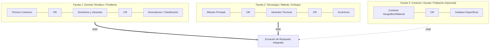
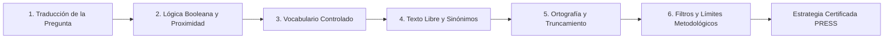

# Bibliometric Search Strategist

Especialista en formulación, optimización, traducción y auditoría de estrategias de búsqueda bibliográfica avanzadas para cienciometría, mapeo científico, bibliometría evaluativa y revisiones sistemáticas de literatura.

Esta habilidad proporciona el rigor metodológico propio de un documentalista de enlace o bibliómetra senior, garantizando un equilibrio óptimo entre **exhaustividad (*Recall*)** y **precisión (*Precision*)**, evitando sesgos de selección y errores sintácticos comunes.

---

## 1. Paradigma Metodológico: Bloques de Construcción (Building Blocks)

El estándar de oro para diseñar ecuaciones de búsqueda es la descomposición conceptual por facetas o bloques independientes, adaptada de los marcos PICO (Población, Intervención, Comparación, Resultado) o PCC (Población, Concepto, Contexto):

$$\text{Estrategia Global} = F_1 \land F_2 \land \dots \land F_k$$



### Reglas Rectoras de los Bloques

1. **Intra-Faceta (`OR` - Maximizar Exhaustividad / Recall)**:
   - Todo término que represente la misma faceta conceptual debe agruparse mediante el operador `OR`.
   - Incluir variantes ortográficas británicas y americanas (p. ej., `behavior` / `behaviour`, `pediatric` / `paediatric`, `organization` / `organisation`).
   - Incluir acrónimos junto a su denominación extendida, evaluando si el acrónimo es ambiguo (p. ej., `"Artificial Intelligence" OR "AI"` puede requerir proximidad si `AI` genera falsos positivos con abreviaturas médicas o químicas).
   - Incluir descriptores de vocabularios controlados (MeSH, Emtree, WoS Subject Categories, Scopus ASJC, OpenAlex Topics).

2. **Inter-Facetas (`AND` - Maximizar Precisión / Precision)**:
   - Cada faceta temática se une con la siguiente mediante el operador `AND`.
   - Limitar el número de facetas a las estrictamente necesarias (típicamente 2 a 3). Añadir más de 3 facetas suele restringir excesivamente el *recall*, provocando el silencio bibliográfico.

3. **Uso Restrictivo del Operador `NOT` (Exclusión Segura)**:
   - **Regla crítica:** Evitar el uso directo de `NOT` en las ecuaciones de bases de datos porque elimina inadvertidamente artículos relevantes que mencionan el término excluido como antecedente, discusión o limitación (p. ej., buscar estudios en humanos con `NOT animal*` elimina artículos titulados *"Comparison of human clinical outcomes with prior animal models"*).
   - **Alternativa recomendada:** Filtrar por tipo de documento (`doctype`), por límites de clasificación temática, o realizar la exclusión en la fase de tamizaje (*screening*).

---

## 2. Métodos Heurísticos Avanzados

### 2.1. Cultivo de Perlas (Pearl Growing)

Cuando el dominio es emergente o la terminología es heterogénea, no se formula la ecuación desde cero; se aplica el método iterativo de *Pearl Growing*:

1. **Selección de Semillas (Pearls):** Identificar de 3 a 5 artículos canónicos indiscutibles del núcleo temático (*golden standard*).
2. **Minería de Descriptores:** Extraer de las semillas:
   - Palabras clave de autor (*Author Keywords*).
   - Palabras clave enriquecidas por base (*Keywords Plus* en WoS, *Index Terms* en Scopus, *MeSH Headings* en PubMed, *Concepts/Topics* en OpenAlex).
   - Categorías temáticas institucionales.
3. **Expansión de Bloques:** Incorporar los términos de mayor poder discriminante a los bloques conceptuales respectivos.
4. **Prueba de Recuperación Cruzada:** Ejecutar la ecuación preliminar y verificar que **el 100% de los artículos semilla sea recuperado**. Si una semilla no se recupera, auditar qué faceta provocó el descarte.

### 2.2. Operadores de Proximidad vs. Frases Exactas

Las frases exactas entre comillas (`"..."`) son rígidas y pueden ignorar adjetivos intermedios o inversiones sintácticas. Los operadores de proximidad resuelven este dilema:

| Base de Datos | Operador | Sintaxis de Ejemplo | Significado |
|---|---|---|---|
| **Web of Science** | `NEAR/n` | `nanoparticle* NEAR/3 drug` | Coinciden dentro de un margen de hasta $n$ palabras intermedias, en cualquier orden. |
| **Scopus** | `W/n` | `nanoparticle* W/3 drug` | Coinciden dentro de $n$ palabras en cualquier orden. |
| **Scopus (orden estricto)**| `PRE/n` | `deep PRE/2 learning` | El primer término precede al segundo por hasta $n$ palabras. |
| **PubMed** | N/A (nativo) | `"nanoparticle drug"~3` | Coincidencia de proximidad en sintaxis de frase con distancia de edición. |
| **ClickHouse** | Substrings / Arrays | Ver sección ClickHouse | Filtrado por presencia en arrays de tokens o substrings continuos. |

### 2.3. Truncamiento y Comodines Seguros

- **Asterisco (`*`)**: Sustituye cero o más caracteres (`nano*` $\to$ *nanoparticle, nanotechnology, nanomedicine*).
- **Regla de seguridad léxica:** Nunca utilizar asterisco en raíces de 3 caracteres o menos (p. ej., `cat*` recupera *catalysis, cataract, caterpillar, category, catholic*).
- **Interrogación (`?`) o Dólar (`$`)**: Sustituye exactamente un carácter o ninguno (`wom?n` $\to$ *woman, women*; `colou?r` o `color$` según base).

---

## 3. Matriz de Traducción Multi-Plataforma (Polyglot Crosswalk)

A continuación se detalla la correspondencia sintáctica exacta entre las principales fuentes de información científica:

| Concepto / Campo | Web of Science (WoS) | Scopus (Elsevier) | PubMed (NLM) | OpenAlex / ClickHouse (`rag.works_academic_all`) |
|---|---|---|---|---|
| **Título + Resumen + Palabras Clave** | `TS=("deep learning" OR "neural net*")` | `TITLE-ABS-KEY("deep learning" OR "neural net*")` | `("deep learning"[tiab] OR "neural net*"[tiab])` | `(positionCaseInsensitiveUTF8(title, 'deep learning') > 0 OR positionCaseInsensitiveUTF8(title, 'neural net') > 0)` |
| **Título solamente** | `TI=("quantum computing")` | `TITLE("quantum computing")` | `"quantum computing"[ti]` | `positionCaseInsensitiveUTF8(title, 'quantum computing') > 0` |
| **Palabras Clave de Autor** | `AK=("solar cell*")` | `AUTHKEY("solar cell*")` | `"solar cells"[ot]` | `arrayExists(x -> positionCaseInsensitiveUTF8(x, 'solar cell') > 0, concepts)` |
| **Vocabulario Controlado / Tópicos** | `WC=("Energy & Fuels")` | `SUBJAREA(ENER)` | `"Solar Energy"[mesh]` | `has(topics, 'Solar Cells')` o `arrayExists(x -> ilike(x, '%Solar%'), concepts)` |
| **Proximidad (distancia $\le 3$)** | `"circular economy" NEAR/3 policy` | `"circular economy" W/3 policy` | N/A (`"circular economy policy"~3`) | `positionCaseInsensitiveUTF8(...)` con validación compuesta |
| **Ventana Temporal** | `PY=(2015-2024)` | `PUBYEAR > 2014 AND PUBYEAR < 2025` | `2015:2024[dp]` | `publication_year >= 2015 AND publication_year <= 2024` |
| **Tipo de Documento (Artículos)** | `DT=(Article OR Review)` | `DOCTYPE(ar) OR DOCTYPE(re)` | `"journal article"[pt]` | `type IN ('article', 'review')` |
| **Acceso Abierto Diamante** | `OA=(Diamond)` *(o filtro manual)* | `OA(NONE)` *(requiere mapeo de APC)* | N/A *(usar filtro PMC)* | `oa_status = 'diamond'` |

### Reglas Especiales para ClickHouse (`rag.works_academic_all`)

En la base de producción local de ClickHouse rigen las siguientes restricciones inviolables:
1. **REGLA ESTRICTA DE CERO JOINS:** Todas las condiciones deben resolverse contra columnas y arrays nativos de la tabla `rag.works_academic_all`.
2. **Funciones de Arrays:**
   - Búsqueda exacta en arrays: `has(concepts, 'Machine Learning')` o `has(topics, 'Natural Language Processing')`.
   - Búsqueda difusa en arrays: `arrayExists(x -> positionCaseInsensitiveUTF8(x, 'sensor') > 0, concepts)`.
   - Identificación de autores/instituciones: `arrayExists(x -> positionCaseInsensitiveUTF8(x, 'unam') > 0, institutions)`.
3. **Evitar comodines masivos en `LIKE` sin prefijo:** En ClickHouse, `positionCaseInsensitiveUTF8(col, 'term') > 0` es más eficiente y predecible que `col ILIKE '%term%'`.

---

## 4. Marco de Auditoría: Estándar PRESS 2015

Toda estrategia de búsqueda formulada por el agente debe ser auditada internamente bajo las 6 dimensiones del estándar internacional **PRESS 2015** (*Peer Review of Electronic Search Strategies*, McGowan et al., 2016):



### Tabla de Autoevaluación PRESS 2015 (Obligatoria en el Informe)

Al generar una ecuación de búsqueda, el agente debe estructurar y reportar la siguiente tabla de auditoría:

| Dimensión PRESS | Criterio de Verificación | Estado | Comentario Técnico |
|---|---|:---:|---|
| **1. Traducción Conceptual** | ¿La ecuación cubre todos los componentes del problema sin omitir facetas clave ni agregar restricciones innecesarias? | ✅ / ⚠️ | Justificación de la selección de facetas. |
| **2. Operadores Booleanos** | ¿Los `OR` agrupan sinónimos intra-faceta y los `AND` unen las facetas? ¿Están correctamente anidados los paréntesis? | ✅ / ⚠️ | Verificación de precedencia de operadores. |
| **3. Vocabulario Controlado** | ¿Se consultaron e incluyeron términos MeSH, categorías WoS, áreas Scopus o Topics de OpenAlex? | ✅ / ⚠️ | Listado de descriptores incorporados. |
| **4. Búsqueda en Texto Libre** | ¿Se contemplaron variantes ortográficas (UK/US), sinónimos técnicos, nombres de marca y acrónimos? | ✅ / ⚠️ | Cobertura léxica evaluada. |
| **5. Ortografía y Truncamiento** | ¿El uso de comodines (`*`, `?`) es seguro y no genera desbordamiento léxico? ¿Están balanceadas las comillas? | ✅ / ⚠️ | Auditoría de raíces truncadas. |
| **6. Filtros y Límites** | ¿Los filtros de fecha, idioma y tipo de documento están justificados y no excluyen literatura relevante erróneamente? | ✅ / ⚠️ | Justificación de límites temporales/idiomáticos. |

---

## 5. Herramienta Automatizada: `scripts/query_synthesizer.py`

Para garantizar la validez sintáctica y la transpilación automática entre plataformas, se proporciona el script CLI autónomo:

```bash
# Validar sintaxis y balanceo de una consulta booleana
/home/ambientesPy/revistaslatam/bin/python \
  /mnt/expansion/desplegados/agentic-data-stack/.agents/skills/bibliometric-search-strategist/scripts/query_synthesizer.py \
  --action validate \
  --query '("quantum computing" OR "quantum algorithm*") AND (cryptograph* OR "post-quantum")'

# Transpilar una definición de bloques en JSON a WoS, Scopus, PubMed y ClickHouse
/home/ambientesPy/revistaslatam/bin/python \
  /mnt/expansion/desplegados/agentic-data-stack/.agents/skills/bibliometric-search-strategist/scripts/query_synthesizer.py \
  --action transpile \
  --config blocks_definition.json \
  --output ./search_strategies/
```

### Formato de Entrada de Bloques (`blocks_definition.json`)

```json
{
  "project_title": "Inteligencia Artificial en Medicina Genómica en México",
  "facets": [
    {
      "name": "Inteligencia Artificial",
      "terms": ["artificial intelligence", "deep learning", "machine learning", "neural network*"],
      "mesh": ["Artificial Intelligence", "Deep Learning"],
      "topics": ["Machine Learning", "Artificial Intelligence"]
    },
    {
      "name": "Genómica Médica",
      "terms": ["genomics", "genome-wide association", "GWAS", "precision medicine", "transcriptom*"],
      "mesh": ["Genomics", "Precision Medicine"],
      "topics": ["Genetics", "Genomics"]
    }
  ],
  "filters": {
    "year_start": 2018,
    "year_end": 2024,
    "doc_types": ["article", "review"],
    "countries": ["Mexico"]
  }
}
```

---

## 6. Flujo de Trabajo Integrado con el Stack de Agentes

1. **Definición del Problema:** Formular bloques con `bibliometric-search-strategist`.
2. **Validación PRESS:** Emitir la tabla de auditoría PRESS 2015.
3. **Cosecha o Consulta:**
   - Si es producción mexicana: Convertir a ClickHouse SQL y delegar a [`openalex-mexico-clickhouse`](../openalex-mexico-clickhouse/SKILL.md).
   - Si es corpus mundial: Convertir a sintaxis de API y cosechar con [`openalex-harvester`](../openalex-harvester/SKILL.md), [`scopus-harvester`](../scopus-harvester/SKILL.md) o [`pubmed-harvester`](../pubmed-harvester/SKILL.md).
4. **Revisión Profunda y Snowballing:** Enlazar con [`deep-literature-researcher`](../deep-literature-researcher/SKILL.md) para ejecutar la revisión sistemática PRISMA 2020.
