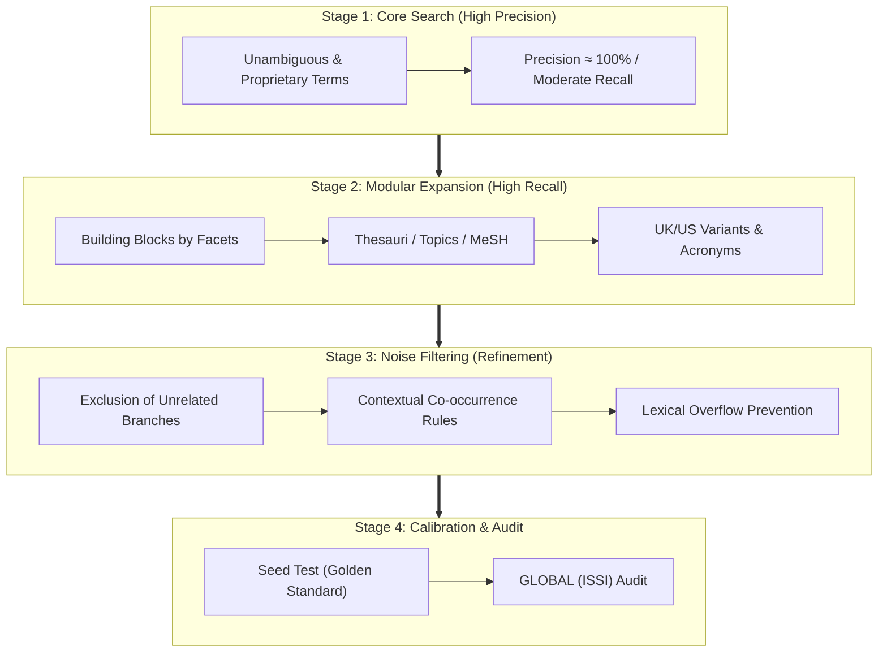

# Bibliometric Search Strategist

> **Language Rule:** Respond and label outputs in the user's language (default to English for script plots/labels, or pass `--lang es` when the user interacts in Spanish).

Specialist in formulating, optimizing, translating, and auditing search strategies and **scientific field delineation (*Field Delineation*)** for scientometrics, science mapping, evaluative bibliometrics, and quantitative studies of science (*Science of Science*).

This skill formally adopts the native standards of the international scientometrics discipline, replacing clinical biomedical frameworks with the **GLOBAL (ISSI)** guideline and the **Huang, Schiebel & Porter (2011) Multi-Stage Field Delineation** protocol, ensuring structural representativeness, transparency, and strict reproducibility.

---

## 1. Methodological Paradigm: Field Delineation

In scientometrics, delineating the corpus of a domain or technology (*Field Delineation*) goes far beyond chaining keywords together: it is the formal process of isolating a scientific subspace while minimizing both **bibliographic silence (false negatives)** and **thematic contamination (false positives)** (Zitt & Bassecoulard, 2006).



### 1.1. Building Blocks Architecture

Adapted to quantitative studies of science, the strategy decomposes the research question into orthogonal conceptual facets:

$$\text{Global Strategy} = F_1 \land F_2 \land \dots \land F_k$$

1. **Intra-Facet (`OR` - Exhaustive Coverage):**
   - Groups synonyms, lemmas, acronyms, and British/American spelling variants (e.g., `behavior` / `behaviour`, `optimization` / `optimisation`).
   - Incorporates descriptors from controlled vocabularies (OpenAlex Topics, WoS Subject Categories, Scopus ASJC, MeSH Headings).
2. **Inter-Facet (`AND` - Contextual Specificity):**
   - Intersects independent conceptual facets. Limit the number of blocks to 2 or 3 to avoid choking off seminal publications.
3. **Prudent Use of Exclusion:**
   - **Scientometric rule:** Avoid free use of the `NOT` operator at the direct text level, as it inadvertently eliminates relevant papers that discuss or refute the excluded concept. Instead, use restrictions on unrelated subject categories or apply filters during screening phases.

---

## 2. Heuristic Methods and Advanced Operators

### 2.1. Pearl Growing
When a domain is emerging or its vocabulary is contested:
1. **Seed Selection (*Pearls*):** Select 3 to 5 undisputed canonical articles (*golden standard*).
2. **Descriptor Mining:** Extract author keywords, indexed terms (*Keywords Plus*, *Index Terms*, *Topics v5.0*), and subject categories.
3. **Expansion and Calibration:** Incorporate discriminating terms into the equation. Verify that **100% of the seed articles are retrieved** by the resulting query.

### 2.2. Proximity Operators vs. Exact Phrases
Exact phrases (`"..."`) are rigid and ignore intervening adjectives or inversions. Proximity operators contextualize co-occurrence:
* **Web of Science:** `termA NEAR/n termB` (at most $n$ intervening words in either order).
* **Scopus:** `termA W/n termB` (either order) or `termA PRE/n termB` (strict order).
* **PubMed:** `"termA termB"~n` (edit-distance proximity).
* **ClickHouse (`rag.works_academic_all`):** Boolean combination of synonymous positional expressions.

### 2.3. Safe Truncation
* **Asterisk (`*`):** Zero or more characters (`nanopart*`). **Prohibition:** Never use truncation on word stems shorter than 4 characters (e.g., `pol*` causes massive lexical overflow with *policy, polymer, police, polish, pollen*).
* **Single-character wildcard (`?` or `$`):** Controlled morphological variations (`wom?n`).

---

## 3. Multi-Platform Translation Matrix (Polyglot Crosswalk)

| Field / Parameter | Web of Science (WoS) | Scopus (Elsevier) | PubMed (NLM) | OpenAlex / ClickHouse (`rag.works_academic_all`) |
|---|---|---|---|---|
| **Title + Abstract + Keywords** | `TS=("deep learning" OR "neural net*")` | `TITLE-ABS-KEY("deep learning" OR "neural net*")` | `("deep learning"[tiab] OR "neural net*"[tiab])` | `(positionCaseInsensitiveUTF8(title, 'deep learning') > 0 OR positionCaseInsensitiveUTF8(title, 'neural net') > 0)` |
| **Title Only** | `TI=("quantum computing")` | `TITLE("quantum computing")` | `"quantum computing"[ti]` | `positionCaseInsensitiveUTF8(title, 'quantum computing') > 0` |
| **Author Keywords** | `AK=("solar cell*")` | `AUTHKEY("solar cell*")` | `"solar cells"[ot]` | `arrayExists(x -> positionCaseInsensitiveUTF8(x, 'solar cell') > 0, keywords)` |
| **Topics / Categories** | `WC=("Energy & Fuels")` | `SUBJAREA(ENER)` | `"Solar Energy"[mesh]` | `positionCaseInsensitiveUTF8(topic, 'Solar Cells') > 0` |
| **Time Window** | `PY=(2015-2024)` | `PUBYEAR > 2014 AND PUBYEAR < 2025` | `2015:2024[dp]` | `(publication_year >= 2015 AND publication_year <= 2024)` |
| **Document Types** | `DT=(Article OR Review)` | `(DOCTYPE(ar) OR DOCTYPE(re))` | `("journal article"[pt] OR "review"[pt])` | `type IN ('article', 'review')` |
| **Diamond Open Access** | `OA=(Diamond)` *(or manual filter)* | `OA(NONE)` *(with APC mapping)* | N/A *(via PMC)* | `oa_status = 'diamond'` |

### ClickHouse Rules (`rag.works_academic_all`)
1. **ZERO JOINS:** Resolve the entire query against the precomputed denormalized table.
2. **Production Columns:** Use `title`, `author_names`, `institution_names`, `topic`, `keywords`, `all_country_codes`.
3. **Columnar Optimization:** Use `positionCaseInsensitiveUTF8(col, 'term') > 0` and higher-order array functions (`arrayExists(...)`).

---

## 4. Quality and Audit Framework: GLOBAL (ISSI) Guideline

In scientometrics, methodological auditing is grounded in the **GLOBAL Guideline** (*Guidance List for repOrting Bibliometric AnaLyses*, developed by consensus of ISSI / ScholCommLab members).

Every delineation strategy generated by the agent must emit the **GLOBAL Checklist**:

| GLOBAL Dimension | Audit Item | Status | Methodological Criterion |
|---|---|:---:|---|
| **1. Conceptual Rationale** | Domain delineation and research questions | ✅ / ⚠️ | Theoretical justification of facets and disciplinary boundaries. |
| **2. Sources & Snapshot** | Database declaration and cutoff date | ✅ / ⚠️ | Explicit record of database, index, extraction date, and time zone. |
| **3. Field Delineation** | Exact search string and field tags | ✅ / ⚠️ | Full publication of query syntax with specific field tags (`TS=`, `TITLE-ABS-KEY()`, etc.). |
| **4. Descriptor Selection** | Controlled vocabularies and synonyms | ✅ / ⚠️ | Systematic coverage of thesauri (Topics, MeSH, Categories) and free-text terms. |
| **5. Spelling & Truncation** | Safe wildcards and lexical balancing | ✅ / ⚠️ | Balanced quotes, no wildcards < 4 letters, and uppercase Boolean operators. |
| **6. Filters & Limits** | Time window and document types | ✅ / ⚠️ | Explicit justification of start/end years and document type inclusion/exclusion. |
| **7. Reproducibility & Code** | Availability of syntax and scripts | ✅ / ⚠️ | Plain-text versioned syntax and reproducible CLI scripts with fixed seeds. |

---

## 5. Automated Tool: `scripts/query_synthesizer.py`

Standalone CLI for syntactic validation, multi-database transpilation, and GLOBAL auditing:

```bash
# Validate syntax and detect lexical anomalies or dangerous wildcards
/home/ambientesPy/revistaslatam/bin/python \
  /mnt/expansion/desplegados/sos-mcp-services/.agents/skills/bibliometric-search-strategist/scripts/query_synthesizer.py \
  --action validate \
  --query '("causal inference" OR "structural causal model*") AND (LLM OR "large language model*")'

# Transpile JSON blocks to WoS, Scopus, PubMed, ClickHouse and generate GLOBAL audit
/home/ambientesPy/revistaslatam/bin/python \
  /mnt/expansion/desplegados/sos-mcp-services/.agents/skills/bibliometric-search-strategist/scripts/query_synthesizer.py \
  --action transpile \
  --config blocks_definition.json \
  --output ./search_strategies/
```

### Block Input Format (`blocks_definition.json`)

```json
{
  "project_title": "Causal Inference in Large Language Models",
  "blocks": [
    {
      "name": "Causal Theory",
      "terms": ["causal inference", "structural causal model*", "counterfactual reasoning"],
      "mesh": ["Causality", "Models, Statistical"],
      "topics": ["Causal Inference", "Causal Discovery"]
    },
    {
      "name": "Artificial Intelligence and Agents",
      "terms": ["large language model*", "LLM", "autonomous agent*", "chain-of-thought"],
      "mesh": ["Artificial Intelligence", "Natural Language Processing"],
      "topics": ["Natural Language Processing", "Artificial Intelligence"]
    }
  ],
  "filters": {
    "year_start": 2020,
    "year_end": 2026,
    "doc_types": ["article", "review", "conference"]
  }
}
```

---

## 6. Ecosystem Integrated Workflow

1. **Initial Delineation:** Design conceptual blocks (*building blocks*) and transpile queries using `bibliometric-search-strategist`.
2. **Quality Audit:** Generate and review the `global_audit.md` report.
3. **Bulk Harvesting:** Extract global data with [`openalex-harvester`](../openalex-harvester/SKILL.md) or Mexican output with [`openalex-mexico-clickhouse`](../openalex-mexico-clickhouse/SKILL.md).
4. **Review and Snowballing:** Chain with [`deep-literature-researcher`](../deep-literature-researcher/SKILL.md) to execute in-depth literature review and citation density filtering.
5. **Network and SOM Mapping:** Process with [`bibliometric-network-analyst`](../bibliometric-network-analyst/SKILL.md) and [`som-methodological-expert`](../som-methodological-expert/SKILL.md).

---

## 7. Bibliographic References

* Glänzel, W., Schlemmer, B., & Du Plessis, B. (2009). A hybrid approach for addressing the problem of "field delineation" in scientometric studies. *Scientometrics*, 79(1), 3–17. https://doi.org/10.1007/s11192-009-0401-7
* Harter, S. P. (1986). *Online Information Retrieval: Concepts, Principles, and Techniques*. Academic Press.
* Hawkins, D. T., & Wagers, R. (1982). Online bibliographic search strategy, analysis. *Online Review*, 6(2), 93–119. https://doi.org/10.1108/eb024099
* Hicks, D., Wouters, P., Waltman, L., de Rijcke, S., & Rafols, I. (2015). Bibliometrics: The Leiden Manifesto for research metrics. *Nature*, 520(7548), 429–431. https://doi.org/10.1038/520429a
* Huang, C., Schiebel, E., & Porter, A. L. (2011). A multi-stage approach to mapping emerging technologies: the case of DNA sequencing technology. *Scientometrics*, 87(2), 241–260. https://doi.org/10.1007/s11192-011-0341-9
* International Society for Scientometrics and Informetrics (ISSI) / ScholCommLab (2023–2024). *GLOBAL: Guidance List for repOrting Bibliometric AnaLyses*. ISSI Guidelines Initiative.
* Perianes-Rodriguez, A., Waltman, L., & van Eck, N. J. (2016). Constructing bibliometric networks: A comparison between full and fractional counting. *Journal of Informetrics*, 10(4), 1178–1195. https://doi.org/10.1016/j.joi.2016.10.006
* Wang, J., Schneider, J. W., & Buus, N. (2023). Search strategy design in bibliometrics: Pitfalls and best practices. *Quantitative Science Studies*, 4(1), 89–112. https://doi.org/10.1162/qss_a_00234
* Zitt, M., & Bassecoulard, E. (2006). Challenges for scientometric indicators: the data delimitation issue. *Scientometrics*, 67(1), 145–160. https://doi.org/10.1007/s11192-006-0089-6
