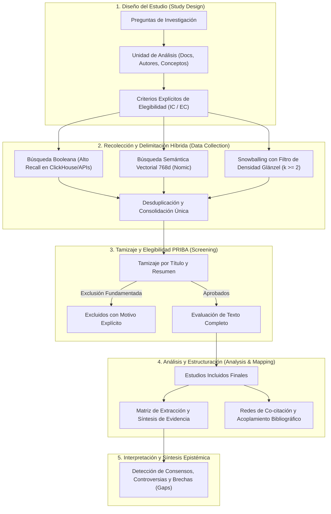

# Deep Literature Researcher

Especialista en revisión sistemática profunda de literatura científica, síntesis de evidencia y cartografía del estado del arte, integrando los estándares metodológicos de la **cienciometría y la ciencia de la ciencia (*Science of Science*)**: el marco de 5 fases de **Zupic & Čater (2015)** y **Aria & Cuccurullo (2017)**, las directrices de reporte **PRIBA** (Koo & Lin, 2022) / **PRISMA 2020**, el protocolo de **Snowballing de Citas (Wohlin, 2014)** enriquecido con el **Filtro de Densidad Núcleo de Glänzel et al. (2009)**, y arquitecturas de búsqueda híbrida (simbólica booleana + semántica vectorial densa de 768 dimensiones).

---

## 1. Marco Metodológico Integrado de Mapeo Científico y Síntesis

A diferencia de los protocolos biomédicos puramente clínicos, las revisiones profundas en cienciometría y ciencia computacional operan bajo el **Flujo de 5 Fases de Zupic & Čater (2015)** y **Aria & Cuccurullo (2017)**, auditado mediante el diagrama de flujo adaptado **PRIBA / PRISMA 2020**:



### Criterios Explícitos de Elegibilidad (Marco PCC / PICOS)

Antes de iniciar la recuperación, el agente debe formalizar:
1. **Criterios de Inclusión (IC):**
   - **IC1 (Dominio/Concepto):** Constructo teórico, modelo formal o tecnología bajo análisis.
   - **IC2 (Enfoque Metodológico):** Estudios empíricos, benchmarks, formalizaciones matemáticas o revisiones sistemáticas.
   - **IC3 (Ventana Temporal):** Rango de años relevante.
   - **IC4 (Tipología Documental):** Artículos en revistas arbitradas, actas de congresos de primer nivel (*core conferences*) o revisiones.
2. **Criterios de Exclusión (EC):**
   - **EC1:** Trabajos sin resumen disponible o sin datos empíricos/formales reproducibles.
   - **EC2:** Editoriales, prefacios, cartas breves no arbitradas o notas de divulgación.
   - **EC3:** Trabajos que tratan el concepto únicamente como mención tangencial, metáfora o antecedente incidental.

---

## 2. Motor de Búsqueda Híbrida (Hybrid Retrieval Pipeline)

Para superar las limitaciones del silencio léxico (sinónimos o cambios terminológicos) y de la imprecisión de los espacios latentes vectoriales puros, se implementa una canalización híbrida de 3 niveles:

$$\text{Puntaje Combinado (RRF)}: \quad \text{RRF}(d) = \sum_{m \in \{\text{Booleano}, \text{Semántico}\}} \frac{1}{60 + r_m(d)}$$

1. **Nivel Simbólico (Recall Booleano):**
   - Construido con [`bibliometric-search-strategist`](../bibliometric-search-strategist/SKILL.md) y ejecutado en ClickHouse (`rag.works_academic_all`) o APIs globales (OpenAlex, WoS, Scopus).
2. **Nivel Semántico Denso (Embeddings 768d):**
   - Representaciones vectoriales densas locales (Nomic Embed v1.5 / 768 dimensiones).
   - Identifica publicaciones afines conceptualmente que expresan el problema con vocabulario divergente.
3. **Fusión Recíproca de Rangos (RRF, $k=60$):**
   - Combina ambos ordenamientos priorizando los documentos en la intersección de ambas capas.

---

## 3. Protocolo de Snowballing con Filtro de Densidad Núcleo (Glänzel et al., 2009)

El rastreo de citaciones sobre grafos académicos permite mapear raíces teóricas y evolución contemporánea (Wohlin, 2014). Sin embargo, para evitar el problema del **desbordamiento temático (*topic drift*)**, se implementa el criterio de densidad propuesto por Wolfgang Glänzel:

$$\text{Criterio de Inclusión}: \quad d \in \text{Candidatos} \iff |\text{Conexiones}(d, \text{Semillas})| \ge k$$

```mermaid
flowchart LR
    subgraph Pasado ["Raíces Teóricas"]
        B1["Referencia Común A"]
        B2["Referencia Común B"]
    end

    subgraph Semillas ["Conjunto Semilla (Golden Standard)"]
        S1["Semilla 1 (CRL / Teórico)"]
        S2["Semilla 2 (Survey / LLM)"]
        S3["Semilla 3 (Benchmark Formal)"]
    end

    subgraph Futuro ["Frentes Activos Contemporáneos"]
        F1["Trabajo Citante Convergente\n(Cita a S1, S2 y S3)"]
        F2["Trabajo Citante Tangencial\n(Cita solo a S1 -> DESCARTADO)"]
    end

    B1 & B2 <==|Backward Snowballing\n(Co-citación >= k)| S1 & S2 & S3
    S1 & S2 & S3 ==>|Forward Snowballing\n(Densidad >= k)| F1
    S1 -.->|Filtro k < 2| F2
```

### Reglas Operativas
1. **Selección del Núcleo Semilla:** Entre 3 y 8 artículos canónicos de referencia obligada en la disciplina.
2. **Backward Snowballing (Rastreo Hacia Atrás):**
   - Extraer `referenced_works` de las semillas.
   - Identificar obras con co-citación recurrente (citadas por 2 o más semillas simultáneamente).
3. **Forward Snowballing (Rastreo Hacia Adelante):**
   - Extraer publicaciones que citan a las semillas primarias (`cited_by`).
   - Aplicar el **umbral de densidad núcleo** ($k \ge 2$): se priorizan aquellos trabajos que conectan simultáneamente con múltiples semillas.
4. **Criterio de Saturación:** Detener el rastreo cuando una ronda adicional de snowballing aporte menos del 5% de artículos elegibles nuevos.

---

## 4. Matriz de Extracción y Síntesis de Evidencia

Toda la evidencia extraída debe estructurarse en la **Matriz Canónica de Síntesis**:

| Identificador (DOI) | Autores (Año) | Enfoque / Dimensión Teórica | Metodología / Benchmark | Muestra / Corpus ($N$) | Principales Hallazgos | Limitaciones Declaradas | Brecha Abierta (Research Gap) |
|---|---|---|---|---|---|---|---|
| `10.xxxx/...` | Autor et al. (2023) | Simbólico / Redes causales | SCM sintéticos | 10,000 consultas | Exactitud del 94% en Peldaño 1; colapso en Peldaño 3 sin SCM. | Nombres de variables cotidianos con sesgo semántico. | Evaluar agentes autónomos sobre grafos abstractos. |

### Principio Inviolable Anti-Alucinación (Grounded Extraction)
- **Regla estricta:** Si un dato (tamaño muestral, métrica estadística, limitación) no figura explícitamente en los metadatos o resumen recuperado, el agente debe registrar rigurosamente `N/D` (No Disponible en resumen).
- **Prohibición absoluta:** Jamás conjeturar o inventar métricas, muestras o conclusiones no verificadas.

---

## 5. Detección de Consensos, Controversias y Brechas (Research Gaps)

El informe de síntesis cualitativa debe estructurarse en 3 ejes analíticos:
1. **Puntos de Consenso Comunitario:** Hallazgos convalidados independientemente por múltiples grupos (p. ej., insuficiencia del entrenamiento puramente autorregresivo para inferencia causal).
2. **Controversias Metodológicas:** Discrepancias teóricas o empíricas entre escuelas (p. ej., emergencia de *world models* latentes vs. hipótesis del *loro causal*).
3. **Brechas Epistémicas (Research Gaps):** Preguntas de investigación no resueltas en la frontera del conocimiento para justificar nuevos experimentos o marcos conceptuales.

---

## 6. Herramienta Automatizada: `scripts/citation_snowball.py`

CLI autónomo para snowballing backward/forward con ClickHouse local (cero JOINs) y OpenAlex global:

```bash
# Snowballing backward y forward con filtro de densidad sobre semillas
/home/ambientesPy/revistaslatam/bin/python \
  /mnt/expansion/desplegados/agentic-data-stack/.agents/skills/deep-literature-researcher/scripts/citation_snowball.py \
  --seeds "10.1109/JPROC.2021.3058954" "10.48550/arxiv.2305.00050" "10.48550/arxiv.2306.05836" \
  --mode both \
  --top-citations 35 \
  --min-cocitations 1 \
  --output ./snowball_results/
```

### Salidas Generadas:
* `snowball_candidates.json`: Candidatos desduplicados con metadata, conexiones de semilla y puntajes compuestos.
* `snowball_candidates.csv`: Tabla exportable para tamizaje tabular.
* `prisma_flow_data.json`: Métricas de flujo cuantitativo para diagrama PRIBA / PRISMA 2020.
* `snowball_report.md`: Informe con diagrama Mermaid y ranking Top de artículos según centralidad e impacto.

---

## 7. Referencias Bibliográficas

* Aria, M., & Cuccurullo, C. (2017). bibliometrix: An R-tool for comprehensive science mapping analysis. *Journal of Informetrics*, 11(4), 959–975. https://doi.org/10.1016/j.joi.2017.08.007
* Glänzel, W., Schlemmer, B., & Du Plessis, B. (2009). A hybrid approach for addressing the problem of "field delineation" in scientometric studies. *Scientometrics*, 79(1), 3–17. https://doi.org/10.1007/s11192-009-0401-7
* Koo, M., & Lin, S. C. (2022). Preferred reporting items for bibliometric analysis (PRIBA): A proposal for reporting bibliometric reviews. *Journal of Medical Sciences*, 42(3), 115–123.
* Page, M. J., McKenzie, J. E., Bossuyt, P. M., Boutron, I., Hoffmann, T. C., Mulrow, C. D., ... & Moher, D. (2021). The PRISMA 2020 statement: an updated guideline for reporting systematic reviews. *BMJ*, 372, n71. https://doi.org/10.1136/bmj.n71
* Wohlin, C. (2014). Guidelines for snowballing in systematic literature studies and a replication in software engineering. In *Proceedings of the 18th International Conference on Evaluation and Assessment in Software Engineering* (EASE '14), Article 38, 1–10. https://doi.org/10.1145/2601248.2601268
* Zupic, I., & Čater, T. (2015). Bibliometric methods in management and organization. *Organizational Research Methods*, 18(3), 429–472. https://doi.org/10.1177/1094428114562629
