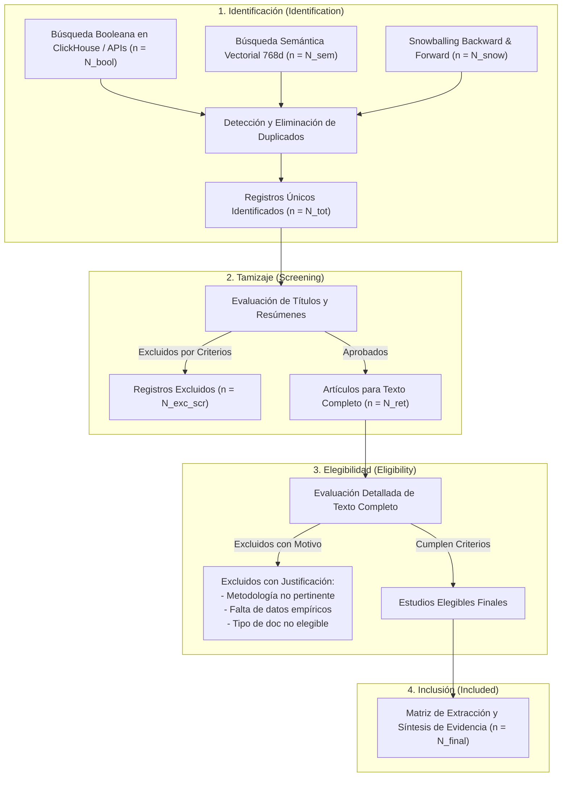

# Deep Literature Researcher

Especialista en revisión sistemática profunda de literatura científica, síntesis de evidencia y cartografía del estado del arte, integrando las directrices internacionales **PRISMA 2020**, el protocolo de **Snowballing de Citas (Wohlin, 2014)** y arquitecturas de búsqueda híbrida (simbólica booleana + semántica vectorial densa de 768 dimensiones).

---

## 1. Protocolo Canónico PRISMA 2020

Toda revisión sistemática o de alcance (*Scoping Review*) orquestada por esta habilidad se rige por las 4 fases del estándar internacional **PRISMA 2020** (Page et al., 2021):



### Criterios Explícitos de Elegibilidad (Marco PICOS / PCC)

Antes de iniciar la recuperación, el agente debe definir formalmente:
1. **Criterios de Inclusión (IC):**
   - **IC1 (Población/Dominio):** Tema, disciplina o contexto institucional específico.
   - **IC2 (Intervención/Fenómeno):** Metodología, tecnología, algoritmo o constructo bajo análisis.
   - **IC3 (Ventana Temporal):** Rango de años relevante.
   - **IC4 (Tipología Documental):** Artículos en revistas arbitradas, revisiones o actas indexadas.
2. **Criterios de Exclusión (EC):**
   - **EC1:** Trabajos sin resumen disponible o sin datos empíricos primarios.
   - **EC2:** Editoriales, notas breves, cartas al editor o prefacios no arbitrados.
   - **EC3:** Trabajos que tratan el término únicamente como mención incidental o analogía periférica.

---

## 2. Motor de Búsqueda Híbrida (Hybrid Retrieval Pipeline)

Para superar las limitaciones de la búsqueda por palabras clave exactas (que sufre de silencio ante sinónimos o vocabulario polisémico) y de la búsqueda vectorial pura (que puede perder precisión en entidades técnicas específicas), se implementa una canalización híbrida de 3 niveles:

$$\text{Puntaje Combinado (RRF)}: \quad \text{RRF}(d) = \sum_{m \in \{\text{Booleano}, \text{Semántico}\}} \frac{1}{60 + r_m(d)}$$

1. **Nivel Simbólico (Recall Booleano):**
   - Construido con [`bibliometric-search-strategist`](../bibliometric-search-strategist/SKILL.md) y ejecutado en ClickHouse (`rag.works_academic_all`).
   - Recupera el universo estructurado de documentos que contienen las facetas requeridas.
2. **Nivel Semántico Denso (Embeddings 768d):**
   - Emplea representaciones vectoriales locales (Nomic Embed v1.5 / 768 dimensiones).
   - Identifica publicaciones afines conceptualmente que expresan el problema en términos alternativos.
3. **Nivel de Fusión y Desduplicación:**
   - Fusión mediante Reciprocal Rank Fusion (RRF, $k=60$).
   - Desduplicación determinista por normalización de DOI (`lower(trim(doi))`) y OpenAlex ID.

---

## 3. Protocolo de Snowballing de Citas (Wohlin, 2014)

El muestreo por bola de nieve sobre grafos de citación garantiza que la revisión no quede aislada en una única ventana o vocabulario:

```mermaid
flowchart LR
    subgraph Pasado ["Raíces Teóricas"]
        B2["Referencia Citada 2"]
        B1["Referencia Citada 1"]
    end

    subgraph Presente ["Conjunto Semilla (Seeds)"]
        S1["Artículo Semilla A\n(Golden Standard)"]
        S2["Artículo Semilla B\n(Golden Standard)"]
    end

    subgraph Futuro ["Frentes Activos"]
        F1["Trabajo Citante 1"]
        F2["Trabajo Citante 2"]
        F3["Trabajo Citante 3"]
    end

    B1 & B2 <==|Backward Snowballing\n(referenced_works)| S1 & S2
    S1 & S2 ==>|Forward Snowballing\n(cited_by)| F1 & F2 & F3
```

### Procedimiento Operativo

1. **Selección del Núcleo Semilla:** Seleccionar entre 3 y 8 artículos de referencia obligada en la disciplina.
2. **Backward Snowballing (Rastreo Hacia Atrás):**
   - Inspeccionar la lista de referencias citadas (`referenced_works`).
   - Identificar obras con co-citación recurrente (citadas simultáneamente por 2 o más semillas).
   - Aplicar los criterios de inclusión/exclusión para incorporarlas a la cohorte.
3. **Forward Snowballing (Rastreo Hacia Adelante):**
   - Extraer todas las publicaciones que citan a las semillas primarias.
   - Filtrar aquellas con mayor impacto relativo (`fwci` o `cited_by_count`) o que provengan de autores de referencia.
   - Someterlas a tamizaje de elegibilidad.
4. **Criterio de Parada (Saturación):**
   - Detener la iteración cuando una ronda adicional de snowballing aporte menos del 5% de artículos nuevos elegibles respecto a la ronda previa.

---

## 4. Matriz de Extracción y Síntesis de Evidencia

Toda la evidencia extraída debe estructurarse en la **Matriz Canónica de Síntesis**:

| DOI / Enlace | Autores (Año) | Enfoque / Metodología | Muestra / Corpus ($N$) | Principales Hallazgos | Limitaciones Declaradas | Brecha Abierta (Gap) |
|---|---|---|---|---|---|---|
| `10.xxxx/...` | Autor et al. (2023) | Cuantitativo / Redes neuronales | 1,450 registros | Exactitud del 94% en clasificación multietiqueta. | Sesgo en literatura no anglosajona. | Falta validación en lenguas romances. |
| `10.yyyy/...` | Investigador (2024) | Cienciométrico / Trayectorias SOM | 8,200 artículos | Detección de 3 fases de maduración comunitaria. | Limitado a metadatos de OpenAlex. | Requiere incorporar citas de patentes. |

### Principio Inviolable Anti-Alucinación (Grounded Extraction)

- **Regla estricta:** Si un dato (tamaño muestral, métrica estadística, limitación) no está presente de forma explícita en los metadatos o resumen recuperado, el agente debe registrar rigurosamente `N/D` (No Disponible en resumen).
- **Prohibición absoluta:** Jamás estimar, extrapolar o conjeturar cifras empíricas no comprobadas.

---

## 5. Detección de Consensos, Controversias y Brechas de Investigación

El informe de síntesis cualitativa debe estructurarse en 3 secciones analíticas:

1. **Puntos de Consenso Comunitario:**
   - Hallazgos convalidados por múltiples grupos independientes (p. ej., *"El 85% de los estudios coincide en que los modelos preentrenados superan a los enfoques de bolsas de palabras"*).
2. **Controversias Metodológicas y Discrepancias:**
   - Resultados divergentes entre autores y explicación técnica del desacuerdo (diferencias en tamaño de ventana, normalización métrica o sesgos de cobertura).
3. **Brechas de Investigación No Resueltas (Research Gaps):**
   - Oportunidades epistemológicas identificadas para futuros proyectos o para el artículo en desarrollo.

---

## 6. Herramienta Automatizada: `scripts/citation_snowball.py`

Para rastrear el grafo de citaciones sin salir del entorno local ni violar la regla de cero JOINs, se proporciona el script CLI:

```bash
# Snowballing backward y forward sobre uno o varios DOIs o IDs de OpenAlex
/home/ambientesPy/revistaslatam/bin/python \
  /mnt/expansion/desplegados/agentic-data-stack/.agents/skills/deep-literature-researcher/scripts/citation_snowball.py \
  --seeds "10.1016/j.joi.2020.101080" "10.1007/s11192-021-04050-x" \
  --mode both \
  --depth 1 \
  --top-citations 20 \
  --output ./snowball_results/
```

### Parámetros Principales
- `--seeds`: Lista de DOIs o identificadores de OpenAlex (p. ej., `W2741809807`).
- `--mode`: `backward` (referencias citadas), `forward` (trabajos que citan) o `both`.
- `--depth`: Profundidad de exploración (1 = vecinos directos, 2 = vecinos de segundo orden).
- `--top-citations`: Número de candidatos más influyentes a priorizar para tamizaje PRISMA.
- `--output`: Directorio para guardar los reportes `snowball_candidates.json` y `prisma_flow_data.json`.
