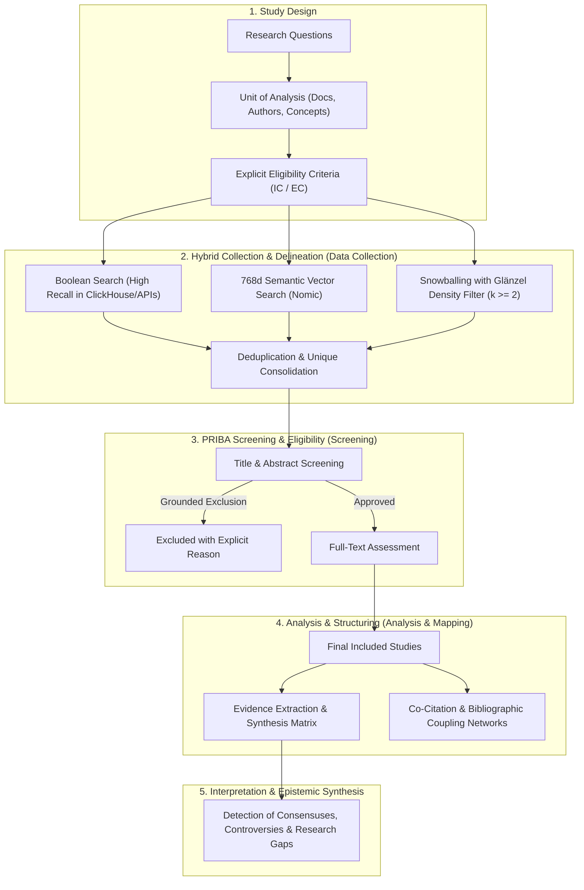

# Deep Literature Researcher

> **Language Rule:** Respond and label outputs in the user's language (default to English for script plots/labels, or pass `--lang es` when the user interacts in Spanish).

Specialist in deep systematic reviews of scientific literature, evidence synthesis, and state-of-the-art mapping, integrating the methodological standards of **scientometrics and the Science of Science**: the 5-phase framework of **Zupic & Čater (2015)** and **Aria & Cuccurullo (2017)**, the **PRIBA** (Koo & Lin, 2022) / **PRISMA 2020** reporting guidelines, the **Citation Snowballing protocol (Wohlin, 2014)** enriched with the **Core Density Filter of Glänzel et al. (2009)**, and hybrid search architectures (symbolic Boolean + dense 768-dimensional semantic vector search).

---

## 1. Integrated Methodological Framework for Science Mapping and Synthesis

Unlike purely clinical biomedical protocols, deep reviews in scientometrics and computational science operate under the **5-Phase Workflow of Zupic & Čater (2015)** and **Aria & Cuccurullo (2017)**, audited via the adapted **PRIBA / PRISMA 2020** flow diagram:



### Explicit Eligibility Criteria (PCC / PICOS Framework)

Before initiating retrieval, the agent must formalize:

1. **Inclusion Criteria (IC):**
   - **IC1 (Domain/Concept):** Theoretical construct, formal model, or technology under analysis.
   - **IC2 (Methodological Approach):** Empirical studies, benchmarks, mathematical formalizations, or systematic reviews.
   - **IC3 (Time Window):** Relevant publication year range.
   - **IC4 (Document Typology):** Peer-reviewed journal articles, top-tier conference proceedings (*core conferences*), or reviews.
2. **Exclusion Criteria (EC):**
   - **EC1:** Works without an available abstract or without reproducible empirical/formal data.
   - **EC2:** Editorials, prefaces, non-peer-reviewed short letters, or popular science notes.
   - **EC3:** Works treating the concept solely as a tangential mention, metaphor, or incidental background.

---

## 2. Hybrid Retrieval Pipeline

To overcome the limitations of lexical silence (synonyms or terminological shifts) and the imprecision of pure latent vector spaces, a 3-tier hybrid pipeline is implemented:

$$
\text{Combined Score (RRF)}: \quad \text{RRF}(d) = \sum_{m \in \{\text{Boolean}, \text{Semantic}\}} \frac{1}{60 + r_m(d)}
$$

1. **Symbolic Tier (Boolean Recall):**
   - Built with [`bibliometric-search-strategist`](../bibliometric-search-strategist/SKILL.md) and executed in ClickHouse (`rag.works_academic_all`) or global APIs (OpenAlex, WoS, Scopus).
2. **Dense Semantic Tier (768d Embeddings):**
   - Local dense vector representations (Nomic Embed v1.5 / 768 dimensions).
   - Identifies conceptually related publications that express the problem using divergent vocabulary.
3. **Reciprocal Rank Fusion (RRF, $k=60$):**
   - Combines both rankings, prioritizing documents at the intersection of both layers.

---

## 3. Snowballing Protocol with Core Density Filter (Glänzel et al., 2009)

Citation tracking across academic graphs maps theoretical roots and contemporary evolution (Wohlin, 2014). However, to prevent **topic drift**, the density criterion proposed by Wolfgang Glänzel is enforced:

$$
\text{Inclusion Criterion}: \quad d \in \text{Candidates} \iff |\text{Connections}(d, \text{Seeds})| \ge k
$$

```mermaid
flowchart LR
    subgraph Past ["Theoretical Roots"]
        B1["Common Reference A"]
        B2["Common Reference B"]
    end

    subgraph Seeds ["Seed Set (Golden Standard)"]
        S1["Seed 1 (CRL / Theoretical)"]
        S2["Seed 2 (Survey / LLM)"]
        S3["Seed 3 (Formal Benchmark)"]
    end

    subgraph Future ["Contemporary Active Fronts"]
        F1["Convergent Citing Work\n(Cites S1, S2, and S3)"]
        F2["Tangential Citing Work\n(Cites only S1 -> DISCARDED)"]
    end

    B1 & B2 <==|Backward Snowballing\n(Co-citation >= k)| S1 & S2 & S3
    S1 & S2 & S3 ==>|Forward Snowballing\n(Density >= k)| F1
    S1 -.->|Filter k < 2| F2
```

### Operational Rules

1. **Seed Core Selection:** Between 3 and 8 canonical landmark articles in the discipline.
2. **Backward Snowballing (Retrospective Tracking):**
   - Extract `referenced_works` from the seeds.
   - Identify works with recurrent co-citation (cited by 2 or more seeds simultaneously).
3. **Forward Snowballing (Prospective Tracking):**
   - Extract publications citing the primary seeds (`cited_by`).
   - Apply the **core density threshold** ($k \ge 2$): prioritize works that simultaneously connect to multiple seeds.
4. **Saturation Criterion:** Stop tracking when an additional snowballing round yields fewer than 5% new eligible articles.

---

## 4. Evidence Extraction and Synthesis Matrix

All extracted evidence must be structured in the **Canonical Synthesis Matrix**:

| Identifier (DOI) | Authors (Year)       | Approach / Theoretical Dimension | Methodology / Benchmark | Sample / Corpus ($N$) | Main Findings                                           | Stated Limitations                          | Open Research Gap                              |
| ---------------- | -------------------- | -------------------------------- | ----------------------- | ----------------------- | ------------------------------------------------------- | ------------------------------------------- | ---------------------------------------------- |
| `10.xxxx/...`  | Author et al. (2023) | Symbolic / Causal networks       | Synthetic SCMs          | 10,000 queries          | 94% accuracy on Rung 1; collapse on Rung 3 without SCM. | Everyday variable names with semantic bias. | Evaluate autonomous agents on abstract graphs. |

### Inviolable Anti-Hallucination Principle (Grounded Extraction)

- **Strict Rule:** If a datum (sample size, statistical metric, limitation) is not explicitly stated in the retrieved metadata, abstract, or harvested full text, the agent must rigorously record `N/A` (Not Available in text/abstract).
- **Full-Text Prioritization:** When `--download-oa-pdfs` is enabled, the agent must inspect the layout-preserved text files in `<output>/text/` to extract exact empirical sample sizes ($N$), experimental conditions, and formal limitations before falling back to `N/A`.
- **Absolute Prohibition:** Never conjecture or fabricate unverified metrics, sample sizes, or conclusions.

---

## 5. Detection of Consensuses, Controversies, and Research Gaps

The qualitative synthesis report must be structured around 3 analytical axes:

1. **Community Consensus Points:** Findings independently validated by multiple groups (e.g., insufficiency of purely autoregressive training for causal inference).
2. **Methodological Controversies:** Theoretical or empirical discrepancies between schools of thought (e.g., emergence of latent *world models* vs. the *causal parrot* hypothesis).
3. **Epistemic Gaps (Research Gaps):** Unresolved research questions at the frontier of knowledge that justify new experiments or conceptual frameworks.

---

## 6. Automated Tool: `scripts/citation_snowball.py`

Standalone CLI for backward/forward snowballing with local ClickHouse (zero JOINs) and global OpenAlex, with optional automated Open Access full-text harvesting:

```bash
# Backward and forward snowballing with density filter over seeds
/home/ambientesPy/revistaslatam/bin/python \
  /mnt/expansion/desplegados/sos-mcp-services/.agents/skills/deep-literature-researcher/scripts/citation_snowball.py \
  --seeds "10.1109/JPROC.2021.3058954" "10.48550/arxiv.2305.00050" "10.48550/arxiv.2306.05836" \
  --mode both \
  --top-citations 35 \
  --min-cocitations 1 \
  --output ./snowball_results/

# Advanced full-text pipeline: Snowballing + automated Open Access PDF acquisition
/home/ambientesPy/revistaslatam/bin/python \
  /mnt/expansion/desplegados/sos-mcp-services/.agents/skills/deep-literature-researcher/scripts/citation_snowball.py \
  --seeds "10.1038/s41598-025-01676-x" "10.1111/bjet.13544" \
  --mode both \
  --top-citations 20 \
  --download-oa-pdfs \
  --fulltext-limit 10 \
  --extract-text \
  --output ./snowball_fulltext/ \
  --lang es
```

### Generated Outputs:

* `snowball_candidates.json`: Deduplicated candidates with metadata, seed connections, composite scores, and local full-text paths.
* `snowball_candidates.csv`: Exportable table for tabular screening with `OA Status`, `FullText Status`, and file paths.
* `prisma_flow_data.json`: Quantitative flow metrics for the PRIBA / PRISMA 2020 diagram, including Full-Text Eligibility counts.
* `snowball_report.md`: Report with Mermaid diagram, Top ranking of articles by centrality, and direct markdown links to local PDFs and texts.
* `pdf/`: (Optional, when `--download-oa-pdfs` is active) Harvested Open Access PDF documents.
* `text/`: (Optional, when `--extract-text` is active) Plain-text extractions for agent reading.

---

## 7. Bibliographic References

* Aria, M., & Cuccurullo, C. (2017). bibliometrix: An R-tool for comprehensive science mapping analysis. *Journal of Informetrics*, 11(4), 959–975. https://doi.org/10.1016/j.joi.2017.08.007
* Glänzel, W., Schlemmer, B., & Du Plessis, B. (2009). A hybrid approach for addressing the problem of "field delineation" in scientometric studies. *Scientometrics*, 79(1), 3–17. https://doi.org/10.1007/s11192-009-0401-7
* Koo, M., & Lin, S. C. (2022). Preferred reporting items for bibliometric analysis (PRIBA): A proposal for reporting bibliometric reviews. *Journal of Medical Sciences*, 42(3), 115–123.
* Page, M. J., McKenzie, J. E., Bossuyt, P. M., Boutron, I., Hoffmann, T. C., Mulrow, C. D., ... & Moher, D. (2021). The PRISMA 2020 statement: an updated guideline for reporting systematic reviews. *BMJ*, 372, n71. https://doi.org/10.1136/bmj.n71
* Wohlin, C. (2014). Guidelines for snowballing in systematic literature studies and a replication in software engineering. In *Proceedings of the 18th International Conference on Evaluation and Assessment in Software Engineering* (EASE '14), Article 38, 1–10. https://doi.org/10.1145/2601248.2601268
* Zupic, I., & Čater, T. (2015). Bibliometric methods in management and organization. *Organizational Research Methods*, 18(3), 429–472. https://doi.org/10.1177/1094428114562629
