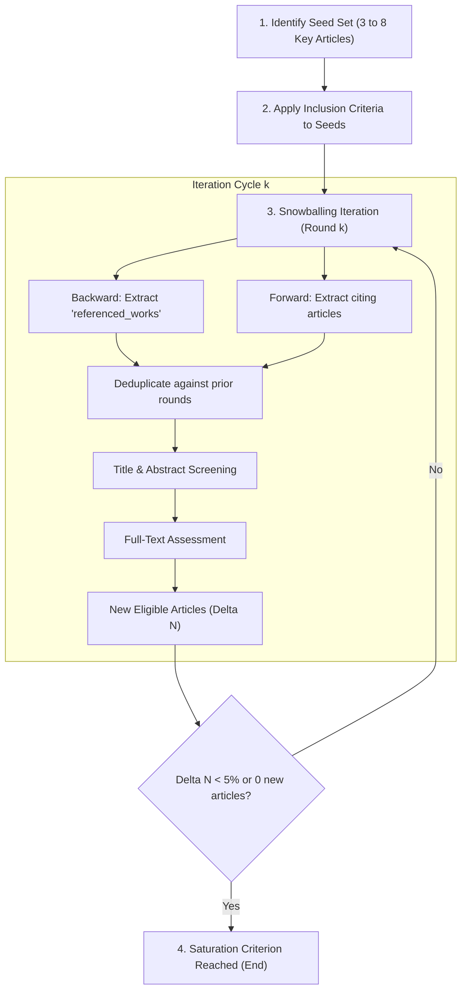

# Citation Snowballing Procedure According to Wohlin (2014)

Based on: Wohlin, C. (2014). *Guidelines for snowballing in systematic literature studies and a replication in software engineering*. Proceedings of the 18th International Conference on Evaluation and Assessment in Software Engineering (EASE '14), Article 38, 1-10.

---

## 1. Methodological Foundations

The *Snowballing* procedure uses the citation network of a seed set of articles to discover additional relevant literature. It is an essential complement to keyword-based database searches, especially effective when terminology is scattered or when isolated communities of practice exist.

---

## 2. Types of Snowballing

### Backward Snowballing (Retrospective Tracking)
- **Definition:** Reviewing the list of bibliographic references cited by the included articles.
- **Utility:** Identifying theoretical origins, foundational algorithms, and pioneering methodological frameworks that structure the field of study.
- **Mechanism:** Extract the identifiers of cited works (`referenced_works` in OpenAlex/ClickHouse) and evaluate them against the inclusion criteria.

### Forward Snowballing (Prospective Tracking)
- **Definition:** Identifying all newer articles that cite the articles in the seed set.
- **Utility:** Discovering contemporary applications, algorithmic extensions, empirical replications, critiques, and theoretical refutations.
- **Mechanism:** Query citing works (`cited_by` in OpenAlex/ClickHouse or Google Scholar) published after the seed work.

---

## 3. Step-by-Step Operational Protocol

### Decision Rules and Quality Control
1. **Seed Set Quality:**
   - Seeds must represent institutional and geographical diversity to avoid school-of-thought biases or research group inbreeding.
   - They should include both methodological review articles and seminal empirical studies.
2. **Co-Citation Assessment:**
   - Articles cited by more than one seed receive higher screening priority, as they form the *co-citation core*.
3. **Stopping Criterion:**
   - Saturation is reached when a full round yields zero new eligible articles or when the proportion of new eligible articles is marginal ($< 5\%$).
