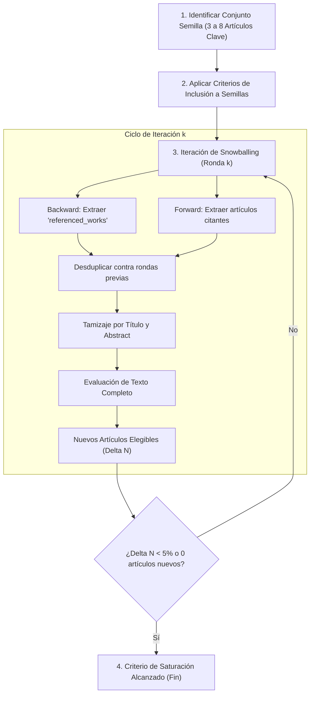

# Procedimiento de Snowballing de Citas según Wohlin (2014)

Basado en: Wohlin, C. (2014). *Guidelines for snowballing in systematic literature studies and a replication in software engineering*. Proceedings of the 18th International Conference on Evaluation and Assessment in Software Engineering (EASE '14), Article 38, 1-10.

---

## 1. Fundamentos Metodológicos

El procedimiento de bola de nieve (*Snowballing*) utiliza la red de citaciones de un conjunto de artículos semilla para descubrir literatura relevante adicional. Es un complemento esencial a las búsquedas basadas en palabras clave en bases de datos indexadas, especialmente eficaz cuando la terminología es dispersa o cuando existen comunidades de práctica aisladas.

---

## 2. Tipos de Snowballing

### Backward Snowballing (Rastreo Retrospectivo)
- **Definición:** Revisión de la lista de referencias bibliográficas citadas por los artículos incluidos.
- **Utilidad:** Identificar los orígenes teóricos, algoritmos fundacionales y marcos metodológicos pioneros que estructuran el campo de estudio.
- **Mecanismo:** Extraer los identificadores de las obras citadas (`referenced_works` en OpenAlex/ClickHouse) y contrastarlas contra los criterios de inclusión.

### Forward Snowballing (Rastreo Prospectivo)
- **Definición:** Identificación de todos los artículos más recientes que citan a los artículos del conjunto semilla.
- **Utilidad:** Descubrir aplicaciones contemporáneas, extensiones algorítmicas, réplicas empíricas, críticas y refutaciones teóricas.
- **Mecanismo:** Consultar las obras citantes (`cited_by` en OpenAlex/ClickHouse o Google Scholar) que hayan sido publicadas con posterioridad a la obra semilla.

---

## 3. Protocolo Operativo Paso a Paso

### Reglas de Decisión y Control de Calidad
1. **Calidad del Conjunto Semilla:**
   - Las semillas deben representar diversidad institucional y geográfica para evitar sesgos de escuela o endogamia de grupos de investigación.
   - Deben incluir tanto artículos de revisión metodológica como estudios empíricos seminales.
2. **Evaluación de Co-citación:**
   - Artículos citados por más de una semilla reciben una prioridad de tamizaje superior, al conformar el núcleo de co-citación (*co-citation core*).
3. **Criterio de Parada:**
   - Se alcanza la saturación cuando una ronda completa no produce ningún artículo elegible nuevo o cuando la proporción de nuevos artículos elegibles es marginal ($< 5\%$).
