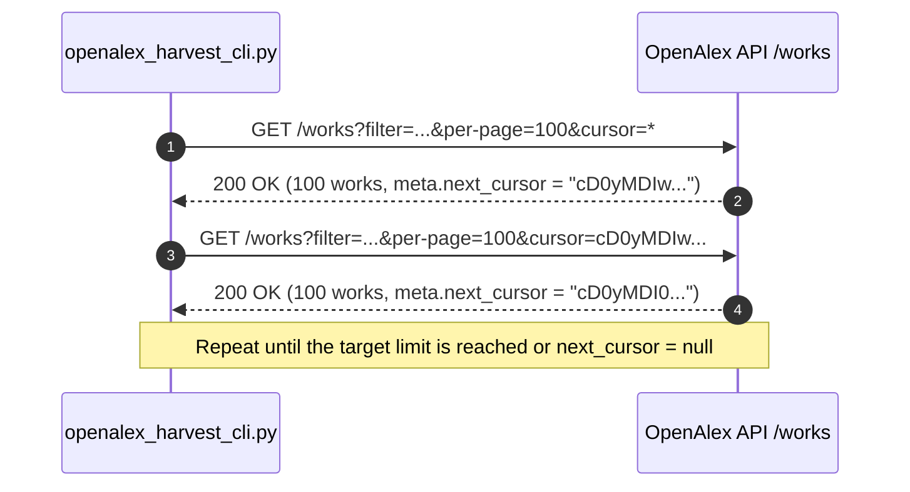

# OpenAlex Cursor Pagination Guide

Cursor pagination is the canonical and fastest mechanism for traversing millions of records without incurring memory or offset penalties (`offset`).

---

## 1. Cursor Algorithm Workflow

---

## 2. Advantages over Numeric Page Pagination (`page=N`)

1. **O(1) performance on every hop:** The database does not scan the preceding $N \times 100$ records.
2. **Data consistency:** Records inserted or updated in real time do not shift or duplicate items across pages.
3. **Scalability:** Enables extracting 10,000+ articles in minutes with complete stability.
