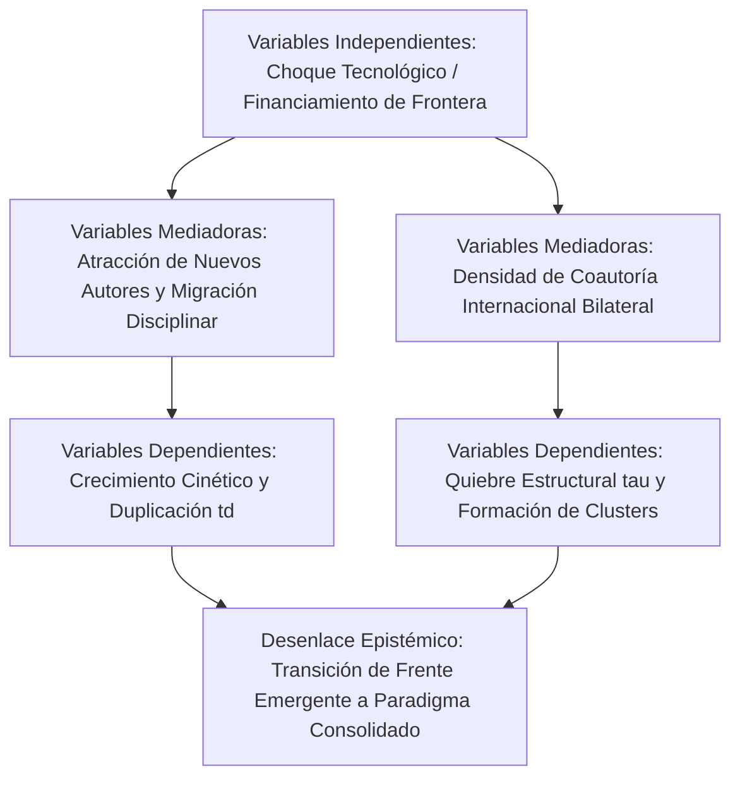

# Plantilla Maestra: Artículo Científico de Investigación Original (Formato IMRyD - Journal Q1)
### *Inspirada en el modelo de estudios bibliométricos avanzados y frentes de investigación (como el estudio de Polaritones)*

Esta plantilla está diseñada para que un **agente único** en LibreChat / `agentic-data-stack` elabore un **MANUSCRITO CIENTÍFICO DE INVESTIGACIÓN ORIGINAL** con estructura canónica **IMRyD** de grado publicable para revistas líderes internacionales (Q1/Q2) en Cienciometría y Metaciencia (*Journal of Informetrics*, *Scientometrics*, *Quantitative Science Studies*, *Research Evaluation*).

---

## Directivas Operativas para el Agente (Protocolo MCP)

Antes de redactar el artículo, debes cosechar los datos cuantitativos mediante las herramientas MCP disponibles:
1. **Delimitación del Frente o Fenómeno Temático:**
   * Invocar `sos_topics` (`topics_search_subfields`, `topics_get_clusters`) para identificar los frentes de investigación (*Research Fronts*), linajes aluviales AMI, palabras clave de alta centralidad y códigos de Topics.
2. **Cosecha Columnar y Series Temporales:**
   * Consultar `ClickHouse-OpenAlex` (bajo la regla estricta de CERO JOINs) o `sos_openalex` (`openalex_search_works`) para extraer la serie temporal de publicaciones, citas anuales, coautorías internacionales e índices de acceso abierto.
3. **Modelado Matemático y Leyes Bibliométricas:**
   * Invocar `sos_plmetrix` para calcular:
     - Ajuste del modelo de crecimiento exponencial de Price: estimar la tasa $\alpha$, bondad de ajuste $R^2$ y tiempo de duplicación $t_d = \frac{\ln(2)}{\alpha}$.
     - Ajuste de la ley de Lotka con conteo fraccionado y completo (prueba Kolmogorov-Smirnov).
     - Índices de especialización (Activity Index $AI$, descomposición $DShareC$ vs $CShareD$).
4. **Redes Bibliométricas y Afinidad Bilateral:**
   * Invocar `sos_knomap` / `sos_topics` para matrices de coautoría internacional normalizadas con Coseno de Salton ($S_{ij} = \frac{C_{ij}}{\sqrt{C_i C_j}}$) y partición modular Leiden/Louvain.
5. **Detección de Quiebres Estructurales:**
   * Identificar puntos de quiebre temporal $\tau$ mediante algoritmos de cambio de régimen (CUSUM / Pettitt) para contrastar el antes y después de choques tecnológicos o descubrimientos de ruptura.

---

## Reglas Editoriales Estrictas

- **LENGUAJE MODERADO Y SOBRIO (PROHIBICIÓN DE SUPERLATIVOS):** Emplear un estilo rigurosamente académico, neutro y fundamentado exclusivamente en evidencia empírica. Queda terminantemente prohibido el uso de adjetivos superlativos o hiperbólicos (*"revolucionario"*, *"sin precedentes"*, *"extraordinario"*, *"espectacular"*, *"abrumador"*, *"pionero"*, *"asombroso"*). Describir cualquier quiebre, aceleración o fenómeno con precisión matemática y cautela científica.
- **ZERO-SCAFFOLDING LEAKAGE:** El documento debe leerse como un artículo de investigación formal sometido a arbitraje ciego por pares. No hacer mención a herramientas de software, agentes, prompts, tokens ni entornos de chat.
- **DENSIDAD TEÓRICA Y MATEMÁTICA:** Integrar fórmulas matemáticas completas, definiciones operativas de variables y tablas empíricas en Markdown en el cuerpo del texto.

---

# [Título del Artículo Formal, Descriptivo e Informativo en Español y en Inglés]
*(Ejemplo: Dinámica Temporal, Cinéticas de Crecimiento y Linajes Temáticos en el Frente de Investigación de Polaritones: Un Análisis Longitudinal con Modelado de Redes y Leyes Bibliométricas)*

> ## RESUMEN ESTRUCTURADO (STRUCTURED ABSTRACT)
> - **Objetivo / Purpose:** Enunciado preciso del problema empírico abordado, la hipótesis de investigación formulada y los objetivos específicos del estudio bibliométrico.
> - **Metodología / Design/Methodology:** Descripción detallada del corpus bibliográfico analizado (periodo temporal, bases de datos OpenAlex/Scopus/arXiv, estrategia de muestreo), modelos matemáticos aplicados (Ley de Price, distribuciones de Lotka, Coseno de Salton, partición modular Louvain) y controles de sesgo (regla de cero JOINs, aislamiento de hiperautoría).
> - **Resultados / Findings:** Resultados cuantitativos principales: tasas de crecimiento cinético $\alpha$, tiempos de duplicación estimados $t_d$, exponentes de productividad de Lotka, localización del punto de quiebre estructural $\tau$ y dinámica de linajes temáticos.
> - **Conclusiones y Originalidad / Originality/Value:** Implicaciones epistemológicas para la comprensión de la aceleración científica, relevancia para la gobernanza y valor diferencial frente a estudios bibliométricos transversales estáticos.
>
> **Palabras clave / Keywords:** (6 a 8 términos canónicos normalizados, ej. *Cienciometría; Frentes de Investigación; Ley de Price; Ley de Lotka; Coseno de Salton; Acceso Abierto; Modelos Cinéticos; Dinámica Temporal*).

---

## 1. INTRODUCCIÓN Y MARCO TEÓRICO DE METACIENCIA

- **1.1. Contexto Fenomenológico y Justificación Epistémica:**
  * Planteamiento del problema científico: la emergencia y evolución de frentes tecnológicos y científicos de frontera (ej. polaritones, materiales cuánticos, inteligencia artificial generativa).
  * Justificación de por qué los indicadores bibliométricos tradicionales y estáticos fracasan en capturar la cinética subyacente y las fases de maduración comunitaria.
- **1.2. Fundamentos Teóricos de Science of Science:**
  * Marco conceptual basado en las leyes bibliométricas clásicas:
    - Ley de crecimiento exponencial de Derek de Solla Price ($N(t) = N_0 e^{\alpha t}$).
    - Distribución de productividad científica de Alfred Lotka ($f(x) = C x^{-\alpha}$).
    - Zonas concéntricas de dispersión de Samuel Bradford.
  * Teoría de variedades semánticas y topología de frentes de investigación (Kleinberg, Chen, Callon, Carrillo-Calvet & Jiménez-Andrade).

---

## 2. REVISIÓN SISTEMÁTICA DEL ESTADO DEL ARTE Y TABLA COMPARATIVA

- **2.1. Síntesis Crítica de la Literatura Previa:**
  * Discusión rigurosa de las investigaciones precedentes que han analizado el dominio temático o fenómenos cinéticos similares, identificando sus marcos teóricos y bases empíricas.
- **2.2. Tabla Comparativa de Investigaciones Similares (State-of-the-Art Benchmark):**
  * Presentar la **Tabla Comparativa de Literatura Previa**:

| Estudio (Autores, Año) | Corpus y Datos Analizados | Enfoque Metodológico | Hallazgos Principales | Limitación o Brecha No Resuelta | Aporte Diferencial de este Trabajo |
| :--- | :--- | :--- | :--- | :--- | :--- |
| [Autor 1 et al., 2021] | [Corpus analizado] | [Metodología utilizada] | [Principales resultados] | [Limitación detectada] | [Superación en este estudio] |
| [Autor 2 et al., 2023] | [Corpus analizado] | [Metodología utilizada] | [Principales resultados] | [Limitación detectada] | [Superación en este estudio] |
| [Autor 3 et al., 2025] | [Corpus analizado] | [Metodología utilizada] | [Principales resultados] | [Limitación detectada] | [Superación en este estudio] |

- **2.3. Identificación de la Brecha Epistémica (Gap Analysis) y Preguntas de Investigación:**
  * Articulación explícita de la brecha no resuelta en la literatura internacional.
  * Formulación de las preguntas de investigación centrales ($RQ_1, RQ_2, RQ_3$) e hipótesis contrastables.

---

## 3. MARCO METODOLÓGICO, FORMALIZACIÓN MATEMÁTICA Y MODELO CAUSAL

- **3.1. Corpus de Datos y Estrategia de Filtrado:**
  * Detalle de la fuente de datos (ClickHouse OpenAlex / Scopus), parámetros de normalización toponímica y temporal.
  * Garantía de reproducibilidad mediante consultas deterministas y exclusión de artefactos de indexación.
- **3.2. Formalización Matemática de Modelos e Indicadores:**
  * **Modelo de Crecimiento Cinético de Price:**
    $$\frac{dN}{dt} = \alpha N \implies N(t) = N_0 e^{\alpha t}, \quad t_d = \frac{\ln(2)}{\alpha}$$
  * **Distribución de Productividad de Lotka:**
    $$y_x = \frac{C}{x^{\alpha}}, \quad \text{con ajuste mediante regresión ponderada y prueba Kolmogorov-Smirnov (KS)}$$
  * **Medida de Afinidad Bilateral de Salton (Coseno de Salton):**
    $$S_{ij} = \frac{C_{ij}}{\sqrt{C_i \cdot C_j}}$$
  * **Descomposición del Índice de Actividad:**
    $$AI = \frac{N_{c,d} / N_c}{N_{w,d} / N_w} = \frac{N_w}{N_{w,d}} \cdot \text{DShareC}$$
- **3.3. Grafo Causal del Fenómeno (Mermaid Obligatorio):**
  * Presentar el Diagrama Causal de relaciones estructurales:

---

## 4. RESULTADOS EMPÍRICOS: CINÉTICAS, QUIEBRES Y DINÁMICA DE REDES

- **4.1. Estimación de Parámetros Cinéticos y Validación de Leyes:**
  * Presentar la **Tabla 1: Parámetros Cinéticos y Bondad de Ajuste**:

| Periodo Analítico | Modelo Ajustado | Parámetro de Tasa ($\alpha$) | Tiempo Duplicación ($t_d$ años) | Coef. Determinación ($R^2$) | Exponente Lotka ($\alpha_{Lotka}$) | P-valor Kolmogorov-Smirnov |
| :--- | :--- | :--- | :--- | :--- | :--- | :--- |
| **Fase Formativa (2000–2010)** | Exponencial | [X.XXX] | [X.XX] años | [0.XXX] | [X.XX] | [0.XXX] |
| **Fase de Aceleración (2011–2018)** | Exponencial | [X.XXX] | [X.XX] años | [0.XXX] | [X.XX] | [0.XXX] |
| **Fase Contemporánea (2019–2026)** | Exponencial / Logístico | [X.XXX] | [X.XX] años | [0.XXX] | [X.XX] | [0.XXX] |

- **4.2. Detección de Quiebres Estructurales y Puntos de Inflexión ($\tau$):**
  * Localización exacta del changepoint temporal $\tau$ mediante CUSUM / Pettitt, indicando el año y mes en que la tasa de acumulación experimenta una discontinuidad estadísticamente significativa ($p < 0.001$).
- **4.3. Métricas Diferenciales y Series Temporales:**
  * Presentar la **Tabla 2: Dinámica Comparativa por Canales y Modalidades**:

| Dimensión Analítica | Canal Preprints (arXiv) | Revistas Indexadas Q1/Q2 | Modalidad Acceso Abierto Diamante | Modalidad Acceso Abierto Gold APC |
| :--- | :--- | :--- | :--- | :--- |
| **Volumen de Trabajos** | [N] | [N] | [N] | [N] |
| **Latencia Promedio de Cita** | [X.X] meses | [XX.X] meses | [XX.X] meses | [XX.X] meses |
| **FWCI Promedio Normalizado** | [X.XX] | [X.XX] | [X.XX] | [X.XX] |
| **Tasa de Colaboración Internacional (%)** | [XX.X]% | [XX.X]% | [XX.X]% | [XX.X]% |

- **4.4. Cartografía de Frentes y Espacio de Estados:**
  * Mapeo de clusters modulares y evolución de linajes temáticos a lo largo del tiempo.
  * Caracterización de la Matriz de Cuadrantes (ej. *Velocidad de Crecimiento vs. Rigor Epistémico / Concentración Autoral*).

---

## 5. DISCUSIÓN: PARADOJAS EPISTÉMICAS, GEOPOLÍTICA Y VULNERABILIDADES

- **5.1. Interpretación Teórica y Ley de Goodhart:**
  * Contrastar los hallazgos empíricos con las premisas de la metaciencia.
  * Discusión sobre los efectos no deseados de los incentivos métricos: cómo la presión por publicar en frentes de alta aceleración induce fragmentación (*salami slicing*) o redundancia temática.
- **5.2. Asimetrías Geopolíticas (Sur Global vs. Norte Global):**
  * Análisis de la división internacional del trabajo científico en el frente analizado: concentración del liderazgo de correspondencia en el Norte Global frente a la participación de coautoría subordinada en el Sur Global.
- **5.3. Fuga Financiera y Sostenibilidad Editorial (APC en USD):**
  * Cuantificación del drenaje financiero por pago de cuotas de procesamiento de artículos (APC) hacia editoriales comerciales en el área temática frente a alternativas sostenibles de Acceso Abierto Diamante.
- **5.4. Amenazas a la Integridad Científica y Limitaciones del Estudio:**
  * Vulnerabilidades detectadas: fatiga en los sistemas de revisión por pares, proliferación de artículos sin reproducibilidad.
  * Limitaciones metodológicas: cobertura de bases de datos, sesgos idiomáticos en OpenAlex/Scopus y supuestos de los modelos cinéticos.

---

## 6. CONCLUSIONES Y AGENDA DE INVESTIGACIÓN FUTURA

- **6.1. Síntesis de Contribuciones Originales:**
  * Recapitulación concisa de los tres principales hallazgos empíricos y teóricos del estudio.
- **6.2. Recomendaciones de Política Científica:**
  * Directrices orientadas a agencias de financiamiento, consejos evaluadores y comités editoriales para fomentar la sustentabilidad del frente.
- **6.3. Agenda de Investigación Longitudinal:**
  * Preguntas abiertas para futuros estudios cienciométricos con horizontes temporales extendidos.

---

## REFERENCIAS BIBLIOGRÁFICAS
*(Listado exhaustivo en formato APA 7ª edición, con autor, año, título formal, revista/fuente y DOI/URL auditable).*
