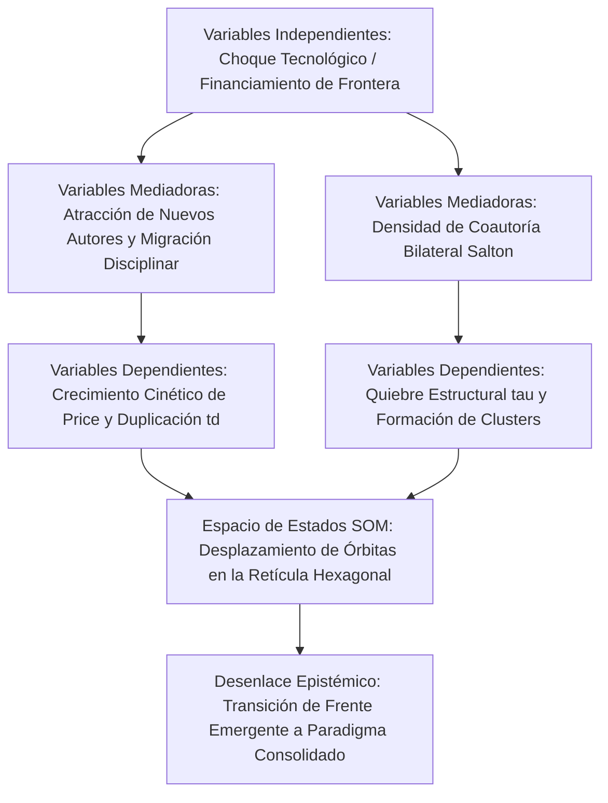

# Plantilla Maestra: Artículo Científico de Investigación Original (Formato IMRyD - Journal Q1)
### *Inspirada en el modelo de estudios bibliométricos avanzados, frentes de investigación y mapeo de trayectorias multidimensionales SOM (como el estudio de Polaritones)*

Esta plantilla está diseñada para que un **agente único** en LibreChat / `agentic-data-stack` o entornos de automatización elabore un **MANUSCRITO CIENTÍFICO DE INVESTIGACIÓN ORIGINAL** con estructura canónica **IMRyD** de grado publicable para revistas líderes internacionales (Q1/Q2) en Cienciometría y Metaciencia (*Journal of Informetrics*, *Scientometrics*, *Quantitative Science Studies*, *Research Evaluation*).

Integra como pilar metodológico distintivo el **Mapeo de Trayectorias en el Espacio de Estados con Redes Autoorganizadas de Kohonen (SOM)** (Jiménez-Andrade, Arencibia-Jorge & Carrillo-Calvet, 2025) y el **Mapeo Neurolongitudinal con encadenamiento intertemporal Warm-Start** (Jiménez-Andrade, Martí-Lahera & Carrillo-Calvet, 2024), superando los análisis estáticos o cinéticos unidimensionales mediante el modelado continuo de órbitas evolutivas multivariadas.

---

## Directivas Operativas para el Agente (Protocolo MCP Real)

Antes de redactar el artículo, debes cosechar los datos cuantitativos mediante las herramientas MCP disponibles:

1. **Delimitación del Frente de Investigación y Linajes AMI:**
   - Invocar `sos_topics`:
     * `detect_research_fronts_multimodal`: Identificar frentes temáticos de alta densidad, clusters y palabras clave de frontera.
     * `track_front_evolution_longitudinal`: Rastrear bifurcaciones, fusiones y linajes aluviales a lo largo de ventanas cronológicas.
2. **Cosecha Columnar y Series Temporales Anualizadas (CERO JOINs):**
   - Consultar `ClickHouse-OpenAlex` (`rag.works_academic_all`) o invocar `sos_openalex` (`openalex_search_works`, `openalex_aggregate_mexico`) para extraer series anuales completas de publicaciones, citas acumuladas, coautorías internacionales y vías de acceso abierto.
3. **Modelado Cinético y Validación de Leyes Bibliométricas (`sos_plmetrix`):**
   - Invocar `sos_plmetrix`:
     * `analyze_scientific_growth_phases`: Ajustar el modelo de Price, calcular la tasa exponencial $\alpha$, bondad $R^2$ y tiempo de duplicación $t_d = \frac{\ln(2)}{\alpha}$.
     * `analyze_lotka_law`: Ajustar la distribución de productividad científica con conteo fraccionado y completo, reportando el exponente $\alpha_{Lotka}$ y la prueba Kolmogorov-Smirnov.
     * `analyze_bradford_law` y `analyze_price_index`: Cuantificar la dispersión en zonas de Bradford y el índice de obsolescencia.
4. **Afinidad Bilateral y Cartografía Geopolítica:**
   - Invocar `sos_topics` (`get_geopolitical_collaboration_matrix`) o `sos_knomap` para construir matrices de coautoría internacional normalizadas con Coseno de Salton ($S_{ij} = \frac{C_{ij}}{\sqrt{C_i C_j}}$) y partición modular Louvain (`detect_louvain_communities`).
5. **Mapeo de Trayectorias Multidimensionales en el Espacio de Estados SOM (`sos_knomap`):**
   - **Preprocesamiento:** Suavizar las series anuales multidimensionales mediante Medias Móviles Centradas (*Centered Moving Averages*) de semiancho $s=2$ para eliminar fluctuaciones estocásticas sin introducir retraso de fase.
   - **Dimensionamiento y Entrenamiento:** Invocar `suggest_grid_size` para obtener el ratio espectral SVD ($\sigma_1 / \sigma_2$) y sobremalla $20N-30N$; invocar `train_som` con topología hexagonal e inicialización PCA.
   - **Interpolación Continua con Splines Cúbicos Paramétricos:** Calcular las trayectorias $u(t), v(t)$ en la retícula asegurando continuidad $C^2$.
   - **Regla de Legibilidad Visual:** Muestreo completo durante el entrenamiento; visualización selectiva con un máximo de 5 entidades/países simultáneos en el mapa para evitar espagueti visual.
   - **Panel Interactivo:** Invocar `knomap_render_som_dashboard` o renderizar la Tríada Visual LabSOM.
6. **Detección de Quiebres Estructurales:**
   - Estimar el punto de cambio de régimen temporal $\tau$ con CUSUM / Pettitt calculado sobre la serie anual extraída (no hay herramienta dedicada; declarar método y p-valor) o acotarlo con `analyze_scientific_growth_phases`.

---

## Disponibilidad de Datos y Reglas Anti-Fabricación (Verificadas contra el Corpus y las Herramientas)

**Columnas reales de `rag.works_academic_all`** (usar solo estas; no inventar nombres): `publication_year`, `cited_by_count`, `is_oa`, `oa_status` (valores: `closed`, `green`, `diamond`, `gold`, `bronze`, `hybrid`), `fwci`, `percentile`, `is_top_10`, `is_top_1`, `author_names`, `institution_rors`, `institution_names`, `country_code`, `all_country_codes`, `domain`, `field`, `subfield`, `topic`, `sdg_ids`, `apc_paid_usd`, `apc_list_usd`, `is_doaj_journal`, `is_core_journal`, `counts_by_year`.

1. **Número de autores:** no existe columna `authors_count`; usar `length(author_names)`.
2. **APC:** no existe `apc_usd`; usar `apc_paid_usd` (pagado) y `apc_list_usd` (precio de lista), indicando cuál se reporta.
3. **Primer autor y autor de correspondencia:** NO son columnas; solo existen dentro del JSON de `raw_data`. Si no se extraen de `raw_data` (consulta costosa, acotada a una sola entidad y sin JOINs), reportar `N/D (no disponible en el corpus)` en las celdas correspondientes y consignarlo como limitación. Nunca estimarlos ni completarlos con cifras plausibles.
4. **Cuartiles Q1/Q2 y colaboración con industria:** no existen en el corpus. No incluirlos como indicador calculado; si se mencionan, marcar `N/D`. Como proxies disponibles: `is_core_journal`, `is_doaj_journal`, `is_top_10`, `is_top_1`.
5. **Dependencias dentro de una institución (ej. Instituto de Neurobiología dentro de la UNAM):** el ROR solo identifica a la institución matriz. Para aislar una dependencia filtrar por `institution_names` con coincidencia insensible a mayúsculas y diacríticos, y declarar que el filtro es aproximado y puede subcontar variantes toponímicas.
6. **Coseno de Salton:** el índice que devuelve `get_geopolitical_collaboration_matrix` es una aproximación (usa un denominador proxy). Recalcular $S_{ij} = C_{ij}/\sqrt{C_i C_j}$ a partir de los conteos de coautoría ($C_{ij}$, $C_i$, $C_j$) y reportar el valor recalculado; si no es posible, rotular el índice como *aproximado*.
7. **Detección de quiebres (CUSUM / Pettitt):** no existe herramienta para ello. Calcularlos a partir de la serie anual extraída (declarando método y estadístico), o acotar los periodos con `analyze_scientific_growth_phases`; no atribuir a una herramienta resultados que no produce. La partición modular disponible es Louvain (`detect_louvain_communities`), no Leiden.
8. **Modo contingencia (`status: "fallback"`):** `train_som`, `evaluate_som_clusters` y `recluster_som` devuelven valores sintéticos (error de cuantización fijo, clusters y BMU ficticios) cuando el motor no está disponible. Si algún resultado trae `status: "fallback"`, NO usarlo para conclusiones: informar que el modelado SOM no pudo ejecutarse y limitar el análisis a lo no-SOM.
9. **Persistencia del SOM:** `train_som` devuelve el estado (pesos, U-Matrix, BMU, clusters) en la respuesta pero no lo guarda en archivo, y `knomap_render_som_dashboard` exige `som_state_path` (JSON en disco). Solo invocar el dashboard si el estado puede guardarse en un archivo accesible al servicio; de lo contrario, describir la U-Matrix, los clusters y los BMU a partir de la respuesta de `train_som` y declarar que no se generó el dashboard interactivo. No volcar matrices de pesos completas en el texto del documento.
10. **Matriz de entrada del SOM:** construirla solo con indicadores realmente calculados y estandarizados (z-score); las dimensiones `N/D` se excluyen del vector, no se rellenan.

---

## Reglas Editoriales Estrictas

- **LENGUAJE MODERADO Y SOBRIO (PROHIBICIÓN ABSOLUTA DE SUPERLATIVOS):** Emplear un estilo rigurosamente académico, neutro y fundamentado exclusivamente en evidencia empírica. Queda terminantemente prohibido el uso de adjetivos superlativos o hiperbólicos (*"revolucionario"*, *"sin precedentes"*, *"extraordinario"*, *"espectacular"*, *"abrumador"*, *"pionero"*, *"asombroso"*). Describir cualquier aceleración o fenómeno con precisión matemática y cautela científica.
- **ZERO-SCAFFOLDING LEAKAGE:** El documento debe leerse como un artículo de investigación formal sometido a arbitraje ciego por pares. No hacer mención a herramientas de software, agentes, prompts, tokens ni entornos de chat.
- **DENSIDAD TEÓRICA Y FORMULACIÓN MATEMÁTICA:** Integrar fórmulas matemáticas completas en LaTeX, definiciones operativas de variables y tablas empíricas en Markdown directamente en el cuerpo del texto.

---

# [Título del Artículo Formal, Descriptivo e Informativo en Español y en Inglés]
*(Ejemplo: Dinámica Temporal, Cinéticas de Crecimiento y Linajes Temáticos en el Frente de Investigación de Polaritones: Un Análisis Longitudinal con Modelado de Redes, Mapeo de Trayectorias SOM y Leyes Bibliométricas)*

> ## RESUMEN ESTRUCTURADO (STRUCTURED ABSTRACT)
> - **Objetivo / Purpose:** Enunciado preciso del problema empírico abordado, la hipótesis de investigación formulada y los objetivos específicos del estudio bibliométrico.
> - **Metodología / Design/Methodology:** Descripción detallada del corpus bibliográfico analizado (periodo temporal, bases de datos OpenAlex/Scopus/arXiv, estrategia de filtrado sin JOINs), modelos cinéticos (Ley de Price, distribuciones de Lotka), afinidad bilateral de Salton y el **Mapeo de Trayectorias en el Espacio de Estados con Redes SOM** (preprocesamiento con medias móviles centradas, retícula hexagonal con ratio SVD, sobremalla continua e interpolación con splines cúbicos paramétricos).
> - **Resultados / Findings:** Resultados cuantitativos principales: tasas de crecimiento cinético $\alpha$, tiempos de duplicación estimados $t_d$, exponentes de productividad de Lotka, localización del punto de quiebre estructural $\tau$, dinámica de linajes aluviales AMI y órbitas temporales de los polos líderes sobre la U-Matrix y mapas de componentes.
> - **Conclusiones y Originalidad / Originality/Value:** Implicaciones epistemológicas para la comprensión de la aceleración científica, relevancia para la gobernanza y valor diferencial del modelado multidimensional continuo frente a estudios transversales estáticos.
>
> **Palabras clave / Keywords:** (6 a 8 términos canónicos normalizados, ej. *Cienciometría; Frentes de Investigación; Mapas Autoorganizados de Kohonen; Mapeo de Trayectorias; Ley de Price; Ley de Lotka; Coseno de Salton; Acceso Abierto; Espacio de Estados; Dinámica Longitudinal*).

---

## 1. INTRODUCCIÓN Y MARCO TEÓRICO DE METACIENCIA

- **1.1. Contexto Fenomenológico y Justificación Epistémica:**
  * Planteamiento del problema científico: la emergencia y evolución de frentes tecnológicos y científicos de frontera (ej. polaritones, condensados de Bose-Einstein en estado sólido, materiales cuánticos, inteligencia artificial generativa).
  * Justificación de por qué los indicadores bibliométricos tradicionales y estáticos fracasan en capturar la cinética subyacente, la deriva sináptica y las fases de maduración comunitaria.
- **1.2. Fundamentos Teóricos de Science of Science:**
  * Marco conceptual basado en las leyes bibliométricas clásicas:
    - Ley de crecimiento exponencial de Derek de Solla Price ($N(t) = N_0 e^{\alpha t}$).
    - Distribución de productividad científica de Alfred Lotka ($f(x) = C x^{-\alpha}$).
    - Zonas concéntricas de dispersión de Samuel Bradford.
  * Teoría de variedades semánticas, topología de redes bibliométricas y espacios de estados autoorganizados (Callon; Ultsch; Vesanto; Carrillo-Calvet, Jiménez-Andrade & Arencibia-Jorge).

---

## 2. REVISIÓN SISTEMÁTICA DEL ESTADO DEL ARTE Y TABLA COMPARATIVA

- **2.1. Síntesis Crítica de la Literatura Previa:**
  * Discusión rigurosa de las investigaciones precedentes que han analizado el dominio temático o fenómenos cinéticos similares, identificando sus marcos teóricos y bases empíricas.
- **2.2. Tabla Comparativa de Investigaciones Similares (State-of-the-Art Benchmark):**
  * Presentar la **Tabla Comparativa de Literatura Previa**:

| Estudio (Autores, Año) | Corpus y Datos Analizados | Enfoque Metodológico | Hallazgos Principales | Limitación o Brecha No Resuelta | Aporte Diferencial de este Trabajo |
| :--- | :--- | :--- | :--- | :--- | :--- |
| [Autor 1 et al., 2021] | [Corpus analizado] | [Metodología utilizada] | [Principales resultados] | [Limitación detectada] | [Superación en este estudio] |
| [Autor 2 et al., 2023] | [Corpus analizado] | [Metodología utilizada] | [Principales resultados] | [Limitación detectada] | [Superación en este estudio] |
| [Autor 3 et al., 2025] | [Corpus analizado] | [Metodología utilizada] | [Principales resultados] | [Limitación detectada] | [Superación en este estudio] |

- **2.3. Identificación de la Brecha Epistémica (Gap Analysis) y Preguntas de Investigación:**
  * Articulación explícita de la brecha no resuelta en la literatura internacional.
  * Formulación de las preguntas de investigación centrales ($RQ_1, RQ_2, RQ_3$) e hipótesis contrastables.

---

## 3. MARCO METODOLÓGICO, FORMALIZACIÓN MATEMÁTICA Y MODELO CAUSAL

- **3.1. Corpus de Datos y Estrategia de Filtrado:**
  * Detalle de la fuente de datos (ClickHouse OpenAlex / Scopus), parámetros de normalización toponímica y temporal.
  * Regla estricta de CERO JOINs en ClickHouse, aislamiento de hiperautoría ($\le 20$ autores) y exclusión de artefactos de indexación.
- **3.2. Formalización Matemática de Modelos Cinéticos y Leyes:**
  * **Modelo de Crecimiento Cinético de Price:**
    $$\frac{dN}{dt} = \alpha N \implies N(t) = N_0 e^{\alpha t}, \quad t_d = \frac{\ln(2)}{\alpha}$$
  * **Distribución de Productividad de Lotka:**
    $$y_x = \frac{C}{x^{\alpha_{Lotka}}}, \quad \text{con ajuste mediante regresión ponderada y prueba Kolmogorov-Smirnov (KS)}$$
  * **Medida de Afinidad Bilateral de Salton (Coseno de Salton):**
    $$S_{ij} = \frac{C_{ij}}{\sqrt{C_i \cdot C_j}}$$
- **3.3. Metodología Neurocomputacional: Mapeo de Trayectorias con Redes SOM:**
  * **Preprocesamiento con Medias Móviles Centradas (Centered Moving Averages):**
    Para eliminar fluctuaciones estocásticas de corto plazo sin introducir desfase de fase temporal (a diferencia de las medias retrospectivas o prospectivas):
    $$y_t = \sum_{r=-s}^{s} a_r x_{t+r}, \quad \text{con } \sum a_r = 1 \text{ y semiancho } s=2$$
  * **Geometría y Calibración de la Retícula SOM:**
    Dimensionamiento continuo con relación de aspecto espectral SVD ($\frac{\text{cols}}{\text{rows}} \approx \frac{\sigma_1}{\sigma_2}$), malla hexagonal *flat-topped* con sobremalla $20N\text{--}30N$, inicialización PCA y entrenamiento por lotes.
  * **Trazado Continuo con Splines Cúbicos Paramétricos:**
    Para modelar la trayectoria no lineal en el plano cartesiano de la retícula $(u(t), v(t))$, se resuelven dos sistemas independientes de $4(N-1)$ ecuaciones asegurando continuidad de primer ($C^1$) y segundo orden ($C^2$):
    $$u_i(t) = a_{ui} + b_{ui}t + c_{ui}t^2 + d_{ui}t^3, \quad v_i(t) = a_{vi} + b_{vi}t + c_{vi}t^2 + d_{vi}t^3$$
  * **Tensión de Deriva Sináptica Intertemporal (Warm-Start):**
    $$\Delta W = \|W^{(t)} - W^{(t-1)}\|_F = \sqrt{\sum_{j=1}^M \sum_{d=1}^D (W_{j,d}^{(t)} - W_{j,d}^{(t-1)})^2}$$
- **3.4. Grafo Causal del Fenómeno (Mermaid Obligatorio):**

---

## 4. RESULTADOS EMPÍRICOS: CINÉTICAS, QUIEBRES Y TRAYECTORIAS SOM

- **4.1. Estimación de Parámetros Cinéticos y Validación de Leyes:**
  * Presentar la **Tabla 1: Parámetros Cinéticos y Bondad de Ajuste**:

| Periodo Analítico | Modelo Ajustado | Parámetro de Tasa ($\alpha$) | Tiempo Duplicación ($t_d$ años) | Coef. Determinación ($R^2$) | Exponente Lotka ($\alpha_{Lotka}$) | P-valor Kolmogorov-Smirnov |
| :--- | :--- | :--- | :--- | :--- | :--- | :--- |
| **Fase Formativa (2000–2010)** | Exponencial | [X.XXX] | [X.XX] años | [0.XXX] | [X.XX] | [0.XXX] |
| **Fase de Aceleración (2011–2018)** | Exponencial | [X.XXX] | [X.XX] años | [0.XXX] | [X.XX] | [0.XXX] |
| **Fase Contemporánea (2019–2026)** | Exponencial / Logístico | [X.XXX] | [X.XX] años | [0.XXX] | [X.XX] | [0.XXX] |

- **4.2. Detección de Quiebres Estructurales y Puntos de Inflexión ($\tau$):**
  * Localización exacta del changepoint temporal $\tau$ mediante CUSUM / Pettitt, indicando la fecha en que la tasa de acumulación experimenta una discontinuidad estadísticamente significativa ($p < 0.001$).
- **4.3. Métricas Diferenciales y Series Temporales:**
  * Presentar la **Tabla 2: Dinámica Comparativa por Canales y Modalidades**:

| Dimensión Analítica | Canal Preprints (arXiv) | Revistas Indexadas Q1/Q2 | Modalidad Acceso Abierto Diamante | Modalidad Acceso Abierto Gold APC |
| :--- | :--- | :--- | :--- | :--- |
| **Volumen de Trabajos** | [N] | [N] | [N] | [N] |
| **Latencia Promedio de Cita** | [X.X] meses | [XX.X] meses | [XX.X] meses | [XX.X] meses |
| **FWCI Promedio Normalizado** | [X.XX] | [X.XX] | [X.XX] | [X.XX] |
| **Tasa de Colaboración Internacional (%)** | [XX.X]% | [XX.X]% | [XX.X]% | [XX.X]% |

- **4.4. Mapeo de Trayectorias en el Espacio de Estados SOM:**
  * Presentar la **Tabla 3: Cronología de Trayectorias y Transiciones de Fase en el SOM**:

| Entidad / Polo Geopolítico | Periodo Histórico Analizado | Cluster Inicial en el SOM | Año del Changepoint ($\tau$) | Velocidad de Deriva ($\Delta s / \Delta t$) | Cluster Final / Destino | Fase de Maduración Alcanzada |
| :--- | :--- | :--- | :--- | :--- | :--- | :--- |
| **Polo Líder A** | [Año_i – Año_f] | Cluster 1 (Baja densidad) | [Año_tau] | [X.XX] celdas/año | Cluster 4 (Polo Élite) | Consolidación y hegemonía |
| **Polo Líder B** | [Año_i – Año_f] | Cluster 2 (Volumen moderado) | [Año_tau] | [X.XX] celdas/año | Cluster 3 (Alto FWCI) | Expansión acelerada |
| **Sur Global / Regional** | [Año_i – Año_f] | Cluster 1 (Periférico) | [Año_tau] | [X.XX] celdas/año | Cluster 2 (Diamante / Colab.) | Inserción en desarrollo |

  * **Interpretación sobre la Tríada Visual LabSOM:**
    - Análisis topológico sobre la U-Matrix: cómo las órbitas superaron crestas de separación (amarillo) para ingresar a los valles de alta maduración (rojo).
    - Mapas de Componentes: identificación de los factores específicos (tonalidades rojas en FWCI, colaboración internacional o patentes) que impulsaron la trayectoria en cada etapa.

---

## 5. DISCUSIÓN: PARADOJAS EPISTÉMICAS, GEOPOLÍTICA Y VULNERABILIDADES

- **5.1. Interpretación Teórica y Ley de Goodhart:**
  * Contrastar los hallazgos empíricos con las premisas de la metaciencia.
  * Discusión sobre los efectos no deseados de los incentivos métricos: cómo la presión por publicar en frentes de alta aceleración induce fragmentación (*salami slicing*) o redundancia temática.
- **5.2. Asimetrías Geopolíticas (Sur Global vs. Norte Global):**
  * Análisis de la división internacional del trabajo científico en el frente: concentración del liderazgo de correspondencia en el Norte Global frente a la participación de coautoría subordinada en el Sur Global.
- **5.3. Fuga Financiera y Sostenibilidad Editorial (APC en USD):**
  * Cuantificación del drenaje financiero por pago de cuotas de procesamiento de artículos (APC) hacia editoriales comerciales frente a alternativas sostenibles de Acceso Abierto Diamante.
- **5.4. Amenazas a la Integridad Científica y Limitaciones del Estudio:**
  * Vulnerabilidades detectadas: fatiga en los sistemas de revisión por pares, proliferación de artículos sin reproducibilidad.
  * Limitaciones metodológicas: cobertura de bases de datos, sesgos idiomáticos en OpenAlex/Scopus y supuestos de los modelos cinéticos.

---

## 6. CONCLUSIONES Y AGENDA DE INVESTIGACIÓN FUTURA

- **6.1. Síntesis de Contribuciones Originales:**
  * Recapitulación concisa de los tres principales hallazgos empíricos y teóricos del estudio.
- **6.2. Recomendaciones de Política Científica:**
  * Directrices orientadas a agencias de financiamiento, consejos evaluadores y comités editoriales para fomentar la sustentabilidad del frente.
- **6.3. Agenda de Investigación Longitudinal:**
  * Preguntas abiertas para futuros estudios cienciométricos con horizontes temporales extendidos y análisis causal avanzado.

---

## REFERENCIAS BIBLIOGRÁFICAS
*(Listado exhaustivo en formato APA 7ª edición con DOI/URL auditable).*

1. **Carrillo-Calvet, H., Jiménez-Andrade, J. L., & Arencibia-Jorge, R. (2025).** Redes neuronales autoorganizadas y mapeos de la ciencia. En S. Gorbea Portal & M. Piña Pozas (Coords.), *La metría de la información-conocimiento y los datos en la búsqueda de evidencias científicas* (pp. 271–292). UNAM, IIBI. ISBN-e: 978-607-642-193-2.
2. **Jiménez-Andrade, J. L., Arencibia-Jorge, R., & Carrillo-Calvet, H. (2025).** Análisis y visualización de la evolución de perfiles cienciométricos multidimensionales con IA. En S. Gorbea Portal & M. Piña Pozas (Coords.), *La metría de la información-conocimiento y los datos en la búsqueda de evidencias científicas* (pp. 293–313). UNAM, IIBI.
3. **Jiménez-Andrade, J. L., Martí-Lahera, Y., & Carrillo-Calvet, H. (2024).** Neural longitudinal mapping of multidimensional performance profiles of Latin American universities. *Iberoamerican Journal of Science Measurement and Communication*, 4(1), 1–16. https://doi.org/10.47909/ijsmc.92
4. **Villaseñor-García, E. A., Arencibia-Jorge, R., & Carrillo-Calvet, H. (2017).** Multiparametric characterization of scientometric performance profiles assisted by neural networks: A study of Mexican higher education institutions. *Scientometrics*, 110(1), 77–104. https://doi.org/10.1007/s11192-016-2166-0
5. **Price, D. J. de S. (1963).** *Little Science, Big Science*. Columbia University Press.
6. **Lotka, A. J. (1926).** The frequency distribution of scientific productivity. *Journal of the Washington Academy of Sciences*, 16(12), 317–323.
7. **Salton, G., & McGill, M. J. (1983).** *Introduction to Modern Information Retrieval*. McGraw-Hill.
