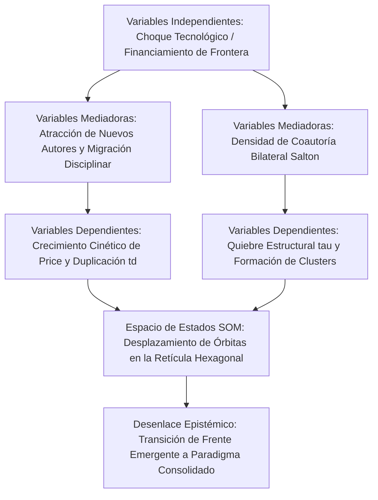

# Plantilla Maestra: Artículo Científico de Investigación Original (Formato IMRyD - Journal Q1)
### *Inspirada en el modelo de estudios bibliométricos avanzados, frentes de investigación y mapeo de trayectorias multidimensionales SOM (como el estudio de Polaritones)*

Esta plantilla está diseñada para que un **agente único** en LibreChat / `agentic-data-stack` o entornos de automatización elabore un **MANUSCRITO CIENTÍFICO DE INVESTIGACIÓN ORIGINAL** con estructura canónica **IMRyD** de grado publicable para revistas líderes internacionales (Q1/Q2) en Cienciometría y Metaciencia (*Journal of Informetrics*, *Scientometrics*, *Quantitative Science Studies*, *Research Evaluation*).

Integra como pilar metodológico distintivo el **Mapeo de Trayectorias en el Espacio de Estados con Redes Autoorganizadas de Kohonen (SOM)** (Jiménez-Andrade, Arencibia-Jorge & Carrillo-Calvet, 2025) y el **Mapeo Neurolongitudinal con encadenamiento intertemporal Warm-Start** (Jiménez-Andrade, Martí-Lahera & Carrillo-Calvet, 2024), superando los análisis estáticos o cinéticos unidimensionales mediante el modelado continuo de órbitas evolutivas multivariadas.

---

## Directivas Operativas para el Agente (Protocolo de Orquestación de Agent Skills)

Esta plantilla opera como una **meta-habilidad orquestadora** de alto nivel. Para garantizar el rigor metodológico, la reproducibilidad y la ausencia de alucinación, el agente NO debe ejecutar llamadas ad-hoc de bajo nivel a ciegas, sino que **debe orquestar y delegar cada fase analítica en la Agent Skill especializada correspondiente del ecosistema**. Las herramientas MCP y los scripts canónicos constituyen el sustrato técnico que cada habilidad ejecuta y audita internamente.

El protocolo canónico de 8 fases se orquesta como sigue:

1. **Fase 1: Delimitación de Campo, Ecuaciones de Búsqueda y Frentes de Investigación:**
   - **Agent Skills Orquestadas:** [`bibliometric-search-strategist`](../bibliometric-search-strategist/SKILL.md) y [`research-fronts-detection-expert`](../research-fronts-detection-expert/SKILL.md).
   - **Propósito y Directivas:**
     * Delimitar el campo mediante el marco multi-etapa de Huang, Schiebel & Porter (2011) en bloques conceptuales (*building blocks*).
     * Transpilar la estrategia a sintaxis nativa multi-base (WoS, Scopus, PubMed y ClickHouse SQL con funciones de array sin JOINs).
     * Auditar rigurosamente la estrategia bajo la directriz **GLOBAL (ISSI)** (sustituyendo directrices biomédicas como PRESS 2015).
     * Extraer los frentes temáticos activos de Topics v5.0 e identificar linajes aluviales AMI (bifurcaciones, fusiones y linajes históricos).
   - **Artefactos Producidos:** Ecuaciones de búsqueda auditadas, matriz de bloques conceptuales (`search_blocks.json`) y reporte de auditoría GLOBAL (`global_audit.md`).

2. **Fase 2: Revisión Sistemática del Estado del Arte y Matriz de Evidencia:**
   - **Agent Skill Orquestada:** [`deep-literature-researcher`](../deep-literature-researcher/SKILL.md).
   - **Propósito y Directivas:**
     * Conducir la revisión de literatura siguiendo el marco de 5 fases de Zupic & Čater (2015) y Aria & Cuccurullo (2017), bajo los estándares metodológicos PRIBA 2022 (Koo & Lin) y PRISMA 2020.
     * Ejecutar el procedimiento de *Citation Snowballing* backward y forward (Wohlin, 2014) partiendo de semillas canónicas y aplicando el **Filtro de Densidad Núcleo de Glänzel et al. (2009)** ($k \ge 2$) para suprimir el ruido marginal.
     * Resolver y normalizar preprints de arXiv (`10.48550/arXiv.xxxx.xxxxx`) y literatura indexada.
   - **Artefactos Producidos:** Tabla Comparativa de Literatura Previa (Benchmark), matriz de extracción de evidencia y diagramas de flujo PRISMA/PRIBA.

3. **Fase 3: Cosecha Columnar y Series Temporales Anualizadas (CERO JOINs):**
   - **Agent Skills Orquestadas:** [`openalex-mexico-clickhouse`](../openalex-mexico-clickhouse/SKILL.md) o [`openalex-harvester`](../openalex-harvester/SKILL.md) (según el alcance nacional o global).
   - **Propósito y Directivas:**
     * Ejecutar consultas de alto rendimiento columnar sobre la base de datos OpenAlex (`rag.works_academic_all`) bajo la regla inviolable de **CERO JOINs**, empleando funciones nativas de arrays (`has`, `arrayExists`, `splitByChar`).
     * Extraer series anuales completas de volumen de producción, citas acumuladas, FWCI, percentiles, decil superior (Top 10%), modalidades de acceso abierto y coautorías internacionales.
   - **Artefactos Producidos:** Dataset del corpus procesado (`corpus_metadata.csv` / Parquet) y script de extracción determinista (`01_corpus_extraction.py`).

4. **Fase 4: Modelado Cinético y Validación Empírica de Leyes Bibliométricas:**
   - **Agent Skill Orquestada:** [`classical-bibliometrics-laws`](../classical-bibliometrics-laws/SKILL.md).
   - **Propósito y Directivas:**
     * Ajustar la **Ley de Crecimiento Exponencial de Price**: calcular la tasa exponencial $\alpha$, bondad de ajuste $R^2$ y tiempo de duplicación $t_d = \frac{\ln(2)}{\alpha}$.
     * Ajustar la **Distribución de Productividad de Lotka**: implementar conteo fraccionado y completo (*fractional vs. full counting*, Perianes-Rodriguez et al., 2016), estimando el exponente $\alpha_{Lotka}$ y la prueba de Kolmogorov-Smirnov (KS).
     * Cuantificar la dispersión en zonas concéntricas de Bradford (formulación continua de Egghe) y estimar la tasa de obsolescencia con el Índice de Price.
     * Localizar quiebres estructurales y changepoints ($\tau$) mediante CUSUM / Pettitt sobre la serie extraída.
   - **Artefactos Producidos:** Tabla 1 de parámetros cinéticos y leyes, y script de ajuste matemático.

5. **Fase 5: Cartografía Geopolítica de Cooperación y Redes Científicas:**
   - **Agent Skills Orquestadas:** [`geopolitical-collaboration-analyst`](../geopolitical-collaboration-analyst/SKILL.md) y [`bibliometric-network-analyst`](../bibliometric-network-analyst/SKILL.md).
   - **Propósito y Directivas:**
     * Construir la matriz de coautoría internacional normalizada con el **Coseno de Salton** ($S_{ij} = \frac{C_{ij}}{\sqrt{C_i C_j}}$) y códigos de país ISO-3166-1 alpha-3.
     * Evaluar la soberanía epistémica y la división internacional del trabajo científico (% primer autor y autor de correspondencia por país o bloque).
     * Construir y particionar redes de colaboración y acoplamiento bibliográfico mediante normalización por *Association Strength* y algoritmos de partición modular (Leiden / Louvain).
   - **Artefactos Producidos:** Matrices de afinidad bilateral, Tabla 2 de dinámica de canales y métricas de red.

6. **Fase 6: Mapeo de Trayectorias en el Espacio de Estados con Redes SOM:**
   - **Agent Skills Orquestadas:** [`som-methodological-expert`](../som-methodological-expert/SKILL.md) y [`som-trajectory-mapping`](../som-trajectory-mapping/SKILL.md).
   - **Propósito y Directivas:**
     * **Preprocesamiento:** Suavizar las trayectorias longitudinales multivariadas con **Medias Móviles Centradas** (*Centered Moving Averages*) de semiancho $s=2$ para erradicar el ruido estocástico sin introducir retraso de fase temporal.
     * **Topología y Calibración Neurocomputacional:** Calcular el ratio de aspecto espectral SVD ($\sigma_1 / \sigma_2$) para la retícula hexagonal *flat-topped*, sobremalla continua $20N\text{--}30N$ e inicialización PCA.
     * **Trazado Continuo con Splines Cúbicos Paramétricos:** Resolver los sistemas de splines para las coordenadas $(u(t), v(t))$ asegurando continuidad de curvatura $C^2$.
     * **Regla de Legibilidad Visual LabSOM:** Muestreo completo en entrenamiento; visualización selectiva de un máximo de 5 entidades simultáneas en la trayectoria para preservar la interpretabilidad.
     * **Tríada Visual LabSOM y Meta-clustering:** Generar la U-Matrix roja/amarilla, mapas de componentes divergentes Verde-Amarillo-Rojo y partición aglomerativa en dos etapas de Vesanto & Alhoniemi con Silhouette máximo ($s^*$).
   - **Artefactos Producidos:** Tabla 3 de cronología de trayectorias y transiciones de fase, estado neuronal persistido (`som_state.json`) y dashboard interactivo LabSOM (`som_dashboard.html`).

7. **Fase 7: Auditoría de Acceso Abierto y Fuga de Capital en APC:**
   - **Agent Skill Orquestada:** [`open-access-monitor`](/home/jlja/.gemini/config/skills/open-access-monitor/SKILL.md).
   - **Propósito y Directivas:**
     * Auditar la distribución de la producción en las 6 vías canónicas de Acceso Abierto (Diamante, Gold APC, Híbrida, Bronce, Verde, Cerrada).
     * Cuantificar el gasto comercial en APC en USD (usando `apc_paid_usd` y `apc_list_usd`), identificando la fuga de presupuestos públicos hacia editoriales oligopólicas comerciales frente al Acceso Abierto Diamante público.
   - **Artefactos Producidos:** Sección de discusión financiera y desglose de canales de publicación.

8. **Fase 8: Empaquetado de Material Suplementario y Protocolo de Reproducibilidad Dual (Obligatorio Q1):**
   - **Propósito y Directivas:**
     * Asegurar el cumplimiento de los estándares de reproducibilidad de grado Q1 mediante el protocolo dual (humano y agéntico).
     * Generar en `./supplementary/` (o directorio de trabajo):
       * `Script S1: 01_corpus_extraction.py`: Extracción SQL columnar en ClickHouse bajo regla de CERO JOINs.
       * `Script S2: 02_laws_and_som_modeling.py`: Cálculo de leyes (Price, Lotka), Coseno de Salton, medias móviles centradas y entrenamiento SOM con semilla fija (`seed=42`).
       * `Dataset S1: corpus_metadata.csv`: Metadatos tabulares auditables.
       * `Dataset S2: som_state.json`: Pesos sinápticos, U-Matrix, BMUs y clusters.
       * `Figura S1: som_dashboard.html`: Visualizador interactivo oficial LabSOM.
       * `Manifiesto S1: reproducibility_manifest.json`: Ficha técnica de ejecución con prompts, skills orquestadas, versiones de librerías y semillas deterministas.

---

## Disponibilidad de Datos y Reglas Anti-Fabricación (Verificadas contra el Corpus y las Herramientas)

**Columnas reales de `rag.works_academic_all`** (usar solo estas; no inventar nombres): `publication_year`, `cited_by_count`, `is_oa`, `oa_status` (valores: `closed`, `green`, `diamond`, `gold`, `bronze`, `hybrid`), `fwci`, `percentile`, `is_top_10`, `is_top_1`, `author_names`, `institution_rors`, `institution_names`, `country_code`, `all_country_codes`, `domain`, `field`, `subfield`, `topic`, `sdg_ids`, `apc_paid_usd`, `apc_list_usd`, `is_doaj_journal`, `is_core_journal`, `counts_by_year`.

1. **Número de autores:** no existe columna `authors_count`; usar `length(author_names)`.
2. **APC:** no existe `apc_usd`; usar `apc_paid_usd` (pagado) y `apc_list_usd` (precio de lista), indicando cuál se reporta.
3. **Primer autor y autor de correspondencia:** NO son columnas; solo existen dentro del JSON de `raw_data`. Si no se extraen de `raw_data` (consulta costosa, acotada a una sola entidad y sin JOINs), reportar `N/D (no disponible en el corpus)` en las celdas correspondientes y consignarlo como limitación. Nunca estimarlos ni completarlos con cifras plausibles.
4. **Cuartiles Q1/Q2 y colaboración con industria:** no existen en el corpus. No incluirlos como indicador calculado; si se mencionan, marcar `N/D`. Como proxies disponibles: `is_core_journal`, `is_doaj_journal`, `is_top_10`, `is_top_1`.
5. **Dependencias dentro de una institución (ej. Instituto de Neurobiología dentro de la UNAM):** el ROR solo identifica a la institución matriz. Para aislar una dependencia filtrar por `institution_names` con coincidencia insensible a mayúsculas y diacríticos, y declarar que el filtro es aproximado y puede subcontar variantes toponímicas.
6. **Coseno de Salton:** el índice que devuelve `get_geopolitical_collaboration_matrix` es una aproximación (usa un denominador proxy). Recalcular $S_{ij} = C_{ij}/\sqrt{C_i C_j}$ a partir de los conteos de coautoría ($C_{ij}$, $C_i$, $C_j$) y reportar el valor recalculado; si no es posible, rotular el índice como *aproximado*.
7. **Detección de quiebres (CUSUM / Pettitt):** no existe herramienta para ello. Calcularlos a partir de la serie anual extraída (declarando método y estadístico), o acotar los periodos con `analyze_scientific_growth_phases`; no atribuir a una herramienta resultados que no produce. La partición modular disponible es Louvain (`detect_louvain_communities`), no Leiden.
8. **Modo contingencia (`status: "fallback"`):** `train_som`, `evaluate_som_clusters` y `recluster_som` devuelven valores sintéticos (error de cuantización fijo, clusters y BMU ficticios) cuando el motor no está disponible. Si algún resultado trae `status: "fallback"`, NO usarlo para conclusiones: informar que el modelado SOM no pudo ejecutarse y limitar el análisis a lo no-SOM.
9. **Persistencia y Dashboard del SOM:** `train_som` cuenta con el parámetro `output_state_path` (ej. `output_state_path="/tmp/som_state.json"`) e `indicator_names`. Para generar el dashboard interactivo oficial con `knomap_render_som_dashboard`, se debe indicar `output_state_path` al invocar `train_som` y pasar esa misma ruta a `knomap_render_som_dashboard(som_state_path=...)`. Si el motor no está disponible, la herramienta devuelve `status: "error"` con la causa raíz; nunca inventar métricas ni volcar matrices numéricas completas de pesos en el cuerpo del texto.
10. **Matriz de entrada del SOM:** construirla solo con indicadores realmente calculados y estandarizados (z-score); las dimensiones `N/D` se excluyen del vector, no se rellenan.

---

## Reglas Editoriales Estrictas

- **LENGUAJE MODERADO Y SOBRIO (PROHIBICIÓN ABSOLUTA DE SUPERLATIVOS):** Emplear un estilo rigurosamente académico, neutro y fundamentado exclusivamente en evidencia empírica. Queda terminantemente prohibido el uso de adjetivos superlativos o hiperbólicos (*"revolucionario"*, *"sin precedentes"*, *"extraordinario"*, *"espectacular"*, *"abrumador"*, *"pionero"*, *"asombroso"*). Describir cualquier aceleración o fenómeno con precisión matemática y cautela científica.
- **ZERO-SCAFFOLDING LEAKAGE:** El documento debe leerse como un artículo de investigación formal sometido a arbitraje ciego por pares. No hacer mención a herramientas de software, agentes, prompts, tokens ni entornos de chat.
- **DENSIDAD TEÓRICA Y FORMULACIÓN MATEMÁTICA:** Integrar fórmulas matemáticas completas en LaTeX, definiciones operativas de variables y tablas empíricas en Markdown directamente en el cuerpo del texto.

---

# [Título del Artículo Formal, Descriptivo e Informativo en Español y en Inglés]
*(Ejemplo: Dinámica Temporal, Cinéticas de Crecimiento y Linajes Temáticos en el Frente de Investigación de Polaritones: Un Análisis Longitudinal con Modelado de Redes, Mapeo de Trayectorias SOM y Leyes Bibliométricas)*

> ## RESUMEN ESTRUCTURADO (STRUCTURED ABSTRACT)
> - **Objetivo / Purpose:** Enunciado preciso del problema empírico abordado, la hipótesis de investigación formulada y los objetivos específicos del estudio bibliométrico.
> - **Metodología / Design/Methodology:** Descripción detallada del corpus bibliográfico analizado (periodo temporal, bases de datos OpenAlex/Scopus/arXiv, estrategia de filtrado sin JOINs), modelos cinéticos (Ley de Price, distribuciones de Lotka), afinidad bilateral de Salton y el **Mapeo de Trayectorias en el Espacio de Estados con Redes SOM** (preprocesamiento con medias móviles centradas, retícula hexagonal con ratio SVD, sobremalla continua e interpolación con splines cúbicos paramétricos).
> - **Resultados / Findings:** Resultados cuantitativos principales: tasas de crecimiento cinético $\alpha$, tiempos de duplicación estimados $t_d$, exponentes de productividad de Lotka, localización del punto de quiebre estructural $\tau$, dinámica de linajes aluviales AMI y órbitas temporales de los polos líderes sobre la U-Matrix y mapas de componentes.
> - **Conclusiones y Originalidad / Originality/Value:** Implicaciones epistemológicas para la comprensión de la aceleración científica, relevancia para la gobernanza y valor diferencial del modelado multidimensional continuo frente a estudios transversales estáticos.
>
> **Palabras clave / Keywords:** (6 a 8 términos canónicos normalizados, ej. *Cienciometría; Frentes de Investigación; Mapas Autoorganizados de Kohonen; Mapeo de Trayectorias; Ley de Price; Ley de Lotka; Coseno de Salton; Acceso Abierto; Espacio de Estados; Dinámica Longitudinal*).

---

## 1. INTRODUCCIÓN Y MARCO TEÓRICO DE METACIENCIA

- **1.1. Contexto Fenomenológico y Justificación Epistémica:**
  * Planteamiento del problema científico: la emergencia y evolución de frentes tecnológicos y científicos de frontera (ej. polaritones, condensados de Bose-Einstein en estado sólido, materiales cuánticos, inteligencia artificial generativa).
  * Justificación de por qué los indicadores bibliométricos tradicionales y estáticos fracasan en capturar la cinética subyacente, la deriva sináptica y las fases de maduración comunitaria.
- **1.2. Fundamentos Teóricos de Science of Science:**
  * Marco conceptual basado en las leyes bibliométricas clásicas:
    - Ley de crecimiento exponencial de Derek de Solla Price ($N(t) = N_0 e^{\alpha t}$).
    - Distribución de productividad científica de Alfred Lotka ($f(x) = C x^{-\alpha}$).
    - Zonas concéntricas de dispersión de Samuel Bradford.
  * Teoría de variedades semánticas, topología de redes bibliométricas y espacios de estados autoorganizados (Callon; Ultsch; Vesanto; Carrillo-Calvet, Jiménez-Andrade & Arencibia-Jorge).

---

## 2. REVISIÓN SISTEMÁTICA DEL ESTADO DEL ARTE Y TABLA COMPARATIVA

- **2.1. Síntesis Crítica de la Literatura Previa:**
  * Discusión rigurosa de las investigaciones precedentes que han analizado el dominio temático o fenómenos cinéticos similares, identificando sus marcos teóricos y bases empíricas.
- **2.2. Tabla Comparativa de Investigaciones Similares (State-of-the-Art Benchmark):**
  * Presentar la **Tabla Comparativa de Literatura Previa**:

| Estudio (Autores, Año) | Corpus y Datos Analizados | Enfoque Metodológico | Hallazgos Principales | Limitación o Brecha No Resuelta | Aporte Diferencial de este Trabajo |
| :--- | :--- | :--- | :--- | :--- | :--- |
| [Autor 1 et al., 2021] | [Corpus analizado] | [Metodología utilizada] | [Principales resultados] | [Limitación detectada] | [Superación en este estudio] |
| [Autor 2 et al., 2023] | [Corpus analizado] | [Metodología utilizada] | [Principales resultados] | [Limitación detectada] | [Superación en este estudio] |
| [Autor 3 et al., 2025] | [Corpus analizado] | [Metodología utilizada] | [Principales resultados] | [Limitación detectada] | [Superación en este estudio] |

- **2.3. Identificación de la Brecha Epistémica (Gap Analysis) y Preguntas de Investigación:**
  * Articulación explícita de la brecha no resuelta en la literatura internacional.
  * Formulación de las preguntas de investigación centrales ($RQ_1, RQ_2, RQ_3$) e hipótesis contrastables.

---

## 3. MARCO METODOLÓGICO, FORMALIZACIÓN MATEMÁTICA Y MODELO CAUSAL

- **3.1. Corpus de Datos, Delimitación de Campo y Protocolo GLOBAL (ISSI):**
  * **3.1.1. Fuentes, Cobertura y Snapshot Temporal:**
    Declarar explícitamente las plataformas de consulta (OpenAlex / ClickHouse `rag.works_academic_all`, Scopus, Web of Science Core Collection), la versión exacta de la base, la fecha de extracción y el huso horario correspondiente (requisito obligatorio de la directriz GLOBAL de la ISSI debido a la naturaleza dinámica de los índices).
  * **3.1.2. Delimitación del Campo (Field Delineation Multi-Etapa de Huang, Schiebel & Porter, 2011):**
    Detallar las 4 etapas de delimitación: 1) *Core Search* con términos de máxima precisión; 2) *Modular Expansion* por bloques conceptuales temáticos y esquemas de clasificación (Topics de OpenAlex, MeSH Headings, Categorías WoS); 3) *Noise Filtering* por reglas de co-ocurrencia y exclusión de ramas ajenas; 4) *Calibración de Semillas* verificando el 100% de recuperación del *golden standard*.
  * **3.1.3. Desambiguación de Entidades y Armonización:**
    Procedimiento para resolver homónimos de autores hispanos (mediante identificadores persistentes ORCID y OpenAlex Author IDs), unificación institucional mediante el catálogo canónico **ROR** (Research Organization Registry) y normalización de descriptores mediante tesauro de sinónimos.
  * **3.1.4. Unidades de Análisis y Métodos de Conteo:**
    Declaración obligatoria del método de ponderación: **conteo completo (*full counting*)** vs. **conteo fraccional (*fractional counting*, Perianes-Rodriguez et al., 2016)** para matrices de coautoría y acoplamiento bibliográfico, aislando de forma justificada el sesgo de mega-consorcios (>20 autores).
  * **3.1.5. Algoritmos de Clustering, Métricas de Similitud y Parámetros:**
    Declaración de la métrica de normalización relacional (*Association Strength* de Van Eck & Waltman o Coseno de Salton), algoritmo de partición comunitaria (Leiden / Louvain), parámetro de resolución modular ($\gamma$) y umbrales mínimos de frecuencia ($k$).

Presentar la **Tabla Metodológica de Cumplimiento de la Directriz GLOBAL (ISSI)**:

| Dimensión GLOBAL | Ítem Metodológico | Especificación Técnica en este Estudio | Estado |
| :--- | :--- | :--- | :---: |
| **1. Justificación Conceptual** | Delimitación del frente y preguntas de investigación | Justificación teórica de la cinética emergente y formalización de $RQ_1, RQ_2, RQ_3$. | ✅ |
| **2. Fuentes y Snapshot** | Base de datos, fecha exacta de corte y huso horario | [Nombre de la base] Snapshot: [YYYY-MM-DD, HH:MM UTC-X]; Ediciones: [Ediciones]. | ✅ |
| **3. Delimitación de Campo** | Ecuación exacta con sintaxis completa y etiquetas | Ecuación booleana completa auditada sin JOINs con etiquetas `TS=` / funciones nativas. | ✅ |
| **4. Desambiguación** | Normalización de autores, catálogos ROR y tesauro | Identificadores ORCID/OpenAlex, ROR IDs unificados y tesauro de sinónimos. | ✅ |
| **5. Métodos de Conteo** | Conteo fraccional vs. completo para redes | Conteo fraccional para coautoría; aislamiento de hiperautoría en Régimen B ($\le 20$ aut). | ✅ |
| **6. Similitud y Clustering** | Métrica de asociación, algoritmo y resolución $\gamma$ | Association Strength / Coseno de Salton; Partición modular ($\gamma = [X.X]$); Topología SOM SVD. | ✅ |
| **7. Reproducibilidad** | Datos abiertos, scripts versionados y manifiesto | Scripts S1-S2 documentados con semillas fijas (`random_state=42`) y manifiesto JSON. | ✅ |
- **3.2. Formalización Matemática de Modelos Cinéticos y Leyes:**
  * **Modelo de Crecimiento Cinético de Price:**
    $$\frac{dN}{dt} = \alpha N \implies N(t) = N_0 e^{\alpha t}, \quad t_d = \frac{\ln(2)}{\alpha}$$
  * **Distribución de Productividad de Lotka:**
    $$y_x = \frac{C}{x^{\alpha_{Lotka}}}, \quad \text{con ajuste mediante regresión ponderada y prueba Kolmogorov-Smirnov (KS)}$$
  * **Medida de Afinidad Bilateral de Salton (Coseno de Salton):**
    $$S_{ij} = \frac{C_{ij}}{\sqrt{C_i \cdot C_j}}$$
- **3.3. Metodología Neurocomputacional: Mapeo de Trayectorias con Redes SOM:**
  * **Preprocesamiento con Medias Móviles Centradas (Centered Moving Averages):**
    Para eliminar fluctuaciones estocásticas de corto plazo sin introducir desfase de fase temporal (a diferencia de las medias retrospectivas o prospectivas):
    $$y_t = \sum_{r=-s}^{s} a_r x_{t+r}, \quad \text{con } \sum a_r = 1 \text{ y semiancho } s=2$$
  * **Geometría y Calibración de la Retícula SOM:**
    Dimensionamiento continuo con relación de aspecto espectral SVD ($\frac{\text{cols}}{\text{rows}} \approx \frac{\sigma_1}{\sigma_2}$), malla hexagonal *flat-topped* con sobremalla $20N\text{--}30N$, inicialización PCA y entrenamiento por lotes.
  * **Trazado Continuo con Splines Cúbicos Paramétricos:**
    Para modelar la trayectoria no lineal en el plano cartesiano de la retícula $(u(t), v(t))$, se resuelven dos sistemas independientes de $4(N-1)$ ecuaciones asegurando continuidad de primer ($C^1$) y segundo orden ($C^2$):
    $$u_i(t) = a_{ui} + b_{ui}t + c_{ui}t^2 + d_{ui}t^3, \quad v_i(t) = a_{vi} + b_{vi}t + c_{vi}t^2 + d_{vi}t^3$$
  * **Tensión de Deriva Sináptica Intertemporal (Warm-Start):**
    $$\Delta W = \|W^{(t)} - W^{(t-1)}\|_F = \sqrt{\sum_{j=1}^M \sum_{d=1}^D (W_{j,d}^{(t)} - W_{j,d}^{(t-1)})^2}$$
- **3.4. Grafo Causal del Fenómeno (Mermaid Obligatorio):**

---

## 4. RESULTADOS EMPÍRICOS: CINÉTICAS, QUIEBRES Y TRAYECTORIAS SOM

- **4.1. Estimación de Parámetros Cinéticos y Validación de Leyes:**
  * Presentar la **Tabla 1: Parámetros Cinéticos y Bondad de Ajuste**:

| Periodo Analítico | Modelo Ajustado | Parámetro de Tasa ($\alpha$) | Tiempo Duplicación ($t_d$ años) | Coef. Determinación ($R^2$) | Exponente Lotka ($\alpha_{Lotka}$) | P-valor Kolmogorov-Smirnov |
| :--- | :--- | :--- | :--- | :--- | :--- | :--- |
| **Fase Formativa (2000–2010)** | Exponencial | [X.XXX] | [X.XX] años | [0.XXX] | [X.XX] | [0.XXX] |
| **Fase de Aceleración (2011–2018)** | Exponencial | [X.XXX] | [X.XX] años | [0.XXX] | [X.XX] | [0.XXX] |
| **Fase Contemporánea (2019–2026)** | Exponencial / Logístico | [X.XXX] | [X.XX] años | [0.XXX] | [X.XX] | [0.XXX] |

- **4.2. Detección de Quiebres Estructurales y Puntos de Inflexión ($\tau$):**
  * Localización exacta del changepoint temporal $\tau$ mediante CUSUM / Pettitt, indicando la fecha en que la tasa de acumulación experimenta una discontinuidad estadísticamente significativa ($p < 0.001$).
- **4.3. Métricas Diferenciales y Series Temporales:**
  * Presentar la **Tabla 2: Dinámica Comparativa por Canales y Modalidades**:

| Dimensión Analítica | Canal Preprints (arXiv) | Revistas Indexadas Q1/Q2 | Modalidad Acceso Abierto Diamante | Modalidad Acceso Abierto Gold APC |
| :--- | :--- | :--- | :--- | :--- |
| **Volumen de Trabajos** | [N] | [N] | [N] | [N] |
| **Latencia Promedio de Cita** | [X.X] meses | [XX.X] meses | [XX.X] meses | [XX.X] meses |
| **FWCI Promedio Normalizado** | [X.XX] | [X.XX] | [X.XX] | [X.XX] |
| **Tasa de Colaboración Internacional (%)** | [XX.X]% | [XX.X]% | [XX.X]% | [XX.X]% |

- **4.4. Mapeo de Trayectorias en el Espacio de Estados SOM:**
  * Presentar la **Tabla 3: Cronología de Trayectorias y Transiciones de Fase en el SOM**:

| Entidad / Polo Geopolítico | Periodo Histórico Analizado | Cluster Inicial en el SOM | Año del Changepoint ($\tau$) | Velocidad de Deriva ($\Delta s / \Delta t$) | Cluster Final / Destino | Fase de Maduración Alcanzada |
| :--- | :--- | :--- | :--- | :--- | :--- | :--- |
| **Polo Líder A** | [Año_i – Año_f] | Cluster 1 (Baja densidad) | [Año_tau] | [X.XX] celdas/año | Cluster 4 (Polo Élite) | Consolidación y hegemonía |
| **Polo Líder B** | [Año_i – Año_f] | Cluster 2 (Volumen moderado) | [Año_tau] | [X.XX] celdas/año | Cluster 3 (Alto FWCI) | Expansión acelerada |
| **Sur Global / Regional** | [Año_i – Año_f] | Cluster 1 (Periférico) | [Año_tau] | [X.XX] celdas/año | Cluster 2 (Diamante / Colab.) | Inserción en desarrollo |

  * **Interpretación sobre la Tríada Visual LabSOM:**
    - Análisis topológico sobre la U-Matrix: cómo las órbitas superaron crestas de separación (amarillo) para ingresar a los valles de alta maduración (rojo).
    - Mapas de Componentes: identificación de los factores específicos (tonalidades rojas en FWCI, colaboración internacional o patentes) que impulsaron la trayectoria en cada etapa.

---

## 5. DISCUSIÓN: PARADOJAS EPISTÉMICAS, GEOPOLÍTICA Y VULNERABILIDADES

- **5.1. Interpretación Teórica y Ley de Goodhart:**
  * Contrastar los hallazgos empíricos con las premisas de la metaciencia.
  * Discusión sobre los efectos no deseados de los incentivos métricos: cómo la presión por publicar en frentes de alta aceleración induce fragmentación (*salami slicing*) o redundancia temática.
- **5.2. Asimetrías Geopolíticas (Sur Global vs. Norte Global):**
  * Análisis de la división internacional del trabajo científico en el frente: concentración del liderazgo de correspondencia en el Norte Global frente a la participación de coautoría subordinada en el Sur Global.
- **5.3. Fuga Financiera y Sostenibilidad Editorial (APC en USD):**
  * Cuantificación del drenaje financiero por pago de cuotas de procesamiento de artículos (APC) hacia editoriales comerciales frente a alternativas sostenibles de Acceso Abierto Diamante.
- **5.4. Amenazas a la Integridad Científica y Limitaciones del Estudio:**
  * Vulnerabilidades detectadas: fatiga en los sistemas de revisión por pares, proliferación de artículos sin reproducibilidad.
  * Limitaciones metodológicas: cobertura de bases de datos, sesgos idiomáticos en OpenAlex/Scopus y supuestos de los modelos cinéticos.

---

## 6. CONCLUSIONES Y AGENDA DE INVESTIGACIÓN FUTURA

- **6.1. Síntesis de Contribuciones Originales:**
  * Recapitulación concisa de los tres principales hallazgos empíricos y teóricos del estudio.
- **6.2. Recomendaciones de Política Científica:**
  * Directrices orientadas a agencias de financiamiento, consejos evaluadores y comités editoriales para fomentar la sustentabilidad del frente.
- **6.3. Agenda de Investigación Longitudinal:**
  * Preguntas abiertas para futuros estudios cienciométricos con horizontes temporales extendidos y análisis causal avanzado.

---

## REFERENCIAS BIBLIOGRÁFICAS
*(Listado exhaustivo en formato APA 7ª edición con DOI/URL auditable).*

1. **Carrillo-Calvet, H., Jiménez-Andrade, J. L., & Arencibia-Jorge, R. (2025).** Redes neuronales autoorganizadas y mapeos de la ciencia. En S. Gorbea Portal & M. Piña Pozas (Coords.), *La metría de la información-conocimiento y los datos en la búsqueda de evidencias científicas* (pp. 271–292). UNAM, IIBI. ISBN-e: 978-607-642-193-2.
2. **Jiménez-Andrade, J. L., Arencibia-Jorge, R., & Carrillo-Calvet, H. (2025).** Análisis y visualización de la evolución de perfiles cienciométricos multidimensionales con IA. En S. Gorbea Portal & M. Piña Pozas (Coords.), *La metría de la información-conocimiento y los datos en la búsqueda de evidencias científicas* (pp. 293–313). UNAM, IIBI.
3. **Jiménez-Andrade, J. L., Martí-Lahera, Y., & Carrillo-Calvet, H. (2024).** Neural longitudinal mapping of multidimensional performance profiles of Latin American universities. *Iberoamerican Journal of Science Measurement and Communication*, 4(1), 1–16. https://doi.org/10.47909/ijsmc.92
4. **Villaseñor-García, E. A., Arencibia-Jorge, R., & Carrillo-Calvet, H. (2017).** Multiparametric characterization of scientometric performance profiles assisted by neural networks: A study of Mexican higher education institutions. *Scientometrics*, 110(1), 77–104. https://doi.org/10.1007/s11192-016-2166-0
5. **Price, D. J. de S. (1963).** *Little Science, Big Science*. Columbia University Press.
6. **Lotka, A. J. (1926).** The frequency distribution of scientific productivity. *Journal of the Washington Academy of Sciences*, 16(12), 317–323.
7. **Salton, G., & McGill, M. J. (1983).** *Introduction to Modern Information Retrieval*. McGraw-Hill.
8. **Hicks, D., Wouters, P., Waltman, L., de Rijcke, S., & Rafols, I. (2015).** Bibliometrics: The Leiden Manifesto for research metrics. *Nature*, 520(7548), 429–431. https://doi.org/10.1038/520429a
9. **Huang, C., Schiebel, E., & Porter, A. L. (2011).** A multi-stage approach to mapping emerging technologies: the case of DNA sequencing technology. *Scientometrics*, 87(2), 241–260. https://doi.org/10.1007/s11192-011-0341-9
10. **International Society for Scientometrics and Informetrics (ISSI) / ScholCommLab (2023–2024).** *GLOBAL: Guidance List for repOrting Bibliometric AnaLyses*. ISSI Guidelines Initiative.
11. **Perianes-Rodriguez, A., Waltman, L., & van Eck, N. J. (2016).** Constructing bibliometric networks: A comparison between full and fractional counting. *Journal of Informetrics*, 10(4), 1178–1195. https://doi.org/10.1016/j.joi.2016.10.006
12. **Zupic, I., & Čater, T. (2015).** Bibliometric methods in management and organization. *Organizational Research Methods*, 18(3), 429–472. https://doi.org/10.1177/1094428114562629

---

## DECLARACIONES Y DISPONIBILIDAD DE DATOS Y CÓDIGO (DATA & CODE AVAILABILITY STATEMENTS)

- **Declaración de Disponibilidad de Datos (Data Availability Statement):**
  * Los datos bibliográficos primarios provienen de OpenAlex y el clúster analítico ClickHouse de la UNAM (`rag.works_academic_all`). El conjunto de datos procesado con los identificadores canónicos de trabajos (OpenAlex IDs, DOIs), métricas normalizadas de impacto y asignaciones temáticas se encuentra disponible en formato abierto en el Material Suplementario (`Dataset S1: corpus_metadata.csv`). Fecha de corte del corpus: [Día Mes Año].
- **Declaración de Disponibilidad de Código y Protocolo de Agente (Code and Agentic Protocol Availability):**
  * Todo el código analítico utilizado para replicar este estudio es de código abierto y completamente auditable.
  * **Ejecución Humana / Clásica:** Los scripts en Python (`Script S1: 01_corpus_extraction.py` y `Script S2: 02_laws_and_som_modeling.py`) no dependen de entornos propietarios y pueden ejecutarse de forma independiente con Python $\ge 3.10$ utilizando librerías científicas estándar (`clickhouse-connect`, `numpy`, `scipy`, `torch`).
  * **Ejecución Agéntica (Re-ejecución por Pares mediante IA):** Cualquier investigadora o investigador puede reproducir el estudio en su totalidad proporcionando a un agente de IA la skill canónica `template-articulo-cientifico-imryd` junto con el archivo `reproducibility_manifest.json`, que especifica los parámetros exactos de extracción, rangos temporales y semillas deterministas (`random_state = 42`).
- **Entorno Computacional y Semillas de Aleatoriedad:**
  * Entorno: Python 3.10+, PyTorch SOM Solver [CUDA/CPU].
  * Semilla fija: `random_state = 42` para inicializaciones SVD/PCA y partición de clusters de Vesanto & Alhoniemi.

---

## ÍNDICE DE MATERIAL SUPLEMENTARIO (SUPPLEMENTARY MATERIAL INDEX)

Presentar la **Tabla S1: Catálogo de Material Suplementario para Reproducibilidad**:

| Identificador | Tipo de Artefacto | Nombre del Archivo | Descripción del Contenido | Formato |
| :--- | :--- | :--- | :--- | :--- |
| **Script S1** | Código Fuente | `01_corpus_extraction.py` | Consulta SQL columnar determinista en ClickHouse bajo regla de CERO JOINs | Python (.py) |
| **Script S2** | Código Fuente | `02_laws_and_som_modeling.py` | Ajuste de leyes cinéticas (Price, Lotka), Coseno de Salton y trayectorias SOM con splines cúbicos | Python (.py) |
| **Dataset S1** | Datos Tabulares | `corpus_metadata.csv` | Metadatos normalizados de trabajos (DOI, año, citas, FWCI, vías OA, países) | CSV / Parquet |
| **Dataset S2** | Estado Neuronal | `som_state.json` | Vectores de pesos $W$, U-Matrix, asignaciones BMU y membresía de clusters | JSON |
| **Figura S1** | Artefacto Visual | `som_dashboard.html` | Dashboard interactivo oficial KnoMap con Tríada LabSOM y planos de componentes | HTML interactivo |
| **Manifiesto S1**| Parámetros Agente | `reproducibility_manifest.json` | Ficha técnica de ejecución con prompts, skill, versiones de paquetes y semillas | JSON |
