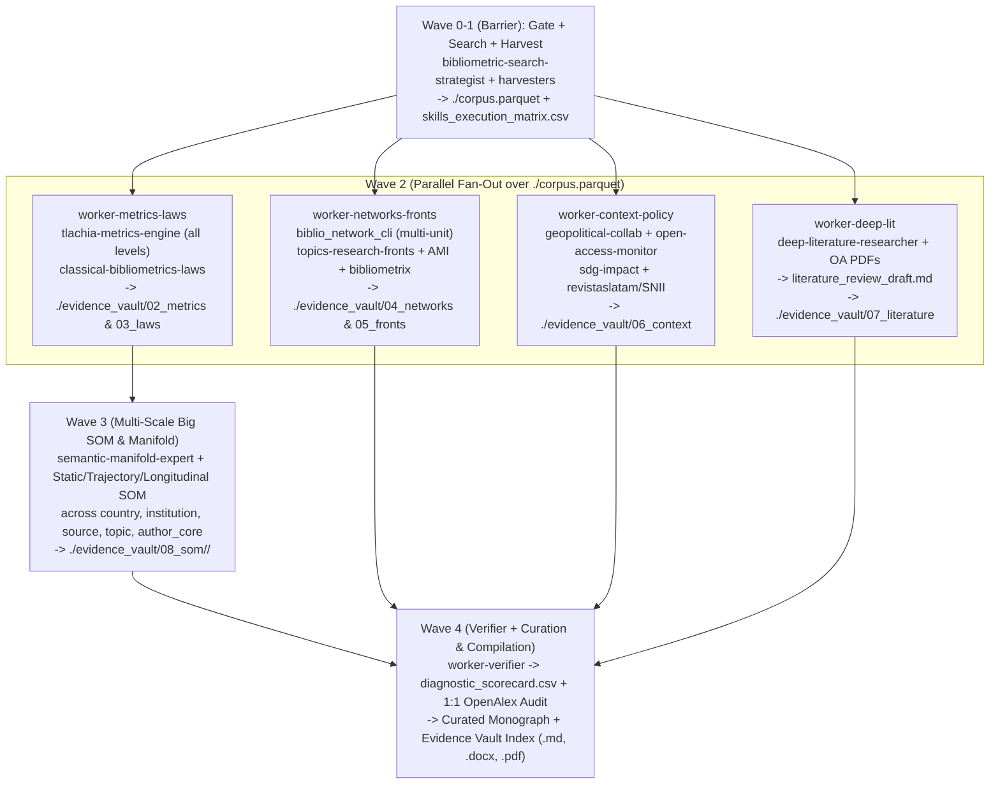

# Master Template: Exhaustive Multi-Scale Scientometric Study (38+ Skills · 4-Wave Swarm / Sequential Protocol)

> **Language Rule:** Respond and label outputs in the user's language (default to English for script plots/labels, or pass `--lang es` when the user interacts in Spanish).
> **Primary Portable Data Source:** All harvesting and verification defaults run autonomously on **OpenAlex** (`openalex-harvester` / `https://api.openalex.org`) and public APIs. When `CLICKHOUSE_HOST` or specialized local resources exist, see [`clickhouse_accelerator.md`](../bibliometric-search-strategist/references/clickhouse_accelerator.md).

Use this template for **special high-rigor studies** (comprehensive field monographs, doctoral state-of-the-art dossiers, multi-scale benchmarks) where the analyst should not pre-judge whether the strongest empirical signal lies at the **macro** (country), **meso** (institution/source), **micro** (author/core paper), or **intellectual** (front/topic) level.

---

## Stage 0: Capability & Scope Gate and Multi-Scale Budgets (`./evidence_vault/00_gate/`)

Before launching computation, audit scope and available infrastructure, and write `./evidence_vault/00_gate/skills_execution_matrix.csv` accounting for **every skill in the catalog** with status `QUEUED`, `SKIPPED_OUT_OF_SCOPE`, or `SKIPPED_MISSING_DEP` (never skip silently):

1. **Conditional Infrastructure & Scope Checks:**
   - **ClickHouse OpenAlex Snapshots (`CLICKHOUSE_HOST`):** Enables `openalex-search-engineer` (`rag.works_flat`) and, for Mexican scope, `openalex-mexico-clickhouse` (`rag.works_academic_all`).
   - **Mexican Academic Registries:** `snii-identity-resolver`, `infotlachia-scholar-intelligence` (`analytics_cache.duckdb`), `graphrag-scientific-intelligence` (768d Nomic + Neo4j/SNII) run only when study scope includes Mexico/SNII and resources are reachable.
   - **Ibero-American Journal Scope:** `revistaslatam-editorial-intelligence` and `revistaslatam-indicators-engine` run when evaluating Ibero-American journals / Latindex 2.0 / Diamond OA.
   - **External Packages & Keys:** `scopus-harvester` (`SCOPUS_API_KEY`), `bibliometrix-guide` (R + `bibliometrix`), `scientometrics-incites-expert` (InCites CSV export), `tlachia-metrics-handler` (`.zip` export), `knomap-project-resumer` (`.knoMap` archive).
2. **Critical-Mass Thresholds (`min_docs`) for Big SOM & Networks:**
   To avoid combinatorial explosion on long-tail noise (e.g., $10 \cdot N$ Big SOM over thousands of 1-paper authors), enforce critical-mass cutoffs per entity scale before training:
   - **Country (`country`):** `min_docs >= 5` (or Top 50 countries).
   - **Institution (`institution`):** `min_docs >= 3`–`5` (or Top 80–150 institutions).
   - **Journal / Source (`source`):** `min_docs >= 3`–`5` or Bradford Core + Zone 2.
   - **Author (`author`):** Restricted for SOM to Lotka core (`min_docs >= 3`–`5` or Top 60–100 authors), while retaining the full author universe for `classical-bibliometrics-laws lotka` and `gini-diversity`.
   - **Topic / Subfield / Front (`topic`, `subfield`, `front_id`):** `min_docs >= 3`–`5`.

---

## Execution Architecture: 4-Wave Swarm (`/teamwork`) or Sequential (`/goal`)

This template supports **Dual Mode**:
- **Swarm Mode (Recommended — `/teamwork` / `swarm`):** Uses `workspace: "inherit"` (zero duplication of `./corpus.parquet`) with **strict disjoint directory ownership** per worker (`./evidence_vault/<dir>/`). Workers NEVER post raw JSONs/tables to the board—only concise executive summaries and `*_run_manifest.json` paths.
- **Sequential Mode (`/goal`):** Runs the exact same waves and directory layout in a single conversation when quota conservation or single-agent environments apply.

---

## Wave-by-Wave Full Evidence-First Protocol

### Wave 1 — Delineation and Multi-Source Harvesting (`./evidence_vault/01_harvest/`)
- **Field Delineation:** [`bibliometric-search-strategist`](../bibliometric-search-strategist/SKILL.md) (Huang & Porter multi-stage blocks, *Pearl Growing* calibrated against canonical seeds, **GLOBAL (ISSI)** audit in `global_audit.md`).
- **Primary & Complementary Harvesters:** [`openalex-harvester`](../openalex-harvester/SKILL.md) into `./corpus.parquet`, optionally enriched/cross-checked with [`arxiv-harvester`](../arxiv-harvester/SKILL.md), [`pubmed-harvester`](../pubmed-harvester/SKILL.md), [`semantic-scholar-harvester`](../semantic-scholar-harvester/SKILL.md), [`scopus-harvester`](../scopus-harvester/SKILL.md), or ClickHouse (`openalex-search-engineer` / `openalex-mexico-clickhouse`).

### Wave 2 — 4 Parallel Analytical Branches

1. **`worker-metrics-laws` (`./evidence_vault/02_metrics/` & `./evidence_vault/03_laws/`):**
   - Run [`tlachia-metrics-engine`](../tlachia-metrics-engine/SKILL.md) without column truncation: `summary`, `gini-diversity`, and `by-entity` / `annual-series --cma-window 3` / `period-series` across **all active scales** (`country`, `institution`, `source`, `author`, `subfield`, `topic`).
   - Run [`classical-bibliometrics-laws`](../classical-bibliometrics-laws/SKILL.md) across all 4 laws: `growth-phase` (exponential vs. logistic with complete `annual_series`, `alpha`, `r`, `aic`, `rmse`), `lotka` (full vs. fractional + KS test), `bradford` (continuous zones), and `price-index`.

2. **`worker-networks-fronts` (`./evidence_vault/04_networks/` & `./evidence_vault/05_fronts/`):**
   - Run [`bibliometric-network-analyst`](../bibliometric-network-analyst/SKILL.md) across multiple units and relations:
     * Conceptual co-occurrence (`--unit keywords`),
     * Collaboration co-authorship (`--unit countries`, `--unit institutions`, `--unit authors`),
     * Source/work coupling + `sequential-networks` with inter-period AMI (`sequence_manifest.json`), persisting `*_network_<lang>.png` (300 DPI), `*_partition_eval.csv`, `*_partition_eval_<lang>.png`, Modularity $Q$, and `*_run_manifest.json`.
   - Run [`topics-research-fronts-intelligence`](../topics-research-fronts-intelligence/SKILL.md) / [`research-fronts-detection-expert`](../research-fronts-detection-expert/SKILL.md) comparing `coupling`, `cocitation`, `topics`, and `hybrid` (saving `fronts_network_{en,es}.png`, `fronts_partition_eval.csv`, `fronts_run_manifest.json`, and `track_longitudinal_lineages.py` outputs `ami_window_summary.csv`, `lineage_similarity_matrix.csv`, `alluvial_lineages_{en,es}.png`, `alluvial_lineages.html`).
   - If R + `bibliometrix` are present, run [`bibliometrix-guide`](../bibliometrix-guide/SKILL.md) for Callon's Strategic Diagram.

3. **`worker-context-policy` (`./evidence_vault/06_context/`):**
   - Run [`geopolitical-science-mapping`](../geopolitical-science-mapping/SKILL.md): [`geopolitical-collaboration-analyst`](../geopolitical-collaboration-analyst/SKILL.md) (ISO-3 matrix, Salton & Jaccard affinity, regional blocs, first/corresponding-author sovereignty), [`open-access-monitor`](../open-access-monitor/SKILL.md) (6 OA routes, commercial APC USD, diamond savings, transition trend), and [`sdg-impact-intelligence`](../sdg-impact-intelligence/SKILL.md) (SDGs 1–17).
   - Run conditional editorial/national skills when in scope: [`journal-editorial-intelligence`](../journal-editorial-intelligence/SKILL.md), [`revistaslatam-editorial-intelligence`](../revistaslatam-editorial-intelligence/SKILL.md), [`revistaslatam-indicators-engine`](../revistaslatam-indicators-engine/SKILL.md), [`snii-identity-resolver`](../snii-identity-resolver/SKILL.md), [`infotlachia-scholar-intelligence`](../infotlachia-scholar-intelligence/SKILL.md), [`graphrag-scientific-intelligence`](../graphrag-scientific-intelligence/SKILL.md).

4. **`worker-deep-lit` (`./evidence_vault/07_literature/`):**
   - Run [`deep-literature-researcher`](../deep-literature-researcher/SKILL.md) + [`open-access-pdf-downloader`](../open-access-pdf-downloader/SKILL.md) over canonical seeds and highest-centrality front papers (`--download-oa-pdfs --extract-text`).
   - Produce the grounded **Canonical Synthesis Matrix** (`N/A` if unstated) and the extended narrative State-of-the-Art draft **`literature_review_draft.md`** (`.docx`/`.pdf`), including the explicit separation between **Author-Signaled Future Work** and **Agent-Assessed Unexplored Paths**.

### Wave 3 — Multi-Scale Neurocomputational SOM & Manifold (`./evidence_vault/08_som/<scale>/`)
Run sequentially across critical-mass entity scales (`country`, `institution`, `source`, `topic`, and `author_core`) on 1–2 dedicated SOM workers to avoid GPU VRAM contention:
- [`semantic-manifold-expert`](../semantic-manifold-expert/SKILL.md): estimate local intrinsic dimension (MLE p95, TwoNN) and UMAP projection per scale.
- [`som-methodological-expert`](../som-methodological-expert/SKILL.md): train **Static Big SOM** (`--norm divmax --grid-type big --max-k 15`). Inspect `*_cluster_eval.csv/.png`; whenever global max Silhouette gives trivial $K=2$, audit local peaks ($K>2$) and also run zero-retrain `--recluster-from <som_state.json> --cluster-strategy local_max_gt2 --min-clusters 3`. Persist QE, TE, SVD ratio, `*_cluster_profiles.csv`, and `*_run_manifest.json`.
- [`som-trajectory-mapping`](../som-trajectory-mapping/SKILL.md): CMA-smoothed continuous trajectories (`<= 5` focal entities per focal group, Big SOM, `--norm divmax`, QE/TE, `*_cluster_eval.csv`).
- [`neural-longitudinal-mapping`](../neural-longitudinal-mapping/SKILL.md): Warm-Start period chaining (`prepare --norm divmax` $\to$ `train --grid-type big --max-k 15` $\to$ `analyze` $\to$ `report`) with per-period QE/TE, synaptic drift $\Delta W$, and Macro/Meso/Micro evolution.

### Wave 4 — Verification, Diagnostic Scorecard, and Two-Layer Deliverables (`./reportes/`)

1. **`worker-verifier` Audit Gate:**
   - Read all `*_run_manifest.json`, `*_cluster_eval.csv`, `*_partition_eval.csv`, `ami_window_summary.csv`, and `skills_execution_matrix.csv`.
   - Build **`./evidence_vault/diagnostic_scorecard.csv`** comparing every executed `(scale, method)` by quantitative diagnostic power ($R^2$, $Q$, $\text{AMI}$, $\text{Silhouette}$, $\text{QE}$, $\text{TE}$, coverage %), explicitly documenting **negative or degenerate runs** in `./reportes/exploration_log.md` to prevent selective reporting (*cherry-picking*).
   - Verify **1:1 OpenAlex Reference Alignment** across all cited works.
2. **Two-Layer Publication Output:**
   - **Layer 1 (`./evidence_vault/`):** Preserved, reproducible evidence repository covering all executed skills and entity scales.
   - **Layer 2 (`./reportes/estudio_exhaustivo_maestro.{md,docx,pdf}`):** Curated multi-scale monograph synthesizing **Macro (Global/Country) $\to$ Meso (Institutions/Journals) $\to$ Micro (Authors/Core Literature) $\to$ Intellectual & Neural Topology $\to$ Author Future Work vs. Unexplored Paths**, embedding selected 300 DPI PNGs and `N/D`-free numbered tables, plus an explicit **38-Skill Evidence Vault Appendix**. Export optionally to `.knoMap` via [`knomap-project-resumer`](../knomap-project-resumer/SKILL.md).
