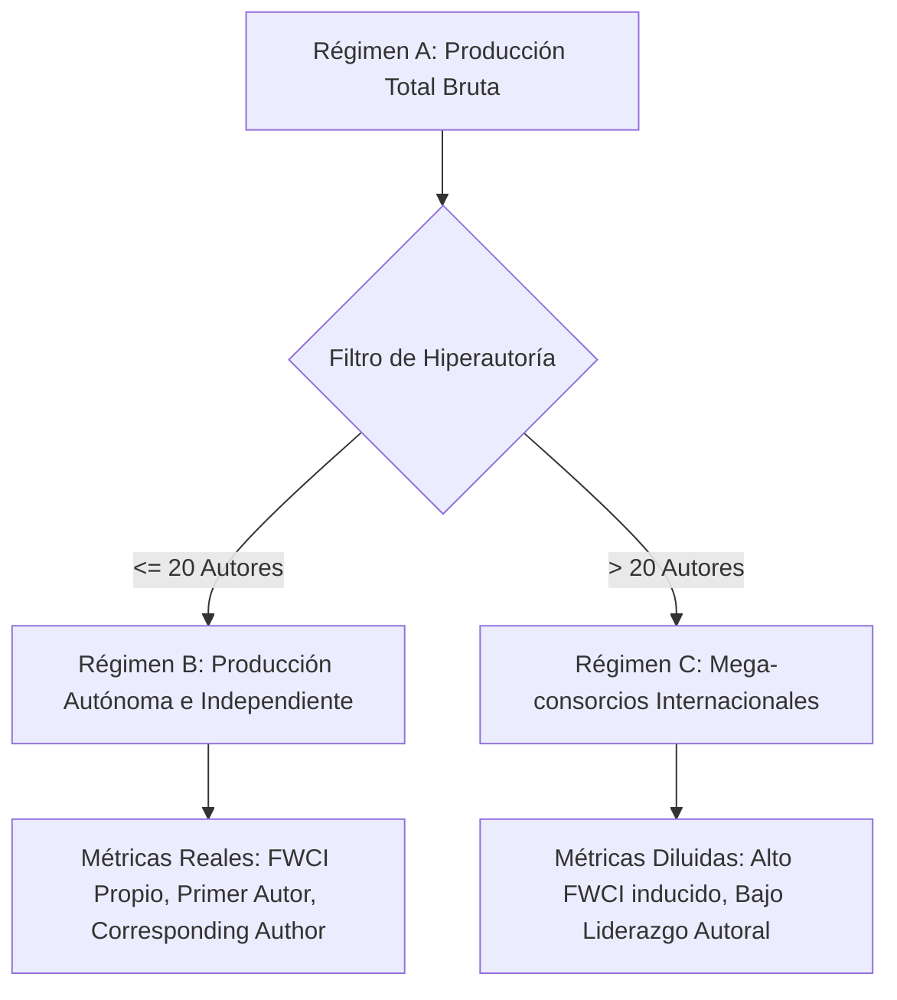

# Plantilla Maestra: Informe Técnico de Evaluación Institucional y Gobernanza Científica
### *Inspirada en el modelo de evaluación cienciométrica de dependencias UNAM (Instituto de Neurobiología / ICN / INCan)*

Esta plantilla está diseñada para que un **agente único** en LibreChat / `agentic-data-stack` elabore un **INFORME TÉCNICO DE EVALUACIÓN INSTITUCIONAL** de máxima autoridad para rectorías, direcciones de institutos, consejos técnicos y comités de política científica.

---

## Directivas Operativas para el Agente (Protocolo MCP)

Antes de redactar el informe, debes cosechar los datos cuantitativos mediante las herramientas MCP disponibles:
1. **Identidad Institucional y ROR:** Invocar `openalex_resolve_institution` o consultar `ClickHouse-OpenAlex` para la institución objetivo (ej. UNAM ROR: `01tmp8f25`) y filtrar por la dependencia específica (ej. *Instituto de Neurobiología*, *Campus Juriquilla*).
2. **Censo Claustro y Padrón SNII:** Invocar `sos_sinapsisai` (`query_snii_census_overview` / `resolve_snii_identity`) para cuantificar la distribución del personal académico por niveles (Candidato, 1, 2, 3, Emérito), antigüedad y áreas de conocimiento.
3. **Producción e Impacto Normalizado:** Invocar `sos_openalex` (`openalex_search_works`, `openalex_aggregate_mexico`) para extraer series temporales anuales de publicaciones, citas, FWCI y artículos en el decil Top 10%.
4. **Filtro de Hiperautoría Tripartito:** Desagregar la producción en:
   - *Régimen A:* Producción total bruta.
   - *Régimen B:* Producción autónoma e independiente ($\le 20$ autores por trabajo).
   - *Régimen C:* Mega-colaboraciones internacionales ($> 20$ autores por trabajo).
5. **Auditoría de Acceso Abierto y Gasto en APC:** Extraer la participación de las 6 vías de OA (Diamante, Gold APC, Híbrido, Bronce, Verde, Cerrado) y calcular el gasto comercial estimado en APC (USD).
6. **Visualizaciones Nativas:** Invocar `openalex_plot_timeseries` y `openalex_plot_oa_donut` o generar especificaciones Plotly.js / Mermaid para el panel de artefactos.

---

## Reglas Editoriales Estrictas

- **LENGUAJE MODERADO Y SOBRIO (PROHIBICIÓN DE SUPERLATIVOS):** Emplear un tono exclusivamente analítico, neutro y respaldado en cifras. Queda prohibido el uso de adjetivos superlativos o hiperbólicos (*"espectacular"*, *"revolucionario"*, *"sin precedentes"*, *"extraordinario"*, *"abrumador"*, *"pionero"*). Sustituir siempre por métricas precisas.
- **ZERO-SCAFFOLDING LEAKAGE:** No mencionar nombres de herramientas MCP, prompts, tokens ni mecánicas del chat. El documento debe leerse como un informe oficial elaborado por especialistas en cienciometría institucional.
- **TABLAS EN EL CHAT:** Todas las tablas estructuradas (Tablas 1, 2, 3 y 4) deben desplegarse en Markdown directamente en el cuerpo del texto.

---

# [Título Oficial del Informe: Evaluación Cienciométrica Integral y Diagnóstico Estratégico de [Nombre de la Institución/Dependencia], Periodo [Año Inicio – Año Fin]]

## 1. RESUMEN EJECUTIVO Y DIAGNÓSTICO SITUACIONAL
- **1.1. Diagnóstico de Alto Nivel:**
  * Síntesis ejecutiva del posicionamiento institucional, volumen global de producción, impacto normalizado (FWCI institucional) y nivel de inserción en el sistema científico nacional e internacional.
  * Identificación de las principales tensiones estructurales detectadas (ej. asimetría entre volumen e impacto autónomo, concentración de liderazgo, fuga financiera en cuotas de publicación).
- **1.2. Semáforo de Desempeño Institucional:**
  * Presentar la **Tabla 1: Semáforo de Desempeño Institucional** evaluando los indicadores críticos en tres estados normativos:
    - **Verde:** Desempeño óptimo / por encima de la media de referencia.
    - **Amarillo:** Alerta preventiva / vulnerabilidad moderada.
    - **Rojo:** Riesgo crítico / requiere intervención correctiva inmediata.

| Indicador Institucional | Valor Actual | Benchmark de Referencia (UNAM / Nacional) | Estado (Semáforo) | Diagnóstico Operativo |
| :--- | :--- | :--- | :--- | :--- |
| **Producción Bruta Anual** | [X] trabajos/año | [X] trabajos/año | 🟢 / 🟡 / 🔴 | [Evaluación concisa] |
| **FWCI Autónomo (Régimen B $\le 20$ aut)** | [X.XX] | 1.00 (Media mundial) / [X.XX] (Media UNAM) | 🟢 / 🟡 / 🔴 | [Evaluación concisa] |
| **Tasa de Primer Autor Institucional** | [XX.X]% | [XX.X]% | 🟢 / 🟡 / 🔴 | [Evaluación concisa] |
| **Tasa de Autor de Correspondencia** | [XX.X]% | [XX.X]% | 🟢 / 🟡 / 🔴 | [Evaluación concisa] |
| **Publicaciones en Decil Superior (Top 10%)** | [XX.X]% | 10.0% (Esperado global) | 🟢 / 🟡 / 🔴 | [Evaluación concisa] |
| **Cuota de Acceso Abierto Diamante** | [XX.X]% | [XX.X]% | 🟢 / 🟡 / 🔴 | [Evaluación concisa] |
| **Gasto Estimado en APC Comercial** | $[XXX,XXX] USD | Baseline histórico | 🟢 / 🟡 / 🔴 | [Evaluación concisa] |
| **Masa Crítica en SNII (Nivel 2, 3 y Eméritos)** | [XX.X]% | [XX.X]% | 🟢 / 🟡 / 🔴 | [Evaluación concisa] |

- **1.3. Benchmarking de Evaluaciones Previas y Pares Comparables:**
  * Contraste con ejercicios de evaluación previos y dependencias homólogas (ej. contrastar INB con ICN, IFC, INCan u otros centros del subsistema de investigación científica).

---

## 2. ANÁLISIS TRIPARTITO OBLIGATORIO DE LA PRODUCCIÓN Y FILTRO DE HIPERAUTORÍA
*El aislamiento del sesgo inducido por mega-colaboraciones internacionales (Big Science) es un mandato metodológico estricto para medir la verdadera capacidad científica instalada de la institución.*

- **2.1. Arquitectura Metodológica del Filtro Tripartito:**
  * Justificación matemática y epistemológica de la partición: demostrar por qué computar papers de 1,000 o 3,000 autores en consorcios globales distorsiona el FWCI institucional y oculta la productividad autónoma.
  * **Diagrama de Flujo del Análisis Tripartito (Mermaid Obligatorio):**

- **2.2. Desglose Cuantitativo y Comparativa de Impacto:**
  * Presentar la **Tabla 2: Desglose Tripartito de la Producción Institucional**:

| Régimen Analítico | Criterio de Inclusión | Volumen de Trabajos (N) | Participación (%) | Citas Totales | FWCI Promedio | % Top 10% | Tasa Primer Autor (%) | Tasa Corresp. Author (%) |
| :--- | :--- | :--- | :--- | :--- | :--- | :--- | :--- | :--- |
| **Régimen A (Total Bruto)** | Todos los trabajos con filiación institucional | [N] | 100.0% | [N] | [X.XX] | [XX.X]% | [XX.X]% | [XX.X]% |
| **Régimen B (Autónomo)** | Trabajos con $\le 20$ autores | [N] | [XX.X]% | [N] | [X.XX] | [XX.X]% | [XX.X]% | [XX.X]% |
| **Régimen C (Mega-consorcios)** | Trabajos con $> 20$ autores | [N] | [XX.X]% | [N] | [X.XX] | [XX.X]% | [XX.X]% | [XX.X]% |

- **2.3. Diagnóstico del Desbalance de Autonomía:**
  * Análisis de la brecha entre el Régimen B y el Régimen C: cuantificar el grado en que el impacto de la institución depende de su inserción pasiva en consorcios externos frente a su capacidad de generación de conocimiento endógeno.

---

## 3. BATERÍA DE INDICADORES DE LIDERAZGO E IMPACTO NORMALIZADO

- **3.1. Soberanía Epistémica y Autoría de Liderazgo:**
  * **Tasa de Primer Autor Institucional (% First Author):** Mide la capacidad de formular y conducir empíricamente las investigaciones.
  * **Tasa de Autor de Correspondencia Institucional (% Corresponding Author):** Indicador crítico de responsabilidad intelectual, tutoría principal, financiamiento y conducción del proyecto.
  * Análisis de asimetrías de liderazgo en colaboraciones bilaterales (Norte Global vs. Sur Global).
- **3.2. Visibilidad y Excelencia:**
  * Distribución por cuartiles Scimago/JCR (proporción en Q1 y Q2).
  * Volumen y tasa de trabajos situados en el decil superior de impacto mundial (Top 10%).
- **3.3. Especialización Temática y Desbalance de Actividad:**
  * Descomposición entre el Índice de Actividad ($AI$) y la participación temática ($DShareC$ vs. $CShareD$).
  * Identificación de las líneas troncales dominantes frente a áreas emergentes sub-representadas.

---

## 4. AUDITORÍA DE LAS 6 VÍAS DE ACCESO ABIERTO Y FUGA DE CAPITAL EN APC (USD)

- **4.1. Distribución Integral por las 6 Vías de Publicación:**
  * Presentar la **Tabla 3: Auditoría de Acceso Abierto y Costos de Publicación**:

| Vía de Acceso Abierto | Definición Operativa | Artículos (N) | Porcentaje (%) | Gasto Unitario Estimado (USD) | Gasto Acumulado Estimado (USD) |
| :--- | :--- | :--- | :--- | :--- | :--- |
| **Diamante (Diamond)** | Publicación abierta sin cobro de APC a autores ni lectores | [N] | [XX.X]% | $0 USD | $0 USD |
| **Dorada Comercial (Gold APC)** | Revistas 100% de acceso abierto con cobro de cuota APC | [N] | [XX.X]% | $[X,XXX] USD | $[XXX,XXX] USD |
| **Híbrida (Hybrid)** | Revistas de suscripción tradicional con pago de APC para liberar artículo | [N] | [XX.X]% | $[X,XXX] USD | $[XXX,XXX] USD |
| **Bronce (Bronze)** | Artículos de libre lectura en la web editorial sin licencia formal abierta | [N] | [XX.X]% | $0 USD | $0 USD |
| **Verde (Green / Repositorio)** | Autoarchivo en repositorios institucionales o temáticos (arXiv, etc.) | [N] | [XX.X]% | $0 USD | $0 USD |
| **Cerrada (Closed)** | Acceso restringido tras muro de pago (paywall) comercial | [N] | [XX.X]% | $0 USD | $0 USD |
| **TOTAL** | — | **[N]** | **100.0%** | — | **$[XXX,XXX] USD** |

- **4.2. Estimación de Fuga Financiera y Concentración Oligopólica:**
  * Análisis del monto total transferido desde presupuestos públicos/universitarios hacia las grandes corporaciones editoriales (Elsevier, Springer-Nature, Wiley, Frontiers, MDPI).
  * Costo promedio por artículo publicado con cobro de APC.
- **4.3. Estrategia de Transición hacia la Soberanía Diamante:**
  * Potencial de fortalecimiento de revistas académicas regionales e institucionales libres de cobro (vía Diamante y repositorios verdes institucionales).

---

## 5. DINÁMICA DEL CLAUSTRO, PADRÓN SNII Y RIESGOS GENERACIONALES

- **5.1. Estructura y Composición en el Padrón SNII:**
  * Distribución del claustro de investigadores adscritos por niveles (Candidato, Nivel 1, Nivel 2, Nivel 3 y Emérito) a partir del censo oficial de `sos_sinapsisai`.
  * Ratio de masa crítica senior (Nivel 2 + Nivel 3 + Eméritos) respecto a investigadores en consolidación (Candidato + Nivel 1).
- **5.2. Envejecimiento de Líneas y Relevo Generacional:**
  * Análisis de la concentración de la producción científica en cohortes históricas consolidadas.
  * Tasa de inserción de nuevas plazas académicas y retención de talento joven.
- **5.3. Obsolescencia Temática e Inserción en Frentes Emergentes:**
  * Identificación de líneas de investigación consolidadas en fase de maduración o declive frente a la tasa de participación en frentes de investigación emergentes (*Research Fronts* con dinámicas aceleradas).

---

## 6. MATRIZ OPERATIVA DE RECOMENDACIONES DE POLÍTICA CIENTÍFICA

Presentar la **Tabla 4: Matriz de Recomendaciones Accionables para los Órganos de Gobierno Institucional**:

| Horizonte Temporal | Línea Estratégica | Acción Concreta | Órgano Responsable | Métrica de Verificación / Impacto |
| :--- | :--- | :--- | :--- | :--- |
| **Corto Plazo (1 Año)** | *Gobernanza Financiera y APC* | Regular el subsidio institucional a cuotas APC comerciales e incentivar la vía Diamante y repositorios verdes. | Dirección / Secretaría Administrativa | Reducción del [XX]% en fuga financiera por APC en USD. |
| **Corto Plazo (1 Año)** | *Soberanía de Autoría* | Establecer lineamientos para asegurar la autoría de correspondencia en convenios de colaboración internacional. | Consejo Técnico / Coordinación | Incremento de [X]% en la tasa de autor de correspondencia institucional. |
| **Mediano Plazo (3 Años)** | *Relevo Generacional* | Convocatorias de atracción de talento dirigidas prioritariamente a frentes emergentes desatendidos. | Comisión Dictaminadora / Consejo Técnico | Incorporación de [N] investigadores en áreas de frontera tecnológica. |
| **Mediano Plazo (3 Años)** | *Impacto Autónomo* | Fondo especial de apoyo a proyectos de investigación donde el liderazgo intelectual recaiga en la institución. | Consejo Asesor de Investigación | Aumento del FWCI en el Régimen B (Autónomo) a un mínimo de [X.XX]. |
| **Largo Plazo (5 Años)** | *Reestructuración Estratégica* | Fusión o reconversión de laboratorios y líneas con agotamiento temático hacia áreas multidisciplinarias de frontera. | Dirección y H. Consejo Técnico | Posicionamiento del [XX]% de la producción en el Top 10% mundial. |

---

## ANEXOS Y FUENTES AUDITABLES
- **Relación de Fuentes y Catálogos Consultados:**
  * Base de datos OpenAlex México en ClickHouse (Filtro institucional ROR: `01tmp8f25`).
  * Padrón Oficial SNII 2026 y Padrón Histórico 1984–2026 vía `sos_sinapsisai`.
  * Motor analítico de indicadores cienciométricos `sos_plmetrix`.
- **Trazabilidad y Reproducibilidad:**
  * Parámetros de consulta SQL y criterios de normalización de variantes toponímicas e institucionales.
