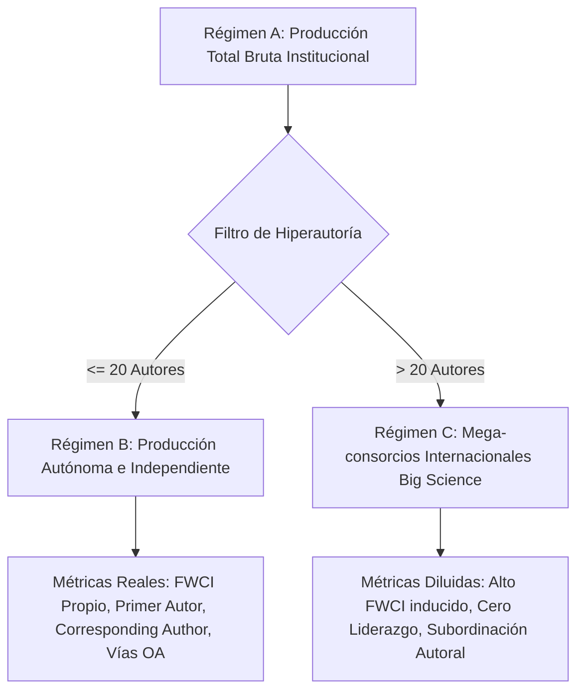

# Plantilla Maestra: Informe Técnico de Evaluación Institucional, Gobernanza Científica y Diagnóstico Multidimensional SOM
### *Inspirada en el modelo de evaluación cienciométrica de dependencias UNAM (Instituto de Neurobiología / ICN / INCan)*

Esta plantilla está diseñada para que un **agente único** en LibreChat / `agentic-data-stack` o entornos de automatización elabore un **INFORME TÉCNICO DE EVALUACIÓN INSTITUCIONAL** de máxima autoridad para rectorías, direcciones de institutos, consejos técnicos y comités de política científica.

Integra rigurosamente el **marco neurocomputacional de análisis multidimensional de perfiles de desempeño basado en Mapas Autoorganizados de Kohonen (SOM)** (Carrillo-Calvet, Jiménez-Andrade & Arencibia-Jorge, 2025; Villaseñor-García et al., 2017) para superar la falacia y el reduccionismo de los rankings unidimensionales (*pesar y sumar*), evaluando a la institución **únicamente frente a sus pares legítimos**.

---

## Directivas Operativas para el Agente (Protocolo MCP Real)

Antes de redactar el informe, debes cosechar los datos cuantitativos mediante las herramientas MCP disponibles:

1. **Identidad Institucional y Catálogo ROR:**
   - Invocar `sos_openalex` (`openalex_get_institution`) o consultar en `ClickHouse-OpenAlex` sobre `rag.institutions_seed_mexico` para resolver el código canónico ROR (ej. UNAM: `https://ror.org/01tmp8f25`) y variantes de la dependencia (ej. *Instituto de Neurobiología*, *Campus Juriquilla*).
2. **Censo del Claustro y Padrón Oficial SNII:**
   - Invocar `sos_sinapsisai` (`query_snii_census_overview`, `resolve_snii_identity`) para cuantificar la masa crítica del personal académico por niveles (Candidato, 1, 2, 3, Emérito), antigüedad y áreas de conocimiento.
3. **Producción e Impacto Normalizado (CERO JOINs):**
   - Invocar `sos_openalex` (`openalex_search_works`, `openalex_aggregate_mexico`) o consultar `rag.works_academic_all` en `ClickHouse-OpenAlex` filtrando con `has(institution_rors, 'https://ror.org/01tmp8f25')`. Extraer series anuales de publicaciones, citas, FWCI y artículos en el decil Top 10%.
4. **Filtro de Hiperautoría Tripartito Obligatorio:**
   - Desagregar la producción mediante `length(author_names)` (no existe columna `authors_count`):
     * *Régimen A (Total Bruto):* Todo el volumen institucional sin filtro.
     * *Régimen B (Producción Autónoma):* Trabajos con $\le 20$ autores.
     * *Régimen C (Mega-consorcios):* Trabajos con $> 20$ autores (Big Science).
5. **Auditoría de Acceso Abierto y Fuga en APC:**
   - Filtrar por `oa_status` en las 6 vías canónicas: Diamante (*diamond*), Gold APC (*gold*), Híbrida (*hybrid*), Bronce (*bronze*), Verde (*green*) y Cerrada (*closed*). Computar el gasto estimado en cuotas APC comerciales en USD a partir de `apc_paid_usd` y `apc_list_usd`.
6. **Modelado Multidimensional con Redes Neuronales SOM (`sos_knomap`):**
   - Invocar `sos_knomap`:
     * `suggest_grid_size`: Obtener el ratio de aspecto espectral SVD ($\sigma_1 / \sigma_2$) y la sobremalla óptima ($20N-30N$).
     * `train_som`: Entrenar sobre la matriz normalizada de instituciones homólogas con topología hexagonal, inicialización PCA y convergencia batch.
     * `evaluate_som_clusters`: Evaluar la partición en dos etapas (Vesanto & Alhoniemi, 2000) mediante el coeficiente Silhouette ($s$).
     * `knomap_render_som_dashboard`: Renderizar el panel interactivo oficial con la Tríada Visual LabSOM.
7. **Generación de Artefactos para el Panel Lateral de LibreChat:**
   - Cuando uses las herramientas nativas de visualización de `sos_openalex` (`openalex_plot_timeseries`, `openalex_plot_oa_donut`, `openalex_plot_top_ranking`, `openalex_plot_quadrant_matrix`, etc.), envuelve el HTML dentro del bloque de artefacto:
     ```markdown
     :::artifact{identifier="grafica-institucional" type="text/html" title="Título de la Gráfica"}
     [html_content retornado por la herramienta]
     :::
     ```
8. **Empaquetado de Material Suplementario y Trazabilidad Institucional:**
   - Para que el informe sea auditable por órganos de gobierno (Consejo Técnico, Dirección, Comisiones Dictaminadoras), el agente DEBE generar en `./scripts/` o `./supplementary/`:
     * `01_extract_institutional_data.py`: Script con las sentencias SQL exactas sobre ClickHouse (ROR institucional, filtro de dependencia, partición tripartita $\le 20$ autores y cálculo de APC en USD).
     * `02_som_institutional_evaluation.py`: Script con la matriz de pares comparables y llamada a `train_som(output_state_path="supplementary/som_state.json", indicator_names=[...])` con semilla fija.
     * `som_institutional_state.json`: Estado persistido del SOM institucional.

---

## Disponibilidad de Datos y Reglas Anti-Fabricación (Verificadas contra el Corpus y las Herramientas)

**Columnas reales de `rag.works_academic_all`** (usar solo estas; no inventar nombres): `publication_year`, `cited_by_count`, `is_oa`, `oa_status` (valores: `closed`, `green`, `diamond`, `gold`, `bronze`, `hybrid`), `fwci`, `percentile`, `is_top_10`, `is_top_1`, `author_names`, `institution_rors`, `institution_names`, `country_code`, `all_country_codes`, `domain`, `field`, `subfield`, `topic`, `sdg_ids`, `apc_paid_usd`, `apc_list_usd`, `is_doaj_journal`, `is_core_journal`, `counts_by_year`.

1. **Número de autores:** no existe columna `authors_count`; usar `length(author_names)`.
2. **APC:** no existe `apc_usd`; usar `apc_paid_usd` (pagado) y `apc_list_usd` (precio de lista), indicando cuál se reporta.
3. **Primer autor y autor de correspondencia:** NO son columnas; solo existen dentro del JSON de `raw_data`. Si no se extraen de `raw_data` (consulta costosa, acotada a una sola entidad y sin JOINs), reportar `N/D (no disponible en el corpus)` en las celdas correspondientes y consignarlo como limitación. Nunca estimarlos ni completarlos con cifras plausibles.
4. **Cuartiles Q1/Q2 y colaboración con industria:** no existen en el corpus. No incluirlos como indicador calculado; si se mencionan, marcar `N/D`. Como proxies disponibles: `is_core_journal`, `is_doaj_journal`, `is_top_10`, `is_top_1`.
5. **Dependencias dentro de una institución (ej. Instituto de Neurobiología dentro de la UNAM):** el ROR solo identifica a la institución matriz. Para aislar una dependencia filtrar por `institution_names` con coincidencia insensible a mayúsculas y diacríticos, y declarar que el filtro es aproximado y puede subcontar variantes toponímicas.
6. **Coseno de Salton:** el índice que devuelve `get_geopolitical_collaboration_matrix` es una aproximación (usa un denominador proxy). Recalcular $S_{ij} = C_{ij}/\sqrt{C_i C_j}$ a partir de los conteos de coautoría ($C_{ij}$, $C_i$, $C_j$) y reportar el valor recalculado; si no es posible, rotular el índice como *aproximado*.
7. **Detección de quiebres (CUSUM / Pettitt):** no existe herramienta para ello. Calcularlos a partir de la serie anual extraída (declarando método y estadístico), o acotar los periodos con `analyze_scientific_growth_phases`; no atribuir a una herramienta resultados que no produce. La partición modular disponible es Louvain (`detect_louvain_communities`), no Leiden.
8. **Modo contingencia (`status: "fallback"`):** `train_som`, `evaluate_som_clusters` y `recluster_som` devuelven valores sintéticos (error de cuantización fijo, clusters y BMU ficticios) cuando el motor no está disponible. Si algún resultado trae `status: "fallback"`, NO usarlo para conclusiones: informar que el modelado SOM no pudo ejecutarse y limitar el análisis a lo no-SOM.
9. **Persistencia y Dashboard del SOM:** `train_som` cuenta con el parámetro `output_state_path` (ej. `output_state_path="/tmp/som_state.json"`) e `indicator_names`. Para generar el dashboard interactivo oficial con `knomap_render_som_dashboard`, se debe indicar `output_state_path` al invocar `train_som` y pasar esa misma ruta a `knomap_render_som_dashboard(som_state_path=...)`. Si el motor no está disponible, la herramienta devuelve `status: "error"` con la causa raíz; nunca inventar métricas ni volcar matrices numéricas completas de pesos en el cuerpo del texto.
10. **Matriz de entrada del SOM:** construirla solo con indicadores realmente calculados y estandarizados (z-score); las dimensiones `N/D` se excluyen del vector, no se rellenan.

---

## Reglas Editoriales Estrictas

- **LENGUAJE MODERADO Y SOBRIO (PROHIBICIÓN ABSOLUTA DE SUPERLATIVOS):** Emplear un tono exclusivamente analítico, neutro y respaldado en cifras empíricas. Queda terminantemente prohibido el uso de adjetivos hiperbólicos (*"espectacular"*, *"revolucionario"*, *"sin precedentes"*, *"extraordinario"*, *"abrumador"*, *"pionero"*, *"asombroso"*). Sustituir siempre por métricas cuantitativas precisas.
- **ZERO-SCAFFOLDING LEAKAGE:** No mencionar nombres de herramientas MCP, prompts, tokens, bases de datos ni mecánicas del chat. El documento debe leerse como un informe oficial elaborado por especialistas en cienciometría institucional.
- **TABLAS ESTRUCTURADAS EN EL TEXTO:** Todas las tablas canónicas (Tablas 1, 2, 3, 4 y 5) deben desplegarse íntegramente en Markdown en el cuerpo del documento.

---

# [Título Oficial: Evaluación Cienciométrica Integral, Diagnóstico Multidimensional SOM y Gobernanza Científica de [Nombre de la Institución/Dependencia], Periodo [Año Inicio – Año Fin]]

## 1. RESUMEN EJECUTIVO Y DIAGNÓSTICO SITUACIONAL

- **1.1. Diagnóstico de Alto Nivel:**
  * Síntesis ejecutiva del posicionamiento institucional, volumen global de producción, impacto normalizado (FWCI institucional) y nivel de inserción en el sistema científico nacional e internacional.
  * Identificación de las principales tensiones estructurales detectadas: asimetría entre volumen e impacto autónomo, concentración de liderazgo autoral, fuga financiera en cuotas de publicación y relevo generacional del claustro.
- **1.2. Semáforo de Desempeño Institucional:**
  * Presentar la **Tabla 1: Semáforo de Desempeño Institucional** evaluando los indicadores críticos en tres estados normativos:
    - **Verde (🟢):** Desempeño óptimo / por encima de la media de referencia.
    - **Amarillo (🟡):** Alerta preventiva / vulnerabilidad moderada.
    - **Rojo (🔴):** Riesgo crítico / requiere intervención correctiva inmediata.

| Indicador Institucional | Valor Actual | Benchmark de Referencia (UNAM / Nacional / Mundial) | Estado (Semáforo) | Diagnóstico Operativo |
| :--- | :--- | :--- | :--- | :--- |
| **Producción Bruta Anual** | [X] trabajos/año | [X] trabajos/año | 🟢 / 🟡 / 🔴 | [Evaluación concisa basada en evidencia] |
| **FWCI Autónomo (Régimen B $\le 20$ aut)** | [X.XX] | 1.00 (Mundial) / [X.XX] (Media UNAM) | 🟢 / 🟡 / 🔴 | [Evaluación concisa basada en evidencia] |
| **Tasa de Primer Autor Institucional** | [XX.X]% | [XX.X]% (Media nacional) | 🟢 / 🟡 / 🔴 | [Evaluación concisa basada en evidencia] |
| **Tasa de Autor de Correspondencia** | [XX.X]% | [XX.X]% (Media nacional) | 🟢 / 🟡 / 🔴 | [Evaluación concisa basada en evidencia] |
| **Publicaciones en Decil Superior (Top 10%)** | [XX.X]% | 10.0% (Esperado global) | 🟢 / 🟡 / 🔴 | [Evaluación concisa basada en evidencia] |
| **Cuota de Acceso Abierto Diamante** | [XX.X]% | [XX.X]% (Referencia Iberoamericana) | 🟢 / 🟡 / 🔴 | [Evaluación concisa basada en evidencia] |
| **Gasto Estimado en APC Comercial** | $[XXX,XXX] USD | Baseline histórico institucional | 🟢 / 🟡 / 🔴 | [Evaluación concisa basada en evidencia] |
| **Masa Crítica en SNII (Nivel 2, 3 y Eméritos)** | [XX.X]% | [XX.X]% (Media del subsistema) | 🟢 / 🟡 / 🔴 | [Evaluación concisa basada en evidencia] |

- **1.3. Benchmarking de Evaluaciones Previas y Dependencias Homólogas:**
  * Contraste histórico con periodos anteriores y dependencias homólogas del subsistema científico (ej. contrastar INB con IFC, ICN, INCan o centros de biomedicina/neurociencias).

---

## 2. ANÁLISIS TRIPARTITO OBLIGATORIO DE LA PRODUCCIÓN Y FILTRO DE HIPERAUTORÍA

*El aislamiento del sesgo inducido por mega-consorcios internacionales (Big Science) es un mandato metodológico estricto para medir la verdadera capacidad científica instalada y la productividad autónoma de la institución.*

- **2.1. Justificación Matemática y Epistemológica del Filtro Tripartito:**
  * Demostración analítica de por qué computar artículos de 1,000 a 3,000 autores en consorcios globales infla artificialmente el FWCI y la tasa de citación institucional, ocultando la realidad del impacto generado por el claustro propio.
- **2.2. Diagrama de Flujo del Análisis Tripartito (Mermaid Obligatorio):**



- **2.3. Desglose Cuantitativo y Comparativa de Impacto:**
  * Presentar la **Tabla 2: Desglose Tripartito de la Producción Institucional**:

| Régimen Analítico | Criterio de Inclusión | Volumen de Trabajos (N) | Participación (%) | Citas Totales | FWCI Promedio | % Top 10% | Tasa Primer Autor (%) | Tasa Corresp. Author (%) |
| :--- | :--- | :--- | :--- | :--- | :--- | :--- | :--- | :--- |
| **Régimen A (Total Bruto)** | Todos los trabajos con filiación institucional | [N] | 100.0% | [N] | [X.XX] | [XX.X]% | [XX.X]% | [XX.X]% |
| **Régimen B (Autónomo)** | Trabajos con $\le 20$ autores | [N] | [XX.X]% | [N] | [X.XX] | [XX.X]% | [XX.X]% | [XX.X]% |
| **Régimen C (Mega-consorcios)** | Trabajos con $> 20$ autores | [N] | [XX.X]% | [N] | [X.XX] | [XX.X]% | [XX.X]% | [XX.X]% |

- **2.4. Diagnóstico del Desbalance de Autonomía:**
  * Cuantificación del grado de dependencia del impacto institucional frente a mega-consorcios externos versus la solidez de la producción autónoma endógena.

---

## 3. ANÁLISIS MULTIDIMENSIONAL DE PERFILES DE RENDIMIENTO CON REDES SOM (KOHONEN)

*Superación metodológica de los rankings unidimensionales mediante mapeo neurocomputacional en el espacio de estados (Carrillo-Calvet, Jiménez-Andrade & Arencibia-Jorge, 2025; Villaseñor-García et al., 2017).*

- **3.1. Fundamentación Epistemológica: Superación de la Falacia del "Pesar y Sumar":**
  * Los rankings comerciales (ARWU, QS, THE) colapsan indicadores disímiles en un único escalar mediante ponderaciones arbitrarias, enmascarando misiones diferenciadas y castigando la diversidad académica.
  * Modelado de cada dependencia como un vector en un espacio abstracto $\mathbb{R}^D$ definido por 8 dimensiones cardinales normalizadas: 1) Volumen, 2) FWCI Régimen B, 3) % Top 10%, 4) % Top 1%, 5) % Colaboración Internacional (derivable de `all_country_codes`), 6) % Acceso Abierto Diamante, 7) % Acceso Abierto total (`is_oa`) y 8) % en revistas núcleo/DOAJ (`is_core_journal`, `is_doaj_journal`).
- **3.2. Parámetros de Calibración Neurocomputacional:**
  * **Relación de Aspecto Espectral SVD:** Proporción de la retícula ajustada a $\sigma_1 / \sigma_2$ para preservar la dispersión principal de los datos.
  * **Sobremalla Empírica:** Retícula hexagonal *flat-topped* dimensionada con $M \approx 20N\text{--}30N$ neuronas (o Big SOM $\ge 10N$), garantizando una representación cuasi-continua del espacio de estados.
  * **Algoritmo de Aprendizaje:** Inicialización PCA sobre los primeros dos componentes principales, decrecimiento monótono del radio de vecindad ($\sigma_0 \to 1.0$) y tasa de aprendizaje ($\alpha_0 \to 0.01$).
- **3.3. Interpretación de la Tríada Visual LabSOM:**
  * **1. U-Matrix (Matriz de Distancias Unificadas):** Distancias euclidianas interneuronales con convención cromática canónica:
    - *Valles Rojos:* Zonas de distancias mínimas $\rightarrow$ alta densidad de datos (núcleos de clusters homogéneos).
    - *Crestas Amarillas:* Saltos bruscos en los pesos $\rightarrow$ barreras topológicas y fronteras entre familias de dependencias.
  * **2. Mapas de Componentes (Component Planes):** $D$ planos alineados espacialmente con paleta divergente LabSOM:
    - *Verde:* Desempeño inferior a la media del subsistema.
    - *Amarillo:* Nivel promedio de referencia.
    - *Rojo:* Desempeño sobresaliente (> media).
    - *Diagnóstico de Compensación:* Identificación de cuadrantes donde coexisten componentes rojos y verdes (ej. alto FWCI pero baja colaboración industrial).
  * **3. Meta-clustering en Dos Etapas (Vesanto & Alhoniemi, 2000):** Agrupamiento jerárquico aglomerativo sobre los vectores de pesos $W \in \mathbb{R}^{M \times D}$, optimizado con el coeficiente Silhouette máximo ($s^*$).
- **3.4. Diagnóstico de Pares Comparables y Polos de Excelencia:**
  * Presentar la **Tabla 3: Caracterización de Pares Comparables y Perfil Cualitativo en el SOM**:

| Cluster SOM ($K^*$) | Dependencias / Instituciones Miembros | Perfil Cualitativo Dominante | Fortalezas Cardinales (Zonas Rojas) | Vulnerabilidades (Zonas Verdes) | Posición de la Institución Evaluada |
| :--- | :--- | :--- | :--- | :--- | :--- |
| **Cluster 1 (Polo Élite)** | [Institución A, Institución B, ...] | Alta excelencia, alto FWCI autónomo y fuerte inserción en revistas núcleo | FWCI, % Top 10%, % Top 1% | Colaboración internacional | [Pertenencia / Distancia al BMU] |
| **Cluster 2 (Orientación Social / Diamante)** | [Institución C, Institución D, ...] | Fuerte impacto regional, liderazgo autoral y vía Diamante | % Primer Autor, OA Diamante | Presencia en revistas de corriente principal | [Pertenencia / Distancia al BMU] |
| **Cluster 3 (Intensivo en Volumen)** | [Institución E, Institución F, ...] | Elevada masa crítica de papers con impacto normalizado medio | Volumen de producción bruta | FWCI autónomo Régimen B | [Pertenencia / Distancia al BMU] |
| **Perfiles Singulares ($|C_k|=1$)** | [Institución Aislada] | Especialización hiperfocalizada o nicho metodológico atípico | [Indicador singular] | [Indicador deprimido] | [Pertenencia / Distancia al BMU] |

---

## 4. BATERÍA DE INDICADORES DE LIDERAZGO E IMPACTO NORMALIZADO

- **4.1. Soberanía Epistémica y Liderazgo de Autoría:**
  * **Tasa de Primer Autor Institucional (% First Author):** Capacidad del personal de formular y ejecutar empíricamente las investigaciones.
  * **Tasa de Autor de Correspondencia (% Corresponding Author):** Responsabilidad intelectual directa, tutoría principal, obtención de financiamiento y conducción de los proyectos.
  * Análisis de asimetrías de liderazgo en colaboraciones internacionales (Sur Global vs. Norte Global).
- **4.2. Visibilidad y Excelencia:**
  * Proporción en revistas núcleo y DOAJ (`is_core_journal`, `is_doaj_journal`); los cuartiles Scimago/JCR no están en el corpus (`N/D`).
  * Volumen y tasa de publicaciones ubicadas en el decil superior de impacto mundial (Top 10%) y en el percentil de élite (Top 1%).
- **4.3. Especialización Temática:**
  * Descomposición entre el Índice de Actividad ($AI$) y la participación temática ($DShareC$ vs. $CShareD$).
  * Identificación de líneas troncales consolidadas frente a campos emergentes desatendidos.

---

## 5. AUDITORÍA DE LAS 6 VÍAS DE ACCESO ABIERTO Y FUGA DE CAPITAL EN APC (USD)

- **5.1. Desglose Integral por las 6 Vías de Publicación:**
  * Presentar la **Tabla 4: Auditoría de Acceso Abierto y Costos de Publicación**:

| Vía de Acceso Abierto | Definición Operativa | Artículos (N) | Porcentaje (%) | Gasto Unitario Estimado (USD) | Gasto Acumulado Estimado (USD) |
| :--- | :--- | :--- | :--- | :--- | :--- |
| **Diamante (Diamond)** | Sin cobro de APC a autores ni a lectores (infraestructura pública) | [N] | [XX.X]% | $0 USD | $0 USD |
| **Dorada Comercial (Gold APC)** | Revistas 100% de acceso abierto con cobro de cuota APC al autor | [N] | [XX.X]% | $[X,XXX] USD | $[XXX,XXX] USD |
| **Híbrida (Hybrid)** | Revistas de suscripción con cobro de APC adicional para liberar artículo | [N] | [XX.X]% | $[X,XXX] USD | $[XXX,XXX] USD |
| **Bronce (Bronze)** | Artículos abiertos en la web editorial sin licencia formal reutilizable | [N] | [XX.X]% | $0 USD | $0 USD |
| **Verde (Green / Repositorio)** | Autoarchivo en repositorios institucionales o servidores de preprints | [N] | [XX.X]% | $0 USD | $0 USD |
| **Cerrada (Closed)** | Acceso restringido tras muro de pago comercial (paywall) | [N] | [XX.X]% | $0 USD | $0 USD |
| **TOTAL** | — | **[N]** | **100.0%** | — | **$[XXX,XXX] USD** |

- **5.2. Concentración Oligopólica y Fuga Financiera:**
  * Análisis del monto transferido desde presupuestos públicos y subsidios universitarios hacia grandes corporaciones comerciales (Elsevier, Springer-Nature, Wiley, Frontiers, MDPI).
  * Costo promedio ponderado por artículo publicado con cobro de APC.
- **5.3. Estrategia de Transición hacia la Soberanía Diamante:**
  * Hoja de ruta para redireccionar fondos de publicación hacia revistas institucionales y repositorios institucionales libres de cuotas.

---

## 6. DINÁMICA DEL CLAUSTRO, PADRÓN SNII Y RIESGOS GENERACIONALES

- **6.1. Estructura y Composición en el Padrón SNII:**
  * Distribución del claustro por niveles (Candidato, Nivel 1, Nivel 2, Nivel 3 y Emérito) a partir del censo oficial de `sos_sinapsisai`.
  * Ratio de masa crítica consolidada (Nivel 2 + Nivel 3 + Eméritos) respecto al personal en formación/consolidación (Candidato + Nivel 1).
- **6.2. Envejecimiento de Líneas y Relevo Generacional:**
  * Concentración de la productividad en cohortes académicas sénior frente a la tasa de incorporación y retención de talento joven.
- **6.3. Obsolescencia Temática e Inserción en Frentes Emergentes:**
  * Proporción de investigadores activos en frentes de investigación con aceleración cinética frente a líneas históricas en fase de estancamiento.

---

## 7. MATRIZ OPERATIVA DE RECOMENDACIONES DE POLÍTICA CIENTÍFICA

Presentar la **Tabla 5: Matriz de Recomendaciones Accionables para los Órganos de Gobierno Institucional**:

| Horizonte Temporal | Línea Estratégica | Acción Concreta | Órgano Responsable | Métrica de Verificación / Impacto |
| :--- | :--- | :--- | :--- | :--- |
| **Corto Plazo (1 Año)** | *Gobernanza Financiera y APC* | Regular el subsidio a cuotas APC comerciales e incentivar la vía Diamante y repositorios verdes institucionales. | Dirección / Secretaría Administrativa | Reducción del [XX]% en fuga financiera por APC en USD. |
| **Corto Plazo (1 Año)** | *Soberanía de Autoría* | Establecer lineamientos para asegurar la autoría de correspondencia en convenios de colaboración internacional. | Consejo Técnico / Coordinación | Incremento de [X]% en la tasa de autor de correspondencia. |
| **Mediano Plazo (3 Años)** | *Relevo Generacional* | Convocatorias de atracción de plazas dirigidas prioritariamente a frentes emergentes desatendidos. | Comisión Dictaminadora / Consejo Técnico | Incorporación de [N] investigadores en áreas de frontera tecnológica. |
| **Mediano Plazo (3 Años)** | *Impacto Autónomo* | Fondo especial de apoyo a proyectos donde el liderazgo intelectual y experimental recaiga en la institución. | Consejo Asesor de Investigación | Aumento del FWCI en el Régimen B (Autónomo) a un mínimo de [X.XX]. |
| **Largo Plazo (5 Años)** | *Reestructuración Multidimensional* | Reorientación estratégica de laboratorios basada en el diagnóstico de pares del SOM para converger al cluster de excelencia. | Dirección y H. Consejo Técnico | Posicionamiento del [XX]% de la producción en el Top 10% mundial. |

---

## ANEXOS Y FUENTES AUDITABLES

- **Relación de Fuentes y Catálogos Consultados:**
  * Base de datos OpenAlex México en ClickHouse (Filtro institucional ROR).
  * Padrón Oficial SNII 2026 y Padrón Histórico 1984–2026 vía `sos_sinapsisai`.
  * Motor analítico de perfiles neurocomputacionales SOM vía `sos_knomap`.
- **Ficha Técnica de Trazabilidad y Auditoría Institucional:**
  * Base de datos: OpenAlex México en ClickHouse (`rag.works_academic_all`).
  * Identificador institucional canónico: ROR [ej. https://ror.org/01tmp8f25].
  * Fecha de corte de la base de datos: [Día Mes Año].
  * Fecha de corte del Padrón Oficial SNII: [Día Mes Año] vía `sos_sinapsisai`.
  * Parámetros de consulta deterministas (CERO JOINs):
    - Filtro institucional: `has(institution_rors, '<ROR>')`
    - Filtro dependencia: `arrayExists(x -> positionCaseInsensitiveUTF8(x, '<Nombre Dependencia>') > 0, institution_names)`
    - Régimen B (Autónomo): `length(author_names) <= 20`
    - Gasto APC: sumas de `apc_paid_usd` y `apc_list_usd` agrupadas por `oa_status`.
- **Catálogo de Material Suplementario para Auditoría:**
  * *Script S1 (`scripts/01_extract_institutional_data.py`):* Extracción y replicación exacta de Tablas 1, 2 y 4.
  * *Script S2 (`scripts/02_som_institutional_evaluation.py`):* Matriz $N \times D$ de pares y entrenamiento SOM reproducible.
  * *Dataset S1 (`data/indicadores_institucionales.csv`):* Serie temporal y métricas calculadas.
  * *Dataset S2 (`data/som_institutional_state.json`):* Pesos y clusters del SOM para inspección en KnoMap.
  * *Protocolo Agéntico:* Ejecutable mediante la skill `template-informe-tecnico-institucional` con el manifiesto de parámetros del informe.
- **Referencias Bibliográficas Metodológicas:**
  * Carrillo-Calvet, H., Jiménez-Andrade, J. L., & Arencibia-Jorge, R. (2025). Redes neuronales autoorganizadas y mapeos de la ciencia. En S. Gorbea Portal & M. Piña Pozas (Coords.), *La metría de la información-conocimiento y los datos en la búsqueda de evidencias científicas* (pp. 271–292). UNAM, IIBI.
  * Villaseñor-García, E. A., Arencibia-Jorge, R., & Carrillo-Calvet, H. (2017). Multiparametric characterization of scientometric performance profiles assisted by neural networks. *Scientometrics*, 110(1), 77–104.
  * Vesanto, J., & Alhoniemi, E. (2000). Clustering of the Self-Organizing Map. *IEEE Transactions on Neural Networks*, 11(3), 586–600.
