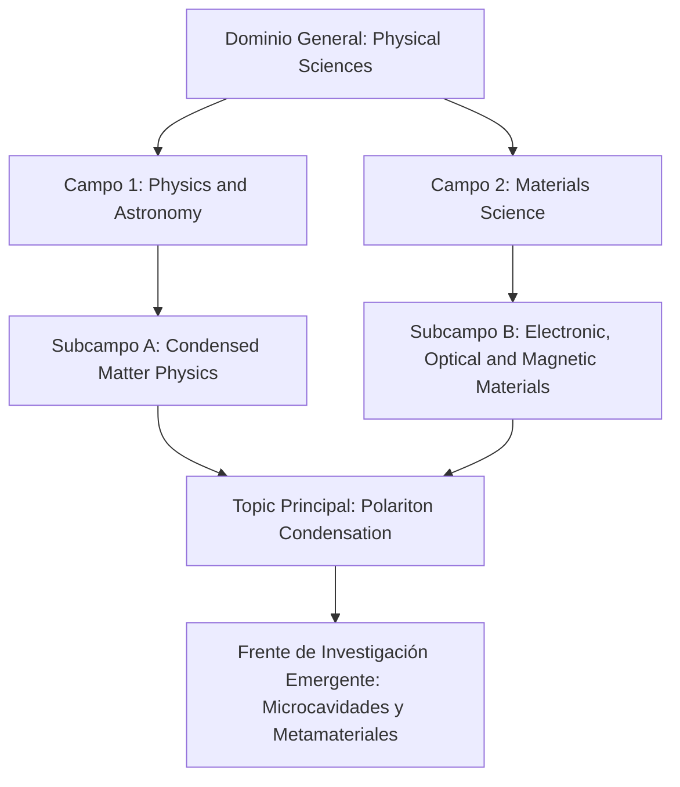

# Plantilla Maestra: Reporte de Inteligencia Científica, Frentes de Investigación, Radar Tecnológico y Cartografía Topológica SOM
### *Especializada en mapeo temático multimodal (Topics v5.0, Linajes AMI, Coautoría Salton, Redes SOM y Alineación con ODS)*

Esta plantilla está diseñada para que un **agente único** en LibreChat / `agentic-data-stack` o entornos de automatización elabore un **REPORTE DE INTELIGENCIA CIENTÍFICA Y RADAR TECNOLÓGICO** de alto valor prospectivo para vicerrectorías de investigación, observatorios tecnológicos, agencias de financiamiento (SECIHTI, CONAHCYT, NSF, Horizon Europe) y comités de planeación estratégica.

Incorpora la **metodología neurocomputacional de Mapas Autoorganizados de Kohonen (SOM)** (Carrillo-Calvet, Jiménez-Andrade & Arencibia-Jorge, 2025; Villaseñor-García et al., 2017) para proyectar la topología del paisaje científico y clasificar los frentes de investigación según sus perfiles multidimensionales de maduración, impacto normalizado y soberanía geopolítica.

---

## Directivas Operativas para el Agente (Protocolo de Orquestación de Agent Skills)

Esta plantilla opera como una **meta-habilidad orquestadora** de inteligencia prospectiva. Para garantizar rigor conceptual y metodológico, el agente NO debe ejecutar llamadas ad-hoc de bajo nivel a ciegas, sino que **debe orquestar y delegar cada fase analítica en la Agent Skill especializada correspondiente del ecosistema**.

El protocolo canónico de 6 fases se orquesta como sigue:

1. **Fase 1: Detección Multimodal de Frentes, Taxonomía y Linajes Aluviales AMI:**
   - **Agent Skills Orquestadas:** [`research-fronts-detection-expert`](../research-fronts-detection-expert/SKILL.md) y [`topics-research-fronts-intelligence`](../topics-research-fronts-intelligence/SKILL.md).
   - **Propósito y Directivas:**
     * Extraer los frentes temáticos activos de Topics v5.0, identificando palabras clave de frontera, clusters de alta densidad y métricas de aceleración temprana.
     * Reconstruir la genealogía histórica y los linajes aluviales AMI (Alluvial Mutation Index), documentando eventos de escisión, fusión y surgimiento a través de ventanas temporales.
     * Navegar y estructurar la jerarquía taxonómica multinivel: Domain $\to$ Field $\to$ Subfield $\to$ Topic.
   - **Artefactos Producidos:** Tabla 1 (Cuadrante de Frentes de Investigación) y Diagrama Taxonómico Multinivel Mermaid.

2. **Fase 2: Delimitación de Campo, Cosecha Columnar y Revisión Profunda:**
   - **Agent Skills Orquestadas:** [`bibliometric-search-strategist`](../bibliometric-search-strategist/SKILL.md) y [`deep-literature-researcher`](../deep-literature-researcher/SKILL.md).
   - **Propósito y Directivas:**
     * Delimitar el campo mediante el enfoque multi-etapa de Huang, Schiebel & Porter (2011) en bloques conceptuales (*building blocks*).
     * Transpilar la estrategia a ClickHouse SQL columnar sobre `rag.works_academic_all` bajo la regla inviolable de **CERO JOINs**, auditando la ecuación bajo la directriz **GLOBAL (ISSI)**.
     * Ejecutar el protocolo de *Citation Snowballing* backward/forward (Wohlin, 2014) con el **Filtro de Densidad Núcleo de Glänzel et al. (2009)** ($k \ge 2$) para aislar los documentos fundacionales del frente sin ruido espurio.
   - **Artefactos Producidos:** Ecuaciones de búsqueda auditadas bajo directriz GLOBAL y benchmark de literatura previa.

3. **Fase 3: Dinámica Longitudinal, Cinéticas Price y Cartografía Geopolítica de Salton:**
   - **Agent Skills Orquestadas:** [`classical-bibliometrics-laws`](../classical-bibliometrics-laws/SKILL.md) y [`geopolitical-collaboration-analyst`](../geopolitical-collaboration-analyst/SKILL.md).
   - **Propósito y Directivas:**
     * Ajustar los modelos de crecimiento exponencial y logístico de Price: tasa anual $\alpha$, tiempo de duplicación $t_d = \frac{\ln(2)}{\alpha}$, $R^2$ y p-valores en ventanas históricas vs. recientes.
     * Construir la matriz de coautoría internacional normalizada con el **Coseno de Salton** ($S_{ij} = \frac{C_{ij}}{\sqrt{C_i C_j}}$) y códigos ISO-3166-1 alpha-3.
     * Evaluar la soberanía epistémica y la asimetría geopolítica Norte-Sur (% primer autor y autor de correspondencia).
   - **Artefactos Producidos:** Tabla 2 (Dinámica de Crecimiento Cinético y Duplicación) y Tabla 3 (Matriz de Cooperación Bilateral y Soberanía Epistémica).

4. **Fase 4: Cartografía Topológica Multidimensional con Redes SOM (Kohonen):**
   - **Agent Skill Orquestada:** [`som-methodological-expert`](../som-methodological-expert/SKILL.md).
   - **Propósito y Directivas:**
     * Construir la matriz multidimensional donde cada frente o topic es un vector caracterizado por: 1) Tasa de aceleración $\alpha$, 2) Tiempo de duplicación $t_d$, 3) FWCI promedio, 4) Volumen de publicaciones, 5) Coautoría internacional, 6) % Acceso Abierto Diamante, y 7) Grado de alineación con ODS.
     * Dimensionar la retícula hexagonal mediante la relación de aspecto espectral SVD ($\sigma_1 / \sigma_2$) y sobremalla $20N\text{--}30N$ con inicialización PCA.
     * Generar la **Tríada Visual LabSOM**: U-Matrix roja/amarilla (barreras topológicas y valles densos), Mapas de Componentes Verde-Amarillo-Rojo (trade-offs multivariados) y agrupamiento aglomerativo en dos etapas de Vesanto & Alhoniemi con Silhouette ($s^*$).
   - **Artefactos Producidos:** Tabla 4 (Clasificación Topológica de Clusters Temáticos en el SOM) y estado neuronal persistido (`topics_som_state.json`).

5. **Fase 5: Mapeo de Alineación e Impacto en Objetivos de Desarrollo Sostenible (ODS 1–17):**
   - **Agent Skill Orquestada:** [`sdg-impact-intelligence`](/home/jlja/.gemini/config/skills/sdg-impact-intelligence/SKILL.md).
   - **Propósito y Directivas:**
     * Analizar la intersección temática con la Agenda 2030 de la ONU mediante las etiquetas oficiales `sdg_ids` en ClickHouse.
     * Cuantificar el porcentaje de producción del frente vinculado a cada ODS, el impacto normalizado (FWCI) por objetivo y las tasas de coautoría internacional asociadas.
   - **Artefactos Producidos:** Tabla 5 (Distribución Temática por ODS Relevantes).

6. **Fase 6: Artefactos Visuales Interactivos, Roadmap Prospectivo y Material Suplementario:**
   - **Agent Skill Orquestada:** [`openalex-mexico-visualizer`](../openalex-mexico-visualizer/SKILL.md).
   - **Propósito y Directivas:**
     * Generar visualizaciones interactivas autónomas HTML (sunburst taxonómico multinivel, dinámicas de frentes, matrices de cuadrantes y diagramas de Sankey geopolíticos).
     * Elaborar la Hoja de Ruta Tecnológica a 1, 3 y 5 años con recomendaciones operativas para consejos de ciencia y tecnología.
     * Empaquetar en `./supplementary/`:
       - `Script S1: 01_extract_topics_data.py`: Cosecha determinista de Topics en ClickHouse sin JOINs.
       - `Script S2: 02_topics_som_mapping.py`: Matriz multidimensional de frentes, cálculo de Salton y llamada a `train_som` con semilla fija (`seed=42`).
       - `Dataset S1: topics_metadata.csv`: Métricas cuantitativas completas de los frentes.
       - `Dataset S2: topics_som_state.json`: Topología de la variedad temática.
   - **Artefactos Producidos:** Visualizaciones interactivas en HTML y catálogo suplementario para auditoría.

---

## Disponibilidad de Datos y Reglas Anti-Fabricación (Verificadas contra el Corpus y las Herramientas)

**Columnas reales de `rag.works_academic_all`** (usar solo estas; no inventar nombres): `publication_year`, `cited_by_count`, `is_oa`, `oa_status` (valores: `closed`, `green`, `diamond`, `gold`, `bronze`, `hybrid`), `fwci`, `percentile`, `is_top_10`, `is_top_1`, `author_names`, `institution_rors`, `institution_names`, `country_code`, `all_country_codes`, `domain`, `field`, `subfield`, `topic`, `sdg_ids`, `apc_paid_usd`, `apc_list_usd`, `is_doaj_journal`, `is_core_journal`, `counts_by_year`.

1. **Número de autores:** no existe columna `authors_count`; usar `length(author_names)`.
2. **APC:** no existe `apc_usd`; usar `apc_paid_usd` (pagado) y `apc_list_usd` (precio de lista), indicando cuál se reporta.
3. **Primer autor y autor de correspondencia:** NO son columnas; solo existen dentro del JSON de `raw_data`. Si no se extraen de `raw_data` (consulta costosa, acotada a una sola entidad y sin JOINs), reportar `N/D (no disponible en el corpus)` en las celdas correspondientes y consignarlo como limitación. Nunca estimarlos ni completarlos con cifras plausibles.
4. **Cuartiles Q1/Q2 y colaboración con industria:** no existen en el corpus. No incluirlos como indicador calculado; si se mencionan, marcar `N/D`. Como proxies disponibles: `is_core_journal`, `is_doaj_journal`, `is_top_10`, `is_top_1`.
5. **Dependencias dentro de una institución (ej. Instituto de Neurobiología dentro de la UNAM):** el ROR solo identifica a la institución matriz. Para aislar una dependencia filtrar por `institution_names` con coincidencia insensible a mayúsculas y diacríticos, y declarar que el filtro es aproximado y puede subcontar variantes toponímicas.
6. **Coseno de Salton:** el índice que devuelve `get_geopolitical_collaboration_matrix` es una aproximación (usa un denominador proxy). Recalcular $S_{ij} = C_{ij}/\sqrt{C_i C_j}$ a partir de los conteos de coautoría ($C_{ij}$, $C_i$, $C_j$) y reportar el valor recalculado; si no es posible, rotular el índice como *aproximado*.
7. **Detección de quiebres (CUSUM / Pettitt):** no existe herramienta para ello. Calcularlos a partir de la serie anual extraída (declarando método y estadístico), o acotar los periodos con `analyze_scientific_growth_phases`; no atribuir a una herramienta resultados que no produce. La partición modular disponible es Louvain (`detect_louvain_communities`), no Leiden.
8. **Modo contingencia (`status: "fallback"`):** `train_som`, `evaluate_som_clusters` y `recluster_som` devuelven valores sintéticos (error de cuantización fijo, clusters y BMU ficticios) cuando el motor no está disponible. Si algún resultado trae `status: "fallback"`, NO usarlo para conclusiones: informar que el modelado SOM no pudo ejecutarse y limitar el análisis a lo no-SOM.
9. **Persistencia y Dashboard del SOM:** `train_som` cuenta con el parámetro `output_state_path` (ej. `output_state_path="/tmp/som_state.json"`) e `indicator_names`. Para generar el dashboard interactivo oficial con `knomap_render_som_dashboard`, se debe indicar `output_state_path` al invocar `train_som` y pasar esa misma ruta a `knomap_render_som_dashboard(som_state_path=...)`. Si el motor no está disponible, la herramienta devuelve `status: "error"` con la causa raíz; nunca inventar métricas ni volcar matrices numéricas completas de pesos en el cuerpo del texto.
10. **Matriz de entrada del SOM:** construirla solo con indicadores realmente calculados y estandarizados (z-score); las dimensiones `N/D` se excluyen del vector, no se rellenan.

---

## Reglas Editoriales Estrictas

- **LENGUAJE MODERADO Y SOBRIO (PROHIBICIÓN ABSOLUTA DE SUPERLATIVOS):** Emplear terminología cienciométrica formal, objetiva y fundamentada en distribuciones empíricas. Queda estrictamente prohibido el uso de hipérboles mercadotécnicas (*"revolucionario"*, *"sin precedentes"*, *"extraordinario"*, *"asombroso"*, *"pionero"*).
- **ZERO-SCAFFOLDING LEAKAGE:** Excluir referencias internas a herramientas computacionales, prompts o tokens del chat.
- **TABLAS ESTRUCTURADAS OBLIGATORIAS:** Presentar las Tablas 1, 2, 3, 4 y 5 íntegramente en Markdown en el cuerpo del texto.

---

# [Título del Reporte: Radar Cienciométrico, Cartografía Topológica SOM e Inteligencia Prospectiva en [Dominio / Frente Temático]: Mapeo de Frentes Emergentes, Linajes de Conocimiento y Alineación Estratégica]

## 1. RESUMEN EJECUTIVO Y RADAR DE ACELERACIÓN TEMÁTICA

- **1.1. Síntesis Estratégica del Dominio:**
  * Diagnóstico global del ritmo de crecimiento, masa crítica de publicaciones, dispersión geográfica y grado de madurez del frente tecnológico o científico.
  * **Trazabilidad Metodológica GLOBAL (ISSI):** Declaración de la fuente de datos (OpenAlex / Topics v5.0), snapshot temporal con fecha y huso horario exacto de corte, criterios de delimitación temática multi-etapa y métricas de normalización relacional (Coseno de Salton para afinidad geopolítica y Association Strength para co-ocurrencia).
- **1.2. Tabla 1: Cuadrante de Frentes de Investigación (Research Fronts v5.0):**

| Frente de Investigación / Topic ID | Denominación Canónica del Frente | Fase del Ciclo de Vida | Tasa Crecimiento Anual ($\alpha$) | Tiempo Duplicación ($t_d$) | FWCI Promedio | Volumen Trabajos | Polo Geopolítico Líder (% Liderazgo) |
| :--- | :--- | :--- | :--- | :--- | :--- | :--- | :--- |
| **Topic [XXXXX]** | [Frente A: ej. Polaritones y Condensados Cuánticos] | Emergente / Acelerado | [X.XX]% | [X.XX] años | [X.XX] | [N] | [País A] ([XX]%) |
| **Topic [YYYYY]** | [Frente B: ej. Guías de Onda Plasmónicas] | Consolidado / Maduro | [X.XX]% | [X.XX] años | [X.XX] | [N] | [País B] ([XX]%) |
| **Topic [ZZZZZ]** | [Frente C: ej. Resonadores Clásicos de Cavidad] | En declive / Residual | [X.XX]% | [X.XX] años | [X.XX] | [N] | [País C] ([XX]%) |

---

## 2. ESTRUCTURA TAXONÓMICA MULTINIVEL Y CONVERGENCIA DISCIPLINAR

- **2.1. Desglose Jerárquico (Domain $\to$ Field $\to$ Subfield $\to$ Topic):**
  * Caracterización de los campos y subcampos disciplinarios que convergen en el área analizada.
- **2.2. Diagrama de Convergencia Taxonómica (Mermaid Obligatorio):**

---

## 3. DINÁMICA LONGITUDINAL, LINAJES AMI Y DIFERENCIACIÓN TEMÁTICA

- **3.1. Trayectoria Histórica y Linajes Aluviales:**
  * Análisis de linajes de conocimiento: cómo frentes históricos se bifurcaron (*escisión*) o cómo disciplinas dispares convergieron (*fusión*) para dar lugar al frente actual.
- **3.2. Tabla 2: Dinámica de Crecimiento Cinético y Tiempos de Duplicación:**

| Periodo Analítico | Volumen Trabajos | Tasa de Aceleración ($\alpha$) | Tiempo Duplicación ($t_d$) | Coeficiente $R^2$ | P-valor Modelo |
| :--- | :--- | :--- | :--- | :--- | :--- |
| **Ventana Histórica (T-10 a T-5)** | [N] | [X.XXX] | [X.XX] años | [0.XXX] | [0.XXX] |
| **Ventana Reciente (T-5 a Actual)** | [N] | [X.XXX] | [X.XX] años | [0.XXX] | [0.XXX] |

---

## 4. CARTOGRAFÍA GEOPOLÍTICA DE COLABORACIÓN Y MATRIZ DE SALTON

- **4.1. Afinidad Bilateral y Bloques Regionales:**
  * Identificación de los ejes de colaboración más densos mediante el Coseno de Salton ($S_{ij}$).
  * Benchmarking por bloques geopolíticos (América Latina, Unión Europea, Norteamérica, Asia-Pacífico).
- **4.2. Tabla 3: Matriz de Cooperación Bilateral y Soberanía Epistémica:**

| Par de Países ($i - j$) | Publicaciones Conjuntas ($C_{ij}$) | Coseno de Salton ($S_{ij}$) | FWCI Conjunto | Ratio Primer Autor País $i$ vs País $j$ | Tasa de Autor Corresp. Institucional |
| :--- | :--- | :--- | :--- | :--- | :--- |
| [País A – País B] | [N] | [0.XXX] | [X.XX] | [XX]% vs [XX]% | [XX.X]% |
| [País A – País C] | [N] | [0.XXX] | [X.XX] | [XX]% vs [XX]% | [XX.X]% |

---

## 5. CARTOGRAFÍA TOPOLÓGICA MULTIDIMENSIONAL CON REDES SOM (KOHONEN)

*Mapeo neurocomputacional continuo del paisaje temático para clasificar frentes de investigación sin reduccionismos unidimensionales (Carrillo-Calvet et al., 2025).*

- **5.1. Arquitectura de Malla y Calibración SVD:**
  * Dimensionamiento con relación de aspecto espectral $\sigma_1 / \sigma_2$, sobremalla continua hexagonal $20N-30N$, inicialización PCA y partición en dos etapas con coeficiente Silhouette máximo ($s^*$).
- **5.2. Interpretación de la Tríada Visual LabSOM:**
  * **U-Matrix:** Identificación de barreras topológicas (crestas amarillas) entre subdominios teóricos y valles densos (rojo) donde convergen frentes consolidados.
  * **Mapas de Componentes:** Gradientes espaciales (Verde < Media < Rojo) revelando el trade-off entre velocidad cinética ($\alpha$), citación normalizada (FWCI) y adopción en acceso abierto diamante.
- **5.3. Tabla 4: Clasificación Topológica de Clusters Temáticos en el SOM:**

| Cluster SOM ($K^*$) | Frentes de Investigación Agrupados | Perfil Multidimensional Dominante | Componentes Sobresalientes (Rojo) | Vulnerabilidades (Verde) | ODS Predominante Vinculado |
| :--- | :--- | :--- | :--- | :--- | :--- |
| **Cluster 1 (Frontera de Ruptura)** | [Frente A, Frente D, ...] | Alta aceleración cinética, alto FWCI y tracción global | Tasa $\alpha$, FWCI, Top 10% | Baja adopción regional Sur Global | ODS 9 (Industria / Innovación) |
| **Cluster 2 (Consolidados / Maduros)** | [Frente B, Frente E, ...] | Elevado volumen acumulado, baja duplicación y alta citación | Volumen, Citas acumuladas | Tasa de aceleración reciente | ODS 7 (Energía Asequible) |
| **Cluster 3 (Nicho Regional / Diamante)** | [Frente C, Frente F, ...] | Enfoque en problemáticas locales, liderazgo autoral y OA Diamante | OA Diamante, Coautoría nacional (N/D si no se calcula primer autor) | Presencia en revistas núcleo | ODS 3 / ODS 13 (Salud / Clima) |

---

## 6. ALINEACIÓN CON OBJETIVOS DE DESARROLLO SOSTENIBLE (ODS 1–17)

- **6.1. Mapeo de Contribución a la Agenda 2030 de la ONU:**
  * Cuantificación del porcentaje de la producción del frente vinculado a los 17 ODS.
- **6.2. Tabla 5: Distribución Temática por ODS Relevantes:**

| ODS de la ONU | Denominación del Objetivo | Publicaciones Vinculadas (N) | Porcentaje del Frente (%) | FWCI Promedio en el ODS | Coautoría Internacional (%) |
| :--- | :--- | :--- | :--- | :--- | :--- |
| **ODS [X]** | [Nombre del ODS: ej. ODS 7 Energía Asequible] | [N] | [XX.X]% | [X.XX] | [XX.X]% |
| **ODS [Y]** | [Nombre del ODS: ej. ODS 9 Industria e Innovación] | [N] | [XX.X]% | [X.XX] | [XX.X]% |

---

## 7. IMPLICACIONES ESTRATÉGICAS Y HOJA DE RUTA PROSPECTIVA (ROADMAP)

- **7.1. Oportunidades de Liderazgo Científico:**
  * Identificación de nichos temáticos desatendidos con alto potencial de impacto epistémico y social, y baja saturación de competidores hegemónicos.
- **7.2. Hoja de Ruta Tecnológica para Órganos de Decisión:**
  * Directrices operativas a 1, 3 y 5 años para comités de evaluación y fondos sectoriales para fomentar la inserción soberana en frentes emergentes.

---

## ANEXOS Y FUENTES AUDITABLES

- **Ficha de Trazabilidad Prospectiva y Agent Skills Orquestadas:**
  * Catálogo de frentes y linajes aluviales AMI vía [`research-fronts-detection-expert`](../research-fronts-detection-expert/SKILL.md) y [`topics-research-fronts-intelligence`](../topics-research-fronts-intelligence/SKILL.md).
  * Delimitación de campo y revisión profunda vía [`bibliometric-search-strategist`](../bibliometric-search-strategist/SKILL.md) y [`deep-literature-researcher`](../deep-literature-researcher/SKILL.md).
  * Cinéticas de Price y afinidad Salton vía [`classical-bibliometrics-laws`](../classical-bibliometrics-laws/SKILL.md) y [`geopolitical-collaboration-analyst`](../geopolitical-collaboration-analyst/SKILL.md).
  * Cartografía topológica neurocomputacional vía [`som-methodological-expert`](../som-methodological-expert/SKILL.md).
  * Monitoreo de alineación ODS vía [`sdg-impact-intelligence`](/home/jlja/.gemini/config/skills/sdg-impact-intelligence/SKILL.md).
  * Artefactos visuales ejecutivos vía [`openalex-mexico-visualizer`](../openalex-mexico-visualizer/SKILL.md).
  * Inventario de Topic IDs OpenAlex analizados: [Lista canónica de IDs primarios].
  * Fecha de corte del corpus: [Día Mes Año].
  * Parámetros de partición y linajes AMI: umbrales de aceleración ($\alpha$) y ventanas temporales analizadas.
  * Catálogo de Material Suplementario:
    - *Script S1 (`supplementary/01_extract_topics_data.py`):* Extracción de producción y citas por Topic.
    - *Script S2 (`supplementary/02_topics_som_mapping.py`):* Construcción de la matriz y proyección SOM.
    - *Dataset S1 (`supplementary/topics_metadata.csv`):* Métricas cinéticas y de impacto de los frentes.
    - *Dataset S2 (`supplementary/topics_som_state.json`):* Pesos y topología de la variedad temática.
    - *Protocolo Agéntico:* Ejecutable mediante la skill `template-radar-frentes-investigacion` con el catálogo de Topic IDs.
- **Referencias metodológicas:**
  * Carrillo-Calvet, H., Jiménez-Andrade, J. L., & Arencibia-Jorge, R. (2025). Redes neuronales autoorganizadas y mapeos de la ciencia. UNAM, IIBI.
  * Jiménez-Andrade, J. L., Arencibia-Jorge, R., & Carrillo-Calvet, H. (2025). Análisis y visualización de la evolución de perfiles cienciométricos multidimensionales con IA. UNAM, IIBI.
  * Huang, C., Schiebel, E., & Porter, A. L. (2011). A multi-stage approach to mapping emerging technologies: the case of DNA sequencing technology. *Scientometrics*, 87(2), 241–260.
  * International Society for Scientometrics and Informetrics (ISSI) / ScholCommLab (2023–2024). *GLOBAL: Guidance List for repOrting Bibliometric AnaLyses*. ISSI Guidelines Initiative.
  * Hicks, D., Wouters, P., Waltman, L., de Rijcke, S., & Rafols, I. (2015). Bibliometrics: The Leiden Manifesto for research metrics. *Nature*, 520(7548), 429–431.
