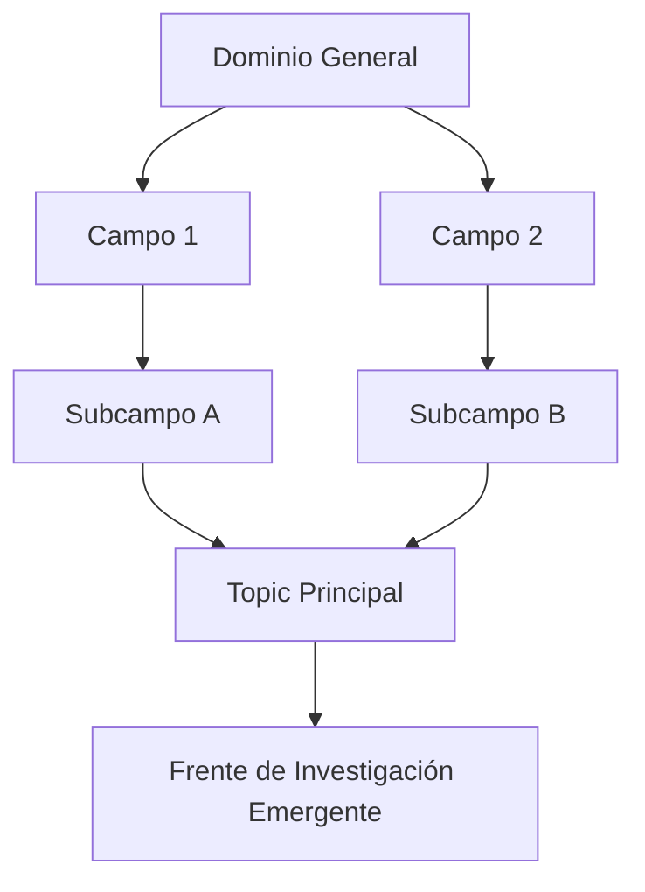

# Plantilla Maestra: Reporte de Inteligencia Científica, Frentes de Investigación y Radar Tecnológico
### *Especializada en mapeo temático multimodal (Topics v5.0, Linajes AMI, Coautoría Salton y Alineación con ODS)*

Esta plantilla está diseñada para que un **agente único** en LibreChat / `agentic-data-stack` elabore un **REPORTE DE INTELIGENCIA CIENTÍFICA Y RADAR TECNOLÓGICO** orientado a vicerrectorías de investigación, observatorios de prospectiva tecnológica y agencias de financiamiento en ciencia y tecnología.

---

## Directivas Operativas para el Agente (Protocolo MCP)

Antes de redactar el reporte, debes cosechar los datos cuantitativos mediante las herramientas MCP disponibles:
1. **Identificación de Subcampos y Topics:**
   * Invocar `sos_topics` (`topics_search_subfields`, `topics_get_clusters`) para navegar la jerarquía taxonómica (Domain $\to$ Field $\to$ Subfield $\to$ Topic) y extraer los identificadores numéricos de los clusters.
2. **Evolución Longitudinal y Linajes Aluviales AMI:**
   * Extraer las transiciones temporales de los frentes (frentes emergentes en fase de aceleración, frentes en maduración y linajes que experimentan bifurcación o fusión).
3. **Afinidad Geopolítica País-País:**
   * Invocar `sos_topics` / `sos_knomap` para obtener matrices de coautoría internacional normalizadas con Coseno de Salton y detectar los polos de liderazgo geopolítico.
4. **Impacto Normalizado y Aceleración:**
   * Invocar `sos_openalex` / `sos_plmetrix` para evaluar FWCI promedio, porcentaje de trabajos en el Top 10% y tiempos de duplicación $t_d$.
5. **Alineación con Objetivos de Desarrollo Sostenible (ODS):**
   * Consultar la distribución de trabajos alineados a los 17 ODS de la ONU (mediante `openalex_plot_sdg_grid` o agregaciones temáticas).

---

## Reglas Editoriales Estrictas

- **LENGUAJE MODERADO Y SOBRIO:** Emplear terminología cienciométrica formal, objetiva y fundamentada en distribuciones empíricas. Prohibición estricta de hipérboles y superlativos.
- **ZERO-SCAFFOLDING:** Excluir referencias a herramientas computacionales o instrucciones de chat.
- **TABLAS Y FIGURAS:** Tablas estructuradas en Markdown y diagramas Mermaid o especificaciones Plotly.js para visualización en el panel de artefactos.

---

# [Título del Reporte: Radar Cienciométrico e Inteligencia Prospectiva en [Dominio / Frente Temático]: Mapeo de Frentes Emergentes, Linajes de Conocimiento y Alineación Estratégica]

## 1. RESUMEN EJECUTIVO Y RADAR DE ACELERACIÓN TEMÁTICA
- **1.1. Síntesis Estratégica del Dominio:**
  * Diagnóstico global del ritmo de crecimiento, masa crítica de producción y dispersión geográfica del frente tecnológico o científico.
- **1.2. Tabla 1: Cuadrante de Frentes de Investigación (Research Fronts v5.0):**

| Frente de Investigación / Topic ID | Nombre del Frente | Fase del Ciclo de Vida | Tasa Crecimiento Anual ($\alpha$) | FWCI Promedio | Volumen Trabajos | País Líder (Liderazgo) |
| :--- | :--- | :--- | :--- | :--- | :--- | :--- |
| **Topic [XXXXX]** | [Nombre del Frente A] | Emergente / Acelerado | [X.XX]% | [X.XX] | [N] | [País] ([XX]%) |
| **Topic [YYYYY]** | [Nombre del Frente B] | Consolidado / Maduro | [X.XX]% | [X.XX] | [N] | [País] ([XX]%) |
| **Topic [ZZZZZ]** | [Nombre del Frente C] | En declive / Residual | [X.XX]% | [X.XX] | [N] | [País] ([XX]%) |

---

## 2. ESTRUCTURA TAXONÓMICA MULTINIVEL Y DISTRIBUCIÓN TEMÁTICA
- **2.1. Desglose Jerárquico (Domain $\to$ Field $\to$ Subfield $\to$ Topic):**
  * Caracterización de los campos y subcampos disciplinarios que convergen en el área analizada.
- **2.2. Diagrama de Convergencia Taxonómica (Mermaid):**

---

## 3. DINÁMICA LONGITUDINAL, LINAJES AMI Y DIFERENCIACIÓN TEMÁTICA
- **3.1. Trayectoria Histórica y Linajes Aluviales:**
  * Análisis de linajes de conocimiento: cómo frentes históricos se dividieron (*escisión*) o cómo disciplinas dispares convergieron (*fusión*) para dar lugar al frente actual.
- **3.2. Tabla 2: Dinámica de Crecimiento Cinético y Tiempos de Duplicación:**

| Periodo | Volumen Publicaciones | Tasa de Aceleración ($\alpha$) | Tiempo Duplicación ($t_d$) | Coeficiente $R^2$ |
| :--- | :--- | :--- | :--- | :--- |
| **Ventana Histórica (T-10 a T-5)** | [N] | [X.XXX] | [X.XX] años | [0.XXX] |
| **Ventana Reciente (T-5 a Actual)** | [N] | [X.XXX] | [X.XX] años | [0.XXX] |

---

## 4. CARTOGRAFÍA GEOPOLÍTICA DE COLABORACIÓN Y MATRIZ DE SALTON
- **4.1. Afinidad Bilateral y Bloques Regionales:**
  * Identificación de los ejes de colaboración más densos mediante el Coseno de Salton ($S_{ij}$).
  * Benchmarking por bloques geopolíticos (América Latina, Unión Europea, Norteamérica, Asia-Pacífico).
- **4.2. Tabla 3: Matriz de Cooperación Bilateral y Soberanía Epistémica:**

| Par de Países ($i - j$) | Publicaciones Conjuntas ($C_{ij}$) | Coseno de Salton ($S_{ij}$) | FWCI Conjunto | Ratio Primer Autor País $i$ vs País $j$ |
| :--- | :--- | :--- | :--- | :--- |
| [País A – País B] | [N] | [0.XXX] | [X.XX] | [XX]% vs [XX]% |
| [País A – País C] | [N] | [0.XXX] | [X.XX] | [XX]% vs [XX]% |

---

## 5. ALINEACIÓN CON OBJETIVOS DE DESARROLLO SOSTENIBLE (ODS 1–17)
- **5.1. Mapeo de Contribución a la Agenda 2030 de la ONU:**
  * Cuantificación del porcentaje de la producción científica vinculado a los 17 ODS.
- **5.2. Tabla 4: Distribución Temática por ODS Relevantes:**

| ODS de la ONU | Denominación del Objetivo | Publicaciones Vinculadas (N) | Porcentaje (%) | FWCI en el ODS |
| :--- | :--- | :--- | :--- | :--- |
| **ODS [X]** | [Nombre del ODS] | [N] | [XX.X]% | [X.XX] |
| **ODS [Y]** | [Nombre del ODS] | [N] | [XX.X]% | [X.XX] |

---

## 6. IMPLICACIONES ESTRATÉGICAS Y HOJA DE RUTA PROSPECTIVA
- **6.1. Oportunidades de Liderazgo Científico:**
  * Identificación de nichos temáticos desatendidos con alto potencial de impacto y baja saturación de competidores globales.
- **6.2. Hoja de Ruta Tecnológica (Roadmap):**
  * Directrices para comités de evaluación y fondos de financiamiento para la inserción en frentes emergentes de alto impacto social y epistémico.

---

## ANEXOS Y FUENTES AUDITABLES
Relación de metadatos de Topics, identificadores OpenAlex y parámetros del modelo de partición modular.
