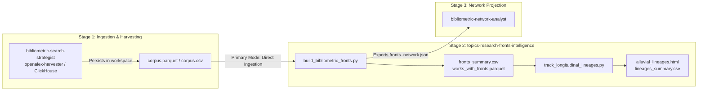
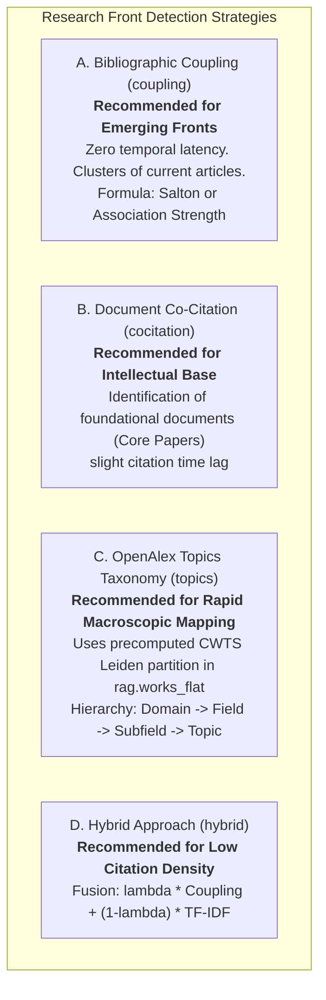

# Skill: Topics & Research Fronts Intelligence
### *Research Front Detection, Bibliometric Networks, and Longitudinal Lineage Tracking (AMI)*

> **Language Rule:** Respond and label outputs in the user's language (default to English for script plots/labels, or pass `--lang es` when the user interacts in Spanish).

---

## 1. Purpose and Epistemological Foundation

This skill enables the agent to **identify, delineate, characterize, and track the temporal evolution of Research Fronts** in the scientific literature.

It goes beyond superficial keyword-based identification through formal community modeling on bibliographic graphs and global taxonomies:
- **Price (1965):** Conceptualization of the research front as the active, moving band of recent publications advancing the frontier of knowledge.
- **Kessler (1963) & Boyack & Klavans (2010):** Contemporary bibliographic coupling for detection with **zero temporal latency** and maximum thematic coherence.
- **Small & Griffith (1974):** Co-citation of classical documents to delineate the *Intellectual Base* (*Core Documents*).
- **CWTS Leiden & Traag et al. (2019):** Leiden algorithm on massive-scale direct citation networks for the hierarchical taxonomy of ~4,500 OpenAlex Topics.
- **Rosvall & Bergstrom (2010):** Longitudinal lineages, Adjusted Mutual Information (AMI), and alluvial diagrams.

---

## 2. Architectural Principle: *Workspace-First* and Data Contract

This skill strictly follows the principle of **decoupling ingestion from analysis**:



### 2.1. Data Contract
To process a previously harvested corpus, the skill only requires a tabular file (`.parquet` or `.csv`) containing:
- `referenced_works` (or `references`): List of cited bibliographic reference IDs (essential for bibliographic coupling and co-citation).
- `publication_year`: Year of publication (essential for sliding windows and alluvial lineages).
- `title` and optionally `abstract`: For automatic semantic labeling and hybrid fronts.
- `topic` or `topic_id` (optional): If using the native OpenAlex taxonomy.
- `cited_by_count` and `fwci` (optional): To identify *Core Papers* and the visibility of each front.

### 2.2. Standalone / Contingency Mode (ClickHouse `rag.works_flat`)
If the user invokes the skill standalone without a previously downloaded corpus, the skill can query the global ClickHouse database directly on **`rag.works_flat`** (464.8M worldwide records) under the strict **ZERO JOINs** rule.

---

## 3. The Four Methodological Detection Strategies



### Operational Decision Matrix for the Agent:
1. **Recent Emerging Fronts (last 1 to 3 years):** Use `--method coupling`. Validated by Boyack & Klavans (2010) for its zero temporal latency and superior thematic coherence.
2. **Historical Landmarks and Consolidated Paradigms:** Use `--method cocitation`. Clusters foundational literature and classics of the intellectual base (Small & Griffith, 1974).
3. **Rapid Exploration of an Entire Subfield at Country or Institution Level:** Use `--method topics`. Aggregates directly over the OpenAlex `topic` column without computing adjacency matrices.
4. **Interdisciplinary or Emerging Fields with Sparse Citations:** Use `--method hybrid`. Combines reference topology with semantic similarity of titles and abstracts.

---

## 4. Longitudinal Dynamics and Alluvial Lineages (AMI Metric)

To capture the evolution of fronts over time, the skill executes the **chronological sliding windows** protocol (Rosvall & Bergstrom, 2010; Shibata et al., 2011):

1. **Segmentation:** Splits the corpus into overlapping windows (e.g., width $w=3$ years, step $s=1$ year).
2. **Intertemporal Matching:** Quantifies affinity between clusters $C_i^{(t)}$ and $C_j^{(t+1)}$ via:
   - **Jaccard Index:** Over the set of shared bibliographic references:
     $$J(C_i^{(t)}, C_j^{(t+1)}) = \frac{|R(C_i^{(t)}) \cap R(C_j^{(t+1)})|}{|R(C_i^{(t)}) \cup R(C_j^{(t+1)})|}$$
   - **Adjusted Mutual Information (AMI):** To compare partition coherence across temporal overlaps.
3. **Formal Classification of Evolutionary Events:**
   - **Persistence (Continuity):** A front transitions uniquely and stably ($J \ge 0.30$).
   - **Split (Bifurcation):** A mature front fragments into two or more specialized fronts.
   - **Merge (Convergence):** Two fronts originating from different disciplines converge into a new interdisciplinary cluster.
   - **Genesis (Emergence):** A cluster appears at $t+1$ without significant predecessors, indicating a disruptive discovery or technological leap.
   - **Decay (Dissolution):** A cluster loses internal cohesion and its articles disperse.
4. **Interactive Alluvial Diagram:** Generates a standalone HTML file with Plotly (`go.Sankey`) to visualize the continuous flow of lineages.

---

## 5. CLI Execution Protocol (Certified Python)

The agent must execute the reproducible scripts using the official environment:
`/home/ambientesPy/revistaslatam/bin/python`

### 5.1. Step 1: Detection and Clustering of Research Fronts

#### Mode A: Consuming Prior Local Corpus (Workspace-First — Recommended)
```bash
/home/ambientesPy/revistaslatam/bin/python /mnt/expansion/desplegados/sos-mcp-services/.agents/skills/topics-research-fronts-intelligence/scripts/build_bibliometric_fronts.py \
  --input-file workspace/corpus.parquet \
  --method coupling \
  --similarity-metric salton \
  --min-similarity 0.08 \
  --min-cluster-size 3 \
  --output-dir reports
```

#### Mode B: Direct Fallback on ClickHouse (`rag.works_flat` — Standalone)
```bash
/home/ambientesPy/revistaslatam/bin/python /mnt/expansion/desplegados/sos-mcp-services/.agents/skills/topics-research-fronts-intelligence/scripts/build_bibliometric_fronts.py \
  --topic-id T10023 \
  --method coupling \
  --output-dir reports
```

*Artifacts Generated in `reports/`:*
- `fronts_summary.csv`: Table with quantitative metrics, volume $N$, citations, mean year, and representative core paper for each front.
- `fronts_network.json`: Structured graph (nodes and normalized edges), ready for visualization.
- `works_with_fronts.parquet`: Enriched corpus with `front_id` and `front_name` columns.

---

### 5.2. Step 2: Longitudinal Lineage Tracking and Alluvial Diagram

```bash
/home/ambientesPy/revistaslatam/bin/python /mnt/expansion/desplegados/sos-mcp-services/.agents/skills/topics-research-fronts-intelligence/scripts/track_longitudinal_lineages.py \
  --input-file reports/works_with_fronts.parquet \
  --window-width 3 \
  --step-size 1 \
  --min-similarity 0.12 \
  --output-dir reports
```

*Artifacts Generated in `reports/`:*
- `lineages_summary.csv`: Quantitative record of all intertemporal transitions and their event type (*Persistence*, *Split*, *Merge*, *Genesis*, *Decay*).
- `alluvial_lineages.html`: Standalone interactive HTML alluvial diagram generated with Plotly.

---

### 5.3. Step 3: Chaining with the Network Analysis Skill

To visualize the topological map of the generated fronts (2D spatial layout, densities, and centralities), the agent should chain into [`bibliometric-network-analyst`](file:///mnt/expansion/desplegados/sos-mcp-services/.agents/skills/bibliometric-network-analyst/SKILL.md) providing the generated file:
`reports/fronts_network.json`.

---

## 6. Canonical Reporting Structure in Manuscripts or Reports

When presenting results to the user or incorporating them into master templates (`template-articulo-cientifico-imryd`, `template-radar-frentes-investigacion`), the agent must include the following canonical tables:

### Table 1: Identified Research Fronts Quadrant
*(Render directly in Markdown in the report):*

| Front ID | Canonical Front Name | Network Strategy | Publications ($N$) | Mean Year | Total Citations | Mean FWCI | Representative Core Document (*Core Paper*) |
| :---: | :--- | :--- | :---: | :---: | :---: | :---: | :--- |
| **Front 1** | Polariton Condensation & Microcavities | Salton Coupling | [N] | [YYYY.Y] | [Citations] | [X.XX] | [First Author et al. (Year), Citations: N] |
| **Front 2** | Plasmonic Waveguides & Metamaterials | Salton Coupling | [N] | [YYYY.Y] | [Citations] | [X.XX] | [First Author et al. (Year), Citations: N] |
| **Front 3** | Exciton-Polariton Superfluidity | Salton Coupling | [N] | [YYYY.Y] | [Citations] | [X.XX] | [First Author et al. (Year), Citations: N] |

---

### Table 2: Longitudinal Dynamics of Thematic Lineages and Evolutionary Events

| Source Window ($W_t$) | Predecessor Front | Target Window ($W_{t+1}$) | Successor Front | Event Type | Similarity ($J$) | Epistemic Interpretation |
| :---: | :--- | :---: | :--- | :---: | :---: | :--- |
| **2016–2018** | Microcavity Excitons | **2017–2019** | Polariton Condensation | Persistence | 0.42 | Incremental maturation of the core |
| **2017–2019** | Polariton Condensation | **2018–2020** | Topological Polaritons | Split (Bifurcation) | 0.24 | Differentiation toward quantum topology |
| **2017–2019** | Plasmonic Arrays | **2018–2020** | Hybrid Metasurfaces | Merge (Convergence) | 0.21 | Convergence with optical metamaterials |
| — | — | **2021–2023** | Neuromorphic Polaritonics | Genesis (Emergence) | 0.00 | Technological breakthrough: neuromorphic computing |

---

### Multi-Level Taxonomic Diagram (Mandatory Mermaid):


---

## 7. Data Availability and Anti-Hallucination Rules

1. **Global Table in ClickHouse:** Any direct query must target `rag.works_flat` (464.8M global records), not `rag.works_academic_all` (which is scoped to Mexico).
2. **ZERO JOINs Rule:** Performing `JOIN` operations in ClickHouse is strictly prohibited. All queries must filter column-wise over denormalized fields (`domain_name`, `field_name`, `subfield_name`, `topic`, `topic_id`, `has(all_topics, '...')`).
3. **Real References:** The reference column in `rag.works_flat` is `referenced_works: Array(String)`. Never invent column names such as `references_ids` or `cites_list`.
4. **Prohibition of Synthetic Data:** If no links exceed the minimum similarity threshold, report that the network is sparse and the fronts do not reach critical mass; never fabricate fictional clusters.
5. **Zero-Scaffolding Leakage:** In reports and manuscripts produced for the user, omit references to prompts, internal scripts, or chat mechanics; the document must read like a formal scientometric study.

---

## 8. Foundational Bibliographic References (APA 7th)

1. **Boyack, K. W., & Klavans, R. (2010).** Co-citation analysis, bibliographic coupling, and direct citation: Which citation approach represents the research front most accurately? *Journal of the American Society for Information Science and Technology*, 61(12), 2389–2404. https://doi.org/10.1002/asi.21419
2. **Glänzel, W., & Thijs, B. (2012).** Using hybrid methods and "core documents" for representation, segmentation and mapping of science. *Journal of Informetrics*, 6(2), 316–329. https://doi.org/10.1016/j.joi.2011.12.005
3. **Jarneving, B. (2007).** Bibliographic coupling and its application to research-front and other core documents. *Journal of Informetrics*, 1(4), 287–307. https://doi.org/10.1016/j.joi.2007.07.004
4. **Kessler, M. M. (1963).** Bibliographic coupling between scientific papers. *American Documentation*, 14(1), 10–25. https://doi.org/10.1002/asi.5090140103
5. **Price, D. J. de S. (1965).** Networks of scientific papers. *Science*, 149(3683), 510–515. https://doi.org/10.1126/science.149.3683.510
6. **Rosvall, M., & Bergstrom, C. T. (2010).** Mapping change in large networks. *PLOS ONE*, 5(1), e8694. https://doi.org/10.1371/journal.pone.0008694
7. **Shibata, N., Kajikawa, Y., Takeda, Y., & Matsushima, K. (2009).** Comparative study on methods of detecting research fronts using different types of citation. *Journal of the American Society for Information Science and Technology*, 81(2), 571–598. https://doi.org/10.1002/asi.20990
8. **Small, H., & Griffith, B. C. (1974).** The structure of scientific literatures I: Identifying and graphing specialties. *Science Studies*, 4(1), 17–40. https://doi.org/10.1177/030631277400400102
9. **Traag, V. A., Waltman, L., & van Eck, N. J. (2019).** From Louvain to Leiden: guaranteeing well-connected communities. *Scientific Reports*, 9(1), 5233. https://doi.org/10.1038/s41598-019-41695-x
10. **Van Eck, N. J., & Waltman, L. (2009).** How to normalize cooccurrence data? An analysis of some well-known similarity measures. *Journal of the American Society for Information Science and Technology*, 60(8), 1635–1651. https://doi.org/10.1002/asi.21075
11. **Vinh, N. X., Epps, J., & Bailey, J. (2010).** Information theoretic measures for clusterings comparison: Variants, properties, normalization and correction for chance. *Journal of Machine Learning Research*, 11, 2837–2854.
