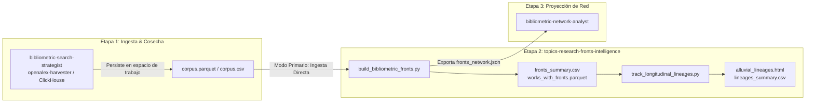
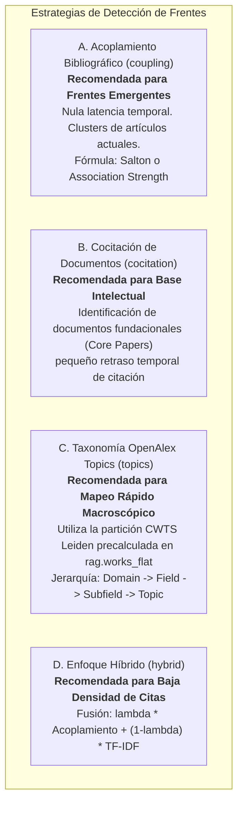
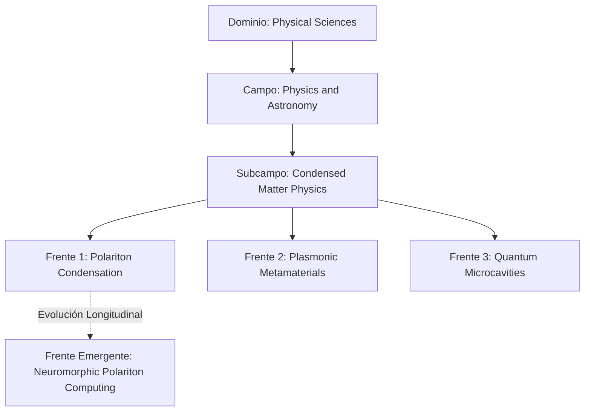

# Skill: Topics & Research Fronts Intelligence
### *Detección de Frentes de Investigación, Redes Bibliométricas y Seguimiento Longitudinal de Linajes (AMI)*

---

## 1. Propósito y Fundamento Epistemológico

Esta skill capacita al agente para **identificar, delimitar, caracterizar y rastrear la evolución temporal de frentes de investigación (*Research Fronts*)** en la literatura científica. 

Supera la identificación superficial basada en palabras clave aisladas mediante el modelado formal de comunidades en grafos bibliográficos y taxonomías globales:
- **Price (1965):** Conceptualización del frente como la banda activa y móvil de publicaciones recientes que avanzan la frontera del conocimiento.
- **Kessler (1963) & Boyack & Klavans (2010):** Acoplamiento bibliográfico contemporáneo para detección con **nula latencia temporal** y máxima coherencia temática.
- **Small & Griffith (1974):** Cocitación de documentos clásicos para delimitar la *Base Intelectual* (*Core Documents*).
- **CWTS Leiden & Traag et al. (2019):** Algoritmo Leiden sobre redes de citación directa a escala masiva para la taxonomía jerárquica de ~4,500 Topics de OpenAlex.
- **Rosvall & Bergstrom (2010):** Linajes longitudinales, Información Mutua Ajustada (AMI) y diagramas aluviales.

---

## 2. Principio Arquitectónico: *Workspace-First* y Contrato de Datos

Esta skill sigue estrictamente el principio de **desacoplamiento entre ingesta y análisis**:



### 2.1. Contrato de Datos (Data Contract)
Para procesar un corpus ya cosechado, la skill solo requiere un archivo tabular (`.parquet` o `.csv`) que contenga:
- `referenced_works` (o `references`): Lista de IDs de las referencias bibliográficas citadas (indispensable para acoplamiento bibliográfico y cocitación).
- `publication_year`: Año de publicación (indispensable para ventanas móviles y linajes aluviales).
- `title` y opcionalmente `abstract`: Para etiquetado semántico automático y frentes híbridos.
- `topic` o `topic_id` (opcional): Si se desea utilizar la taxonomía nativa de OpenAlex.
- `cited_by_count` y `fwci` (opcional): Para identificar los *Core Papers* y la visibilidad de cada frente.

### 2.2. Modo Standalone / Contingencia (ClickHouse `rag.works_flat`)
Si la o el usuario invoca la skill de forma aislada sin un corpus previo descargado, la skill cuenta con capacidad de consulta directa a la base global de ClickHouse sobre **`rag.works_flat`** (464.8M de registros mundiales) bajo la regla estricta de **CERO JOINs**.

---

## 3. Las Cuatro Estrategias Metodológicas de Detección



### Matriz de Decisión Operativa para el Agente:
1. **Frentes Emergentes Recientes (últimos 1 a 3 años):** Usar `--method coupling`. Es el método validado por Boyack & Klavans (2010) por su nula latencia temporal y mayor coherencia temática.
2. **Hitos Históricos y Paradigmas Consolidados:** Usar `--method cocitation`. Agrupa la literatura fundacional y los clásicos de la base intelectual (Small & Griffith, 1974).
3. **Exploración Rápida de un Subcampo Completo a Nivel País o Institución:** Usar `--method topics`. Agrupa directamente sobre la columna `topic` de OpenAlex sin requerir cómputo de matrices.
4. **Campos Interdisciplinares o Emergentes con Pocas Citas:** Usar `--method hybrid`. Combina la topología de referencias con la similitud semántica de títulos y resúmenes.

---

## 4. Dinámica Longitudinal y Linajes Aluviales (Métrica AMI)

Para capturar la evolución de los frentes a lo largo del tiempo, la skill ejecuta el protocolo de **ventanas móviles cronológicas** (Rosvall & Bergstrom, 2010; Shibata et al., 2011):

1. **Segmentación:** Divide el corpus en ventanas solapadas (ej. ancho $w=3$ años, desplazamiento $s=1$ año).
2. **Emparejamiento Intertemporal:** Cuantifica la afinidad entre clusters $C_i^{(t)}$ y $C_j^{(t+1)}$ mediante:
   - **Índice de Jaccard:** Sobre el conjunto de referencias bibliográficas compartidas:
     $$J(C_i^{(t)}, C_j^{(t+1)}) = \frac{|R(C_i^{(t)}) \cap R(C_j^{(t+1)})|}{|R(C_i^{(t)}) \cup R(C_j^{(t+1)})|}$$
   - **Información Mutua Ajustada (AMI):** Para comparar la coherencia de la partición en el solapamiento temporal.
3. **Clasificación Formal de Eventos Evolutivos:**
   - **Persistencia (Continuidad):** Un frente transita de forma unívoca y estable ($J \ge 0.30$).
   - **Escisión (Bifurcación / *Split*):** Un frente maduro se fragmenta en dos o más frentes especializados.
   - **Fusión (Convergencia / *Merge*):** Dos frentes procedentes de distintas disciplinas convergen en un nuevo cluster interdisciplinar.
   - **Génesis (Emergencia):** Aparece un cluster en $t+1$ sin predecesores significativos, indicando un descubrimiento disruptivo o salto tecnológico.
   - **Disolución (*Decay*):** Un cluster pierde cohesión interna y sus artículos se dispersan.
4. **Diagrama Aluvial Interactivo:** Genera un archivo HTML autónomo con Plotly (`go.Sankey`) para visualizar el flujo continuo de linajes.

---

## 5. Protocolo de Ejecución CLI (Python Certificado)

El agente debe ejecutar los scripts reproducibles utilizando el entorno oficial:
`/home/ambientesPy/revistaslatam/bin/python`

### 5.1. Paso 1: Detección y Clustering de Frentes de Investigación

#### Modo A: Consumiendo Corpus Local Previo (Workspace-First — Recomendado)
```bash
/home/ambientesPy/revistaslatam/bin/python /mnt/expansion/desplegados/sos-mcp-services/.agents/skills/topics-research-fronts-intelligence/scripts/build_bibliometric_fronts.py \
  --input-file workspace/corpus.parquet \
  --method coupling \
  --similarity-metric salton \
  --min-similarity 0.08 \
  --min-cluster-size 3 \
  --output-dir reports
```

#### Modo B: Fallback Directo sobre ClickHouse (`rag.works_flat` — Standalone)
```bash
/home/ambientesPy/revistaslatam/bin/python /mnt/expansion/desplegados/sos-mcp-services/.agents/skills/topics-research-fronts-intelligence/scripts/build_bibliometric_fronts.py \
  --topic-id T10023 \
  --method coupling \
  --output-dir reports
```

*Artefactos Generados en `reports/`:*
- `fronts_summary.csv`: Tabla con métricas cuantitativas, volumen $N$, citas, año medio y core paper representativo de cada frente.
- `fronts_network.json`: Grafo estructurado (nodos y aristas normalizadas), listo para visualización.
- `works_with_fronts.parquet`: Corpus enriquecido con las columnas `front_id` y `front_name`.

---

### 5.2. Paso 2: Rastreo de Linajes Longitudinales y Diagrama Aluvial

```bash
/home/ambientesPy/revistaslatam/bin/python /mnt/expansion/desplegados/sos-mcp-services/.agents/skills/topics-research-fronts-intelligence/scripts/track_longitudinal_lineages.py \
  --input-file reports/works_with_fronts.parquet \
  --window-width 3 \
  --step-size 1 \
  --min-similarity 0.12 \
  --output-dir reports
```

*Artefactos Generados en `reports/`:*
- `lineages_summary.csv`: Registro cuantitativo de todas las transiciones intertemporales y su tipo de evento (*Persistence*, *Split*, *Merge*, *Genesis*, *Decay*).
- `alluvial_lineages.html`: Diagrama aluvial interactivo autónomo en HTML generado con Plotly.

---

### 5.3. Paso 3: Encadenamiento con la Skill de Redes

Para visualizar el mapa topológico de los frentes generados (distribución espacial en 2D, densidades y centralidades), el agente debe enlazar con [`bibliometric-network-analyst`](file:///mnt/expansion/desplegados/sos-mcp-services/.agents/skills/bibliometric-network-analyst/SKILL.md) proporcionando el archivo generado:
`reports/fronts_network.json`.

---

## 6. Estructura Canónica de Reporte en el Manuscrito o Informe

Al presentar los resultados al usuario o incorporarlos en plantillas maestras (`template-articulo-cientifico-imryd`, `template-radar-frentes-investigacion`), el agente debe incluir las siguientes tablas canónicas:

### Tabla 1: Cuadrante de Frentes de Investigación Identificados
*(Desplegar directamente en Markdown en el informe):*

| ID Frente | Denominación Canónica del Frente | Estrategia de Red | Publicaciones ($N$) | Año Medio | Citas Totales | FWCI Promedio | Documento Núcleo Representativo (*Core Paper*) |
| :---: | :--- | :--- | :---: | :---: | :---: | :---: | :--- |
| **Frente 1** | Polariton Condensation & Microcavities | Acoplamiento Salton | [N] | [YYYY.Y] | [Citas] | [X.XX] | [Primer Autor et al. (Año), Citas: N] |
| **Frente 2** | Plasmonic Waveguides & Metamaterials | Acoplamiento Salton | [N] | [YYYY.Y] | [Citas] | [X.XX] | [Primer Autor et al. (Año), Citas: N] |
| **Frente 3** | Exciton-Polariton Superfluidity | Acoplamiento Salton | [N] | [YYYY.Y] | [Citas] | [X.XX] | [Primer Autor et al. (Año), Citas: N] |

---

### Tabla 2: Dinámica Longitudinal de Linajes Temáticos y Eventos Evolutivos

| Ventana Origen ($W_t$) | Frente Predecesor | Ventana Destino ($W_{t+1}$) | Frente Sucesor | Tipo de Evento | Similitud ($J$) | Interpretación Epistémica |
| :---: | :--- | :---: | :--- | :---: | :---: | :--- |
| **2016–2018** | Microcavity Excitons | **2017–2019** | Polariton Condensation | Persistencia | 0.42 | Maduración incremental del núcleo |
| **2017–2019** | Polariton Condensation | **2018–2020** | Topological Polaritons | Split (Bifurcación) | 0.24 | Diferenciación hacia topología cuántica |
| **2017–2019** | Plasmonic Arrays | **2018–2020** | Hybrid Metasurfaces | Fusión (Convergencia) | 0.21 | Convergencia con metamateriales ópticos |
| — | — | **2021–2023** | Neuromorphic Polaritonics | Génesis (Emergencia) | 0.00 | Ruptura tecnológica: computación neuromórfica |

---

### Diagrama Taxonómico Multinivel (Mermaid Obligatorio):



---

## 7. Disponibilidad de Datos y Reglas Anti-Alucinación

1. **Tabla Global en ClickHouse:** Toda consulta directa debe apuntar a `rag.works_flat` (464.8M de registros mundiales), no a `rag.works_academic_all` (que está acotada a México).
2. **Regla de CERO JOINs:** Está estrictamente prohibido realizar `JOIN` en ClickHouse. Todas las consultas deben filtrar columnarmente sobre campos desnormalizados (`domain_name`, `field_name`, `subfield_name`, `topic`, `topic_id`, `has(all_topics, '...')`).
3. **Referencias Reales:** La columna de referencias en `rag.works_flat` es `referenced_works: Array(String)`. Nunca inventar nombres de columnas como `references_ids` o `cites_list`.
4. **Prohibición de Datos Sintéticos:** Si no se encuentran enlaces que superen el umbral mínimo de similitud, reportar que la red es dispersa y los frentes no alcanzan masa crítica; nunca inventar clusters ficticios.
5. **Zero-Scaffolding Leakage:** En los informes y artículos producidos para el usuario, omitir la mención de prompts, scripts internos o mecánicas del chat; el documento debe leerse como un estudio cienciométrico formal.

---

## 8. Referencias Bibliográficas Fundacionales (APA 7ª)

1. **Boyack, K. W., & Klavans, R. (2010).** Co-citation analysis, bibliographic coupling, and direct citation: Which citation approach represents the research front most accurately? *Journal of the American Society for Information Science and Technology*, 61(12), 2389–2404. https://doi.org/10.1002/asi.21419
2. **Glänzel, W., & Thijs, B. (2012).** Using hybrid methods and "core documents" for representation, segmentation and mapping of science. *Journal of Informetrics*, 6(2), 316–329. https://doi.org/10.1016/j.joi.2011.12.005
3. **Jarneving, B. (2007).** Bibliographic coupling and its application to research-front and other core documents. *Journal of Informetrics*, 1(4), 287–307. https://doi.org/10.1016/j.joi.2007.07.004
4. **Kessler, M. M. (1963).** Bibliographic coupling between scientific papers. *American Documentation*, 14(1), 10–25. https://doi.org/10.1002/asi.5090140103
5. **Price, D. J. de S. (1965).** Networks of scientific papers. *Science*, 149(3683), 510–515. https://doi.org/10.1126/science.149.3683.510
6. **Rosvall, M., & Bergstrom, C. T. (2010).** Mapping change in large networks. *PLOS ONE*, 5(1), e8694. https://doi.org/10.1371/journal.pone.0008694
7. **Shibata, N., Kajikawa, Y., Takeda, Y., & Matsushima, K. (2009).** Comparative study on methods of detecting research fronts using different types of citation. *Journal of the American Society for Information Science and Technology*, 81(2), 571–598. https://doi.org/10.1002/asi.20990
8. **Small, H., & Griffith, B. C. (1974).** The structure of scientific literatures I: Identifying and graphing specialties. *Science Studies*, 4(1), 17–40. https://doi.org/10.1177/030631277400400102
9. **Traag, V. A., Waltman, L., & van Eck, N. J. (2019).** From Louvain to Leiden: guaranteeing well-connected communities. *Scientific Reports*, 9(1), 5233. https://doi.org/10.1038/s41598-019-41695-x
10. **Van Eck, N. J., & Waltman, L. (2009).** How to normalize cooccurrence data? An analysis of some well-known similarity measures. *Journal of the American Society for Information Science and Technology*, 60(8), 1635–1651. https://doi.org/10.1002/asi.21075
11. **Vinh, N. X., Epps, J., & Bailey, J. (2010).** Information theoretic measures for clusterings comparison: Variants, properties, normalization and correction for chance. *Journal of Machine Learning Research*, 11, 2837–2854.
