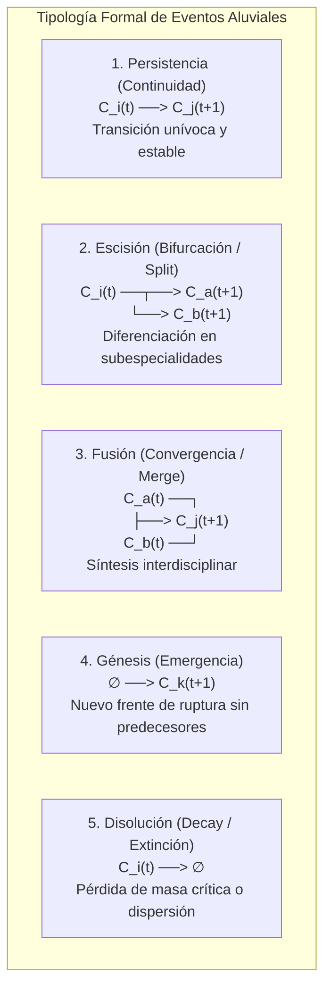

# Guía Metodológica de Dinámica Longitudinal, Métrica AMI y Linajes Aluviales

### *Evolución Temporal de Frentes de Investigación, Detección de Eventos y Diagramas Aluviales*

---

## 1. Fundamentos de la Cartografía Científica Longitudinal

En la Ciencia de la Ciencia (*Science of Science*), la estructura del conocimiento no es estática. Los frentes de investigación experimentan transformaciones constantes impulsadas por nuevos descubrimientos, la migración de investigadores entre disciplinas, la maduración tecnológica y la emergencia de problemas sociales apremiantes.

El análisis transversal estático (*cross-sectional analysis*) toma una "fotografía" en un solo momento o colapsa décadas de literatura en una única red agregada. Esto genera dos patologías metodológicas graves:
1. **Falacia del anacronismo:** Mezcla artículos pioneros de los años noventa con trabajos contemporáneos de los años 2020 en un mismo cluster, ocultando que el significado conceptual de los términos y las comunidades activas cambió radicalmente.
2. **Ceguera ante eventos evolutivos:** Es incapaz de distinguir si un área interdisciplinar actual surgió de la fusión de dos campos previamente separados, o si un campo clásico se escindió en subespecialidades divergentes.

Para superar estas limitaciones, el análisis longitudinal de frentes de investigación modela la ciencia como una **secuencia temporal de redes y particiones** (Rosvall & Bergstrom, 2010; Shibata et al., 2011).

---

## 2. Protocolo de Ventanas Cronológicas Móviles (*Sliding Windows*)

El procedimiento estándar para capturar la dinámica temporal sin introducir cortes arbitrarios rígidos consiste en segmentar el corpus mediante **ventanas móviles solapadas**:

```
Corpus Temporal: [ Año Inicio ———————————————— Año Fin ]

Ventana W1: [ t0 ——— t0+w ]
Ventana W2:      [ t0+s ——— t0+s+w ]
Ventana W3:           [ t0+2s ——— t0+2s+w ]
...
```

### 2.1. Parámetros de Configuración Canónicos
- **Ancho de Ventana ($w$ — *Window Width*):**
  - Típicamente $w = 3$ a $w = 5$ años.
  - *Justificación:* Un año individual suele tener una red de citas demasiado dispersa y sujeta a fluctuaciones estocásticas. Una ventana de 3 años acumula suficiente densidad de publicaciones y referencias compartidas para formar clusters estadísticamente robustos.
- **Paso de Desplazamiento ($s$ — *Step Size*):**
  - Típicamente $s = 1$ año (desplazamiento anual continuo).
  - *Justificación:* El solapamiento temporal ($w - s$ años) garantiza continuidad empírica en el flujo de citas y documentos entre ventanas contiguas, evitando saltos discretos artificiales.

---

## 3. Emparejamiento Intertemporal y Métricas de Similitud de Clusters

En cada ventana $t \in \{1, \dots, T\}$, se ejecuta el clustering modular (Leiden / Louvain) de forma determinista, obteniendo una partición de la red en clusters de frentes:
$$\mathcal{P}^{(t)} = \{ C_1^{(t)}, C_2^{(t)}, \dots, C_{k_t}^{(t)} \}$$

El desafío central consiste en **emparejar los clusters entre ventanas consecutivas ($t \to t+1$)** para reconstruir los linajes de conocimiento sin colapsar arbitrariamente sus identidades. Para cuantificar la afinidad intertemporal entre un cluster $C_i^{(t)}$ y un cluster $C_j^{(t+1)}$, se emplean tres métricas complementarias:

### 3.1. Índice de Jaccard sobre Documentos / Referencias Compartidas
Mide el solapamiento directo de la base documental o de las referencias bibliográficas citadas por ambos clusters:
$$J(C_i^{(t)}, C_j^{(t+1)}) = \frac{|R(C_i^{(t)}) \cap R(C_j^{(t+1)})|}{|R(C_i^{(t)}) \cup R(C_j^{(t+1)})|}$$
Donde $R(C_k)$ denota el conjunto de referencias únicas citadas por los artículos del cluster $C_k$.
- Rango: $J \in [0, 1]$.
- Un valor alto ($J > 0.3$) indica que ambos clusters descansan sobre la misma base intelectual compartida.

### 3.2. Coseno de Similitud Vectorial de Perfiles de Referencias
Representa cada cluster $C_k$ como un vector disperso en el espacio de todas las referencias posibles $\mathbb{R}^{|R|}$, donde cada coordenada es la frecuencia con que esa referencia fue citada dentro del cluster:
$$\cos(C_i^{(t)}, C_j^{(t+1)}) = \frac{\mathbf{r}_i^{(t)} \cdot \mathbf{r}_j^{(t+1)}}{\|\mathbf{r}_i^{(t)}\| \cdot \|\mathbf{r}_j^{(t+1)}\|}$$
- Rango: $[0, 1]$. Pondera fuertemente las referencias de alta frecuencia (*core documents*) sobre referencias marginales citadas una sola vez.

### 3.3. Información Mutua Ajustada (*Adjusted Mutual Information - AMI*)
Cuando se analiza el conjunto de artículos que coexisten en el solapamiento de dos ventanas consecutivas, la **Información Mutua Ajustada (Vinh, Epps & Bailey, 2010)** compara las particiones globales $\mathcal{U} = \mathcal{P}^{(t)}$ y $\mathcal{V} = \mathcal{P}^{(t+1)}$ corrigiendo el efecto del azar:
$$AMI(\mathcal{U}, \mathcal{V}) = \frac{MI(\mathcal{U}, \mathcal{V}) - \mathbb{E}[MI(\mathcal{U}, \mathcal{V})]}{\max(H(\mathcal{U}), H(\mathcal{V})) - \mathbb{E}[MI(\mathcal{U}, \mathcal{V})]}$$
Donde:
- $MI(\mathcal{U}, \mathcal{V}) = \sum_{i=1}^R \sum_{j=1}^C \frac{|U_i \cap V_j|}{N} \log \left( \frac{N |U_i \cap V_j|}{|U_i| |V_j|} \right)$ es la Información Mutua.
- $H(\mathcal{U})$ es la entropía de Shannon de la partición $\mathcal{U}$.
- $\mathbb{E}[MI]$ es el valor esperado de la información mutua bajo el modelo hipergeométrico aleatorio con tamaños de cluster fijos.
- **Interpretación:** $AMI \in [0, 1]$. Un $AMI \approx 1$ denota alta estabilidad y persistencia estructural del paisaje científico; un $AMI \to 0$ refleja una reconfiguración caótica o ruptura paradigmática en la disciplina.

---

## 4. Tipología Formal de Eventos en Linajes de Conocimiento

Inspirado en el marco formal de mapeo de cambios en redes complejas de **Rosvall & Bergstrom (2010, *PLOS ONE*)** y los estudios de evolución de frentes de **Shibata et al. (2011)**, se formalizan cinco eventos topológicos que definen el ciclo de vida de un frente de investigación:



### 4.1. Definiciones Operativas y Umbrales
Sea $S(C_i^{(t)}, C_j^{(t+1)})$ la medida de similitud normalizada (Jaccard o Coseno):

1. **Persistencia / Estabilidad (*Continuity*):**
   - Existe un único cluster predecesor dominante $C_i^{(t)}$ y un único sucesor dominante $C_j^{(t+1)}$ tales que:
     $$S(C_i^{(t)}, C_j^{(t+1)}) \ge \theta_{\text{persist}} \quad (\text{ej. } \theta_{\text{persist}} = 0.35)$$
   - *Significado:* El frente madura de forma incremental sin cambios bruscos de identidad.
2. **Escisión / Bifurcación (*Splitting / Branching*):**
   - Un cluster $C_i^{(t)}$ distribuye su flujo documental de manera significativa hacia dos o más clusters sucesores en $t+1$:
     $$S(C_i^{(t)}, C_a^{(t+1)}) \ge \theta_{\text{split}} \quad \text{y} \quad S(C_i^{(t)}, C_b^{(t+1)}) \ge \theta_{\text{split}} \quad (\text{ej. } \theta_{\text{split}} = 0.20)$$
   - *Significado:* Diferenciación disciplinar. La masa crítica acumulada provoca que subcomunidades adopten métodos o problemas empíricos especializados divergentes.
3. **Fusión / Convergencia (*Merging / Convergence*):**
   - Dos o más clusters predecesores independientes $C_a^{(t)}$ y $C_b^{(t)}$ aportan flujo significativo hacia un único cluster sucesor común $C_j^{(t+1)}$:
     $$S(C_a^{(t)}, C_j^{(t+1)}) \ge \theta_{\text{merge}} \quad \text{y} \quad S(C_b^{(t)}, C_j^{(t+1)}) \ge \theta_{\text{merge}}$$
   - *Significado:* Hibridación e interdisciplinariedad. Campos previamente aislados encuentran un puente teórico o instrumental común (ej. Inteligencia Artificial + Bioquímica $\to$ Plegamiento de Proteínas).
4. **Génesis / Emergencia (*Genesis / Emergence*):**
   - Un nuevo cluster $C_k^{(t+1)}$ aparece con volumen significativo de producción pero carece de predecesores que superen el umbral mínimo de afinidad:
     $$\max_{i} S(C_i^{(t)}, C_k^{(t+1)}) < \theta_{\text{min}} \quad (\text{ej. } \theta_{\text{min}} = 0.10)$$
   - *Significado:* Salto paradigmático radical (*disruptive breakthrough*), frecuentemente impulsado por una nueva técnica experimental o teoría revolucionaria.
5. **Disolución / Obsolescencia (*Decay / Dissolution*):**
   - Un cluster $C_i^{(t)}$ pierde cohesión y volumen sin que ninguno de sus flujos hacia $t+1$ alcance el umbral mínimo de continuidad:
     $$\max_{j} S(C_i^{(t)}, C_j^{(t+1)}) < \theta_{\text{min}}$$
   - *Significado:* El frente se agota, sus problemas quedan resueltos o sus publicaciones se dispersan en la literatura general.

---

## 5. El Diagrama Aluvial (*Alluvial Diagram*)

El **diagrama aluvial** (Rosvall & Bergstrom, 2010) es la representación visual por excelencia para comunicar la evolución de linajes temáticos a tomadores de decisiones y evaluadores científicos:

### 5.1. Componentes Visuales
- **Columnas Verticales:** Representan las ventanas cronológicas sucesivas ($W_1, W_2, \dots, W_T$).
- **Bloques Verticales (*Nodes*):** Cada bloque representa un frente de investigación activo en esa ventana. La altura del bloque es directamente proporcional al volumen de publicaciones ($N$) o al impacto acumulado del frente.
- **Cintas de Flujo (*Ribbons / Links*):** Conectan bloques entre columnas contiguas. El grosor de la cinta es proporcional al grado de afinidad o al volumen de referencias/documentos compartidos que transitan de un frente a otro.

### 5.2. Generación Interactiva en Plotly (`go.Sankey`)
En entornos analíticos y paneles ejecutivos, el diagrama aluvial se renderiza de forma determinista mediante la librería Plotly en Python, estructurando nodos con coordenadas fijas por columnas y aristas ponderadas por la matriz de transición temporal.

---

## 6. Referencias Bibliográficas (APA 7ª)

1. **Chen, C. (2006).** CiteSpace II: Detecting and visualizing emerging trends and transient patterns in scientific literature. *Journal of the American Society for Information Science and Technology*, 57(3), 359–377. https://doi.org/10.1002/asi.20317
2. **Morris, S. A., Yen, G., Wu, Z., & Asnake, B. (2003).** Timeline visualization of research fronts. *Journal of the American Society for Information Science and Technology*, 54(5), 413–422. https://doi.org/10.1002/asi.10227
3. **Price, D. J. de S. (1965).** Networks of scientific papers. *Science*, 149(3683), 510–515. https://doi.org/10.1126/science.149.3683.510
4. **Rosvall, M., & Bergstrom, C. T. (2010).** Mapping change in large networks. *PLOS ONE*, 5(1), e8694. https://doi.org/10.1371/journal.pone.0008694
5. **Shibata, N., Kajikawa, Y., Takeda, Y., & Matsushima, K. (2011).** Detecting emerging research fronts in regenerative medicine by the citation network analysis of scientific papers. *Technological Forecasting and Social Change*, 78(2), 274–282. https://doi.org/10.1016/j.techfore.2010.07.016
6. **Vinh, N. X., Epps, J., & Bailey, J. (2010).** Information theoretic measures for clusterings comparison: Variants, properties, normalization and correction for chance. *Journal of Machine Learning Research*, 11, 2837–2854.
