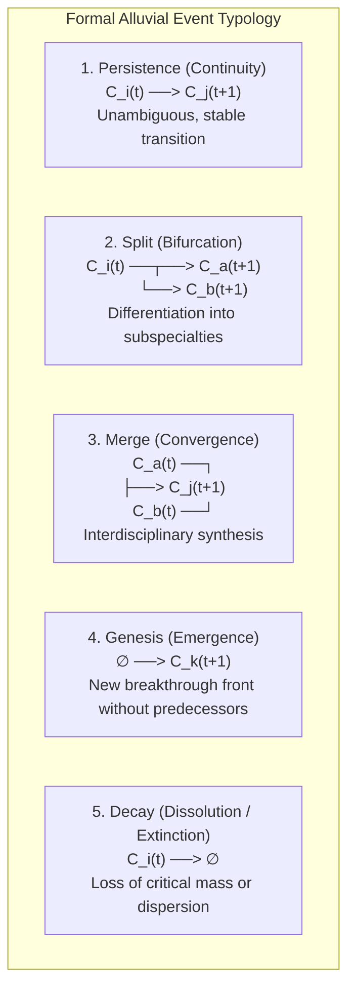

# Methodological Guide to Longitudinal Dynamics, AMI Metric, and Alluvial Lineages

### *Temporal Evolution of Research Fronts, Event Detection, and Alluvial Diagrams*

---

## 1. Foundations of Longitudinal Science Mapping

In the Science of Science, the structure of knowledge is not static. Research fronts undergo continuous transformations driven by new discoveries, researcher migration across disciplines, technological maturation, and the emergence of pressing societal challenges.

Static cross-sectional analysis takes a "snapshot" at a single point in time or collapses decades of literature into a single aggregated network. This creates two serious methodological pathologies:
1. **Fallacy of anachronism:** Mixes pioneering articles from the 1990s with contemporary works from the 2020s in the same cluster, obscuring radical shifts in the conceptual meaning of terms and active communities.
2. **Blindness to evolutionary events:** Fails to distinguish whether a current interdisciplinary area arose from the fusion of two previously separate fields, or whether a classical field split into diverging subspecialties.

To overcome these limitations, longitudinal research front analysis models science as a **temporal sequence of networks and partitions** (Rosvall & Bergstrom, 2010; Shibata et al., 2011).

---

## 2. Chronological Sliding Windows Protocol

The standard procedure for capturing temporal dynamics without introducing rigid arbitrary cutoffs consists of segmenting the corpus using **overlapping sliding windows**:

```
Temporal Corpus: [ Start Year ———————————————— End Year ]

Window W1: [ t0 ——— t0+w ]
Window W2:      [ t0+s ——— t0+s+w ]
Window W3:           [ t0+2s ——— t0+2s+w ]
...
```

### 2.1. Canonical Configuration Parameters
- **Window Width ($w$):**
  - Typically $w = 3$ to $w = 5$ years.
  - *Justification:* A single year typically has an overly sparse citation network subject to stochastic fluctuations. A 3-year window accumulates sufficient publication density and shared references to form statistically robust clusters.
- **Step Size ($s$):**
  - Typically $s = 1$ year (continuous annual shift).
  - *Justification:* Temporal overlap ($w - s$ years) ensures empirical continuity in the flow of citations and documents across adjacent windows, avoiding artificial discrete jumps.

---

## 3. Intertemporal Matching and Cluster Similarity Metrics

In each window $t \in \{1, \dots, T\}$, modular clustering (Leiden / Louvain) is executed deterministically, yielding a network partition into research front clusters:
$$\mathcal{P}^{(t)} = \{ C_1^{(t)}, C_2^{(t)}, \dots, C_{k_t}^{(t)} \}$$

The central challenge is **matching clusters across consecutive windows ($t \to t+1$)** to reconstruct knowledge lineages without arbitrarily collapsing their identities. To quantify intertemporal affinity between a cluster $C_i^{(t)}$ and a cluster $C_j^{(t+1)}$, three complementary metrics are used:

### 3.1. Jaccard Index on Shared Documents / References
Measures the direct overlap of the document base or cited bibliographic references between both clusters:
$$J(C_i^{(t)}, C_j^{(t+1)}) = \frac{|R(C_i^{(t)}) \cap R(C_j^{(t+1)})|}{|R(C_i^{(t)}) \cup R(C_j^{(t+1)})|}$$
Where $R(C_k)$ denotes the set of unique references cited by articles in cluster $C_k$.
- Range: $J \in [0, 1]$.
- A high value ($J > 0.3$) indicates that both clusters rest on the same shared intellectual base.

### 3.2. Vector Cosine Similarity of Reference Profiles
Represents each cluster $C_k$ as a sparse vector in the space of all possible references $\mathbb{R}^{|R|}$, where each coordinate is the frequency with which that reference was cited within the cluster:
$$\cos(C_i^{(t)}, C_j^{(t+1)}) = \frac{\mathbf{r}_i^{(t)} \cdot \mathbf{r}_j^{(t+1)}}{\|\mathbf{r}_i^{(t)}\| \cdot \|\mathbf{r}_j^{(t+1)}\|}$$
- Range: $[0, 1]$. Heavily weights high-frequency references (*core documents*) over marginal references cited only once.

### 3.3. Adjusted Mutual Information (AMI)
When analyzing the set of articles coexisting in the overlap of two consecutive windows, **Adjusted Mutual Information (Vinh, Epps & Bailey, 2010)** compares global partitions $\mathcal{U} = \mathcal{P}^{(t)}$ and $\mathcal{V} = \mathcal{P}^{(t+1)}$ while correcting for chance:
$$AMI(\mathcal{U}, \mathcal{V}) = \frac{MI(\mathcal{U}, \mathcal{V}) - \mathbb{E}[MI(\mathcal{U}, \mathcal{V})]}{\max(H(\mathcal{U}), H(\mathcal{V})) - \mathbb{E}[MI(\mathcal{U}, \mathcal{V})]}$$
Where:
- $MI(\mathcal{U}, \mathcal{V}) = \sum_{i=1}^R \sum_{j=1}^C \frac{|U_i \cap V_j|}{N} \log \left( \frac{N |U_i \cap V_j|}{|U_i| |V_j|} \right)$ is the Mutual Information.
- $H(\mathcal{U})$ is the Shannon entropy of partition $\mathcal{U}$.
- $\mathbb{E}[MI]$ is the expected mutual information under a random hypergeometric model with fixed cluster sizes.
- **Interpretation:** $AMI \in [0, 1]$. An $AMI \approx 1$ denotes high stability and structural persistence of the scientific landscape; an $AMI \to 0$ reflects chaotic reconfiguration or a paradigmatic shift in the discipline.

---

## 4. Formal Event Typology in Knowledge Lineages

Inspired by the formal framework for mapping change in complex networks by **Rosvall & Bergstrom (2010, *PLOS ONE*)** and the research front evolution studies by **Shibata et al. (2011)**, five topological events defining the lifecycle of a research front are formalized:



### 4.1. Operational Definitions and Thresholds
Let $S(C_i^{(t)}, C_j^{(t+1)})$ be the normalized similarity measure (Jaccard or Cosine):

1. **Persistence / Continuity:**
   - There is a single dominant predecessor cluster $C_i^{(t)}$ and a single dominant successor cluster $C_j^{(t+1)}$ such that:
     $$S(C_i^{(t)}, C_j^{(t+1)}) \ge \theta_{\text{persist}} \quad (\text{e.g., } \theta_{\text{persist}} = 0.35)$$
   - *Meaning:* The front matures incrementally without abrupt identity changes.
2. **Split / Bifurcation:**
   - A cluster $C_i^{(t)}$ distributes its document flow significantly across two or more successor clusters at $t+1$:
     $$S(C_i^{(t)}, C_a^{(t+1)}) \ge \theta_{\text{split}} \quad \text{and} \quad S(C_i^{(t)}, C_b^{(t+1)}) \ge \theta_{\text{split}} \quad (\text{e.g., } \theta_{\text{split}} = 0.20)$$
   - *Meaning:* Disciplinary differentiation. Accumulated critical mass leads subcommunities to adopt diverging specialized methods or empirical problems.
3. **Merge / Convergence:**
   - Two or more independent predecessor clusters $C_a^{(t)}$ and $C_b^{(t)}$ contribute significant flow to a single common successor cluster $C_j^{(t+1)}$:
     $$S(C_a^{(t)}, C_j^{(t+1)}) \ge \theta_{\text{merge}} \quad \text{and} \quad S(C_b^{(t)}, C_j^{(t+1)}) \ge \theta_{\text{merge}}$$
   - *Meaning:* Hybridization and interdisciplinarity. Previously isolated fields find a common theoretical or instrumental bridge (e.g., Artificial Intelligence + Biochemistry $\to$ Protein Folding).
4. **Genesis / Emergence:**
   - A new cluster $C_k^{(t+1)}$ appears with significant publication volume but lacks predecessors exceeding the minimum affinity threshold:
     $$\max_{i} S(C_i^{(t)}, C_k^{(t+1)}) < \theta_{\text{min}} \quad (\text{e.g., } \theta_{\text{min}} = 0.10)$$
   - *Meaning:* Radical paradigmatic leap (*disruptive breakthrough*), often driven by a new experimental technique or revolutionary theory.
5. **Decay / Dissolution:**
   - A cluster $C_i^{(t)}$ loses cohesion and volume without any of its outgoing flows toward $t+1$ reaching the minimum continuity threshold:
     $$\max_{j} S(C_i^{(t)}, C_j^{(t+1)}) < \theta_{\text{min}}$$
   - *Meaning:* The front is exhausted, its core problems are resolved, or its publications disperse into the broader literature.

---

## 5. The Alluvial Diagram

The **alluvial diagram** (Rosvall & Bergstrom, 2010) is the premier visual representation for communicating the evolution of thematic lineages to decision-makers and scientific evaluators:

### 5.1. Visual Components
- **Vertical Columns:** Represent successive chronological windows ($W_1, W_2, \dots, W_T$).
- **Vertical Blocks (*Nodes*):** Each block represents an active research front in that window. Block height is directly proportional to publication volume ($N$) or cumulative impact of the front.
- **Flow Ribbons (*Links*):** Connect blocks across adjacent columns. Ribbon thickness is proportional to the degree of affinity or volume of shared references/documents transitioning from one front to another.

### 5.2. Interactive Generation in Plotly (`go.Sankey`)
In analytical environments and executive dashboards, the alluvial diagram is deterministically rendered via the Python Plotly library, structuring nodes with fixed column coordinates and links weighted by the temporal transition matrix.

---

## 6. Bibliographic References (APA 7th)

1. **Chen, C. (2006).** CiteSpace II: Detecting and visualizing emerging trends and transient patterns in scientific literature. *Journal of the American Society for Information Science and Technology*, 57(3), 359–377. https://doi.org/10.1002/asi.20317
2. **Morris, S. A., Yen, G., Wu, Z., & Asnake, B. (2003).** Timeline visualization of research fronts. *Journal of the American Society for Information Science and Technology*, 54(5), 413–422. https://doi.org/10.1002/asi.10227
3. **Price, D. J. de S. (1965).** Networks of scientific papers. *Science*, 149(3683), 510–515. https://doi.org/10.1126/science.149.3683.510
4. **Rosvall, M., & Bergstrom, C. T. (2010).** Mapping change in large networks. *PLOS ONE*, 5(1), e8694. https://doi.org/10.1371/journal.pone.0008694
5. **Shibata, N., Kajikawa, Y., Takeda, Y., & Matsushima, K. (2011).** Detecting emerging research fronts in regenerative medicine by the citation network analysis of scientific papers. *Technological Forecasting and Social Change*, 78(2), 274–282. https://doi.org/10.1016/j.techfore.2010.07.016
6. **Vinh, N. X., Epps, J., & Bailey, J. (2010).** Information theoretic measures for clusterings comparison: Variants, properties, normalization and correction for chance. *Journal of Machine Learning Research*, 11, 2837–2854.
