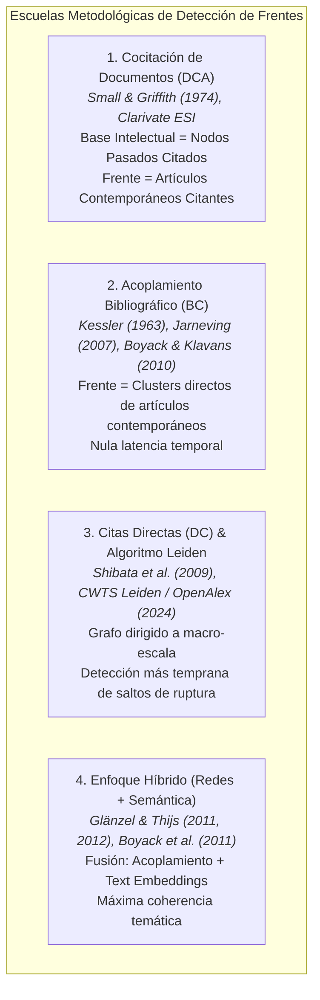

# Benchmark Metodológico de Detección de Frentes de Investigación en Redes Bibliométricas

### *Fundamentación Teórica, Formalizaciones Matemáticas y Análisis Comparativo*

---

## 1. Introducción y Marco Epistemológico

El concepto de **Frente de Investigación (*Research Front*)** fue introducido originalmente por **Derek John de Solla Price (1965)** en su trabajo seminal *"Networks of Scientific Papers"* (*Science*). Price postuló que la literatura científica no se distribuye de manera homogénea ni crece como una masa informe; por el contrario, cada nuevo artículo científico conecta selectivamente con una banda estrecha y densamente interconectada de publicaciones recientes (la literatura de los últimos 2 a 5 años). Esta "piel en crecimiento" o franja activa de la ciencia constituye la frontera epistémica en rápido avance: el frente de investigación.

En la cienciometría contemporánea, un frente de investigación se define como:
> **Definición Operativa:** Un agrupamiento denso (*cluster*) de documentos, conceptos y autores que comparten problemas empíricos, marcos metodológicos y recursos teóricos contemporáneos, representando el estado del arte activo de una especialidad científica.

A lo largo de seis décadas de desarrollo en la Ciencia de la Ciencia (*Science of Science*), se han consolidado **cuatro escuelas metodológicas principales** para operacionalizar y cartografiar frentes de investigación a partir de redes de citación:

---

## 2. Las Cuatro Escuelas Metodológicas

### 2.1. Escuela de Cocitación de Documentos (*Document Co-Citation Analysis - DCA*)
- **Pioneros:** Henry Small (1973), Irina V. Marshakova (1973), Belver C. Griffith & Henry Small (1974).
- **Mecanismo Operativo:**
  Dos documentos anteriores $d_i$ y $d_j$ se consideran cocitados si un documento posterior $d_k$ incluye a ambos en su lista de referencias bibliográficas. La fuerza de cocitación $C_{ij}$ es el conteo total de documentos posteriores que citan conjuntamente a $d_i$ y $d_j$.
- **La Dualidad Estructural Fundamental (Small & Griffith, 1974):**
  Small y Griffith establecieron que el análisis de cocitación divide la literatura en dos componentes acoplados:
  1. **Base Intelectual (*Intellectual Base*):** El cluster formado por los documentos pasados altamente cocitados. Representa los fundamentos conceptuales consolidados, teorías de base y metodologías de consenso.
  2. **Frente de Investigación (*Research Front*):** El conjunto de artículos recientes que citan a los documentos miembros del cluster de la base intelectual.
- **Implementación Canónica en Clarivate Essential Science Indicators (ESI):**
  Clarivate define los *Research Fronts* oficiales de la siguiente manera:
  1. Se seleccionan los *Highly Cited Papers* (el top 1% de artículos más citados por campo temático en los últimos 10 años).
  2. Se identifican pares de artículos altamente citados con frecuencia de cocitación superior a un umbral variable según la disciplina.
  3. Se forman clusters de cocitación mediante enlace único (*single-linkage*) o enlace promedio (*average-linkage*): estos son los **Documentos Núcleo (*Core Documents*)**.
  4. El **Frente de Investigación** es el conjunto formado por los documentos núcleo junto con todos los artículos recientes que los citan. El título del frente se genera algorítmicamente mediante las palabras clave más frecuentes en los títulos de los artículos citantes.
- **Limitación Estructural — El Rezago de Citación (*Citation Lag*):**
  El análisis de cocitación requiere que los descubrimientos acumulen citas de forma independiente antes de que puedan establecerse enlaces de cocitación. Esto genera un **retraso de 2 a 5 años**, haciendo que la cocitación sea un método retrospectivo que mapea paradigmas consolidados pero tiene dificultad para detectar áreas nacientes de ruptura en tiempo real.

---

### 2.2. Escuela de Acoplamiento Bibliográfico (*Bibliographic Coupling - BC*)
- **Pioneros:** M. M. Kessler (1963), Bo Jarneving (2005, 2007), Kevin W. Boyack & Richard Klavans (2010).
- **Mecanismo Operativo:**
  Dos documentos contemporáneos $d_A$ y $d_B$ están acoplados bibliográficamente si comparten una o más referencias en sus respectivas bibliografías ($R_A \cap R_B \neq \emptyset$). La fuerza de acoplamiento es el número de referencias compartidas:
  $$B_{AB} = |R_A \cap R_B|$$
- **Conceptualización Directa del Frente:**
  A diferencia de la cocitación, donde el frente es una entidad derivada indirectamente de los documentos citados, en el acoplamiento bibliográfico **los clusters resultantes están compuestos directamente por los artículos activos actuales**.
- **Ventaja Decisiva — Latencia Temporal Nula:**
  Las referencias bibliográficas de un artículo se definen de manera permanente en el instante de su publicación (o al subirse a un servidor de preprints como arXiv o bioRxiv). Por lo tanto, el acoplamiento bibliográfico permite asignar inmediatamente un nuevo documento a un frente de investigación **sin esperar a que reciba citas**.
- **El Gran Benchmark de Boyack & Klavans (2010):**
  En su riguroso estudio comparativo a escala masiva publicado en *JASIST*, Kevin Boyack y Richard Klavans compararon directamente la cocitación, el acoplamiento bibliográfico y las citas directas utilizando dos criterios objetivos de validación:
  1. **Coherencia textual (Textual Coherence):** Similitud de vocabulario entre los miembros de un cluster medida con BM25.
  2. **Concentración de financiamiento:** Correlación entre los clusters y las subvenciones de agencias otorgantes.
  *Hallazgo Concluyente:* **El acoplamiento bibliográfico superó a la cocitación y a las citas directas como el método puro de citación más preciso para representar el frente de investigación activo.**

---

### 2.3. Escuela de Citas Directas (*Direct Citation - DC*) y Algoritmo Leiden
- **Pioneros:** Richard Klavans & Kevin Boyack (2006, 2017), Naoki Shibata, Yuya Kajikawa, Yoshiyuki Takeda & Katsumori Matsushima (2008, 2009, 2011), Ludo Waltman & Nees Jan van Eck (2012, 2020), Vincent Traag, Ludo Waltman & Nees Jan van Eck (2019).
- **Mecanismo Operativo:**
  Se construye un grafo dirigido $G = (V, E)$ donde los nodos son las publicaciones y las aristas dirigidas representan citas explícitas ($d_i \to d_j$). Para el clustering, el grafo puede tratarse como no dirigido o ponderado por flujo extendido (*extended direct citation*).
- **El Benchmark de Shibata et al. (2009):**
  Shibata y colaboradores compararon citas directas, acoplamiento bibliográfico y cocitación en tres campos tecnológicos emergentes (Nitruro de Galio, Redes Complejas y Nanotubos de Carbono).
  *Hallazgo Concluyente:* **Las redes de citas directas detectan frentes emergentes antes que el acoplamiento bibliográfico y la cocitación**, ya que una investigación pionera que cita a un trabajo canónico queda de inmediato interconectada a la componente gigante del grafo, facilitando la detección de núcleos nacientes.
- **El Algoritmo Leiden (Traag, Waltman & van Eck, 2019):**
  Para particionar redes masivas de citas directas, el algoritmo Louvain tradicional adolece de un defecto grave: tiende a generar comunidades desconectadas internamente o mal cohesionadas. El **algoritmo Leiden** soluciona esta limitación mediante tres fases iterativas:
  1. Movimiento local de nodos.
  2. Refinamiento de la partición (donde se garantiza que cada subcomunidad sea conexa).
  3. Agregación de la red basada en la partición refinada.
- **La Taxonomía de Topics de OpenAlex (CWTS Leiden, 2024):**
  El Centro de Estudios de Ciencia y Tecnología (CWTS) de la Universidad de Leiden procesó el grafo mundial de citas directas de OpenAlex utilizando el algoritmo Leiden bajo el modelo *Constant Potts Model* (CPM), generando una taxonomía jerárquica abierta de ~4,500 Topics, agrupados en 252 Subfields, 26 Fields y 4 Domains globales.

---

### 2.4. Escuela Híbrida / Multimodal (Redes + Similitud Semántica)
- **Pioneros:** Wolfgang Glänzel & Bart Thijs (2011, 2012), Kevin Boyack et al. (2011).
- **Mecanismo Operativo:**
  Integra la topología estructural de citación con la semántica del lenguaje natural (títulos, resúmenes, descriptores MeSH o embeddings densos tipo SPECTER2 / SciBERT / Nomic).
  La matriz de adyacencia combinada se formula comúnmente como una combinación lineal convexa:
  $$S_{ij}^{\text{híbrido}} = \lambda \cdot S_{ij}^{\text{red}} + (1 - \lambda) \cdot S_{ij}^{\text{texto}}, \quad \text{con } \lambda \in [0, 1]$$
- **Ventajas:**
  - Resuelve el problema del vocabulario (sinonimia y polisemia) mediante la restricción bibliográfica.
  - Resuelve la dispersión de citas en artículos muy recientes mediante la proximidad semántica.

---

## 3. Tabla Comparativa de las Cuatro Escuelas

| Criterio | Cocitación (DCA) | Acoplamiento Bibliográfico (BC) | Citas Directas (DC) | Enfoque Híbrido |
| :--- | :--- | :--- | :--- | :--- |
| **Referencia Fundacional** | Small & Griffith (1974) | Kessler (1963); Boyack & Klavans (2010) | Shibata et al. (2009); Traag et al. (2019) | Glänzel & Thijs (2012) |
| **Definición del Frente** | Documentos recientes que citan al cluster de clásicos | Clusters directos de artículos contemporáneos | Comunidades de alta densidad en el grafo de citas | Clusters optimizados por citas y texto |
| **Naturaleza de los Nodos** | Documentos pasados citados (*Core*) | Documentos contemporáneos | Todos los documentos del grafo | Documentos contemporáneos |
| **Latencia Temporal** | Alta (2 a 5 años) | **Nula (Inmediata)** | Baja | **Nula (Inmediata)** |
| **Coherencia Temática** | Media-Alta | **Máxima (Método puro)** | Media (Sensible a densidad) | **Óptima absoluta** |
| **Velocidad de Detección** | Lenta | Alta | **Muy Alta (Shibata et al.)** | Muy Alta |
| **Complejidad de Cálculo** | $O(N_{\text{citados}}^2)$ | $O(N_{\text{recientes}}^2)$ sobre sparse matrices | $O(|E|)$ sobre grafos dirigidos | Media-Alta |
| **Uso Canónico** | Clarivate ESI, CiteSpace | VOSviewer, mapeos de vanguardia | CWTS Leiden, OpenAlex Topics | Modelos avanzados de IA / NLP |

---

## 4. Formalizaciones Matemáticas de Similitud y Normalización

Para construir la red de frentes de investigación, la fuerza cruda de acoplamiento o cocitación debe normalizarse para evitar que artículos con bibliografías extensas (e.g., revisiones sistemáticas) dominen artificialmente la topología:

### 4.1. Coseno de Salton (*Salton's Cosine*)
Mide la afinidad relativa entre dos documentos $i$ y $j$ normalizando por el producto geométrico de los tamaños de sus listas de referencias ($|R_i|$ y $|R_j|$):
$$S_{ij} = \frac{|R_i \cap R_j|}{\sqrt{|R_i| \cdot |R_j|}}$$
- Rango: $S_{ij} \in [0, 1]$.
- Propiedad: Si dos artículos citan exactamente las mismas referencias, $S_{ij} = 1.0$, independientemente del tamaño absoluto de la bibliografía.

### 4.2. Índice de Jaccard
Mide la proporción de referencias compartidas sobre la unión total de referencias:
$$J_{ij} = \frac{|R_i \cap R_j|}{|R_i \cup R_j|} = \frac{|R_i \cap R_j|}{|R_i| + |R_j| - |R_i \cap R_j|}$$
- Rango: $J_{ij} \in [0, 1]$. Tiende a penalizar más severamente las asimetrías de longitud que el Coseno de Salton.

### 4.3. Fuerza de Asociación (*Association Strength* — Van Eck & Waltman, 2009)
Es la métrica de normalización estándar utilizada por VOSviewer. Representa el ratio entre la co-ocurrencia observada y la co-ocurrencia esperada bajo un modelo nulo aleatorio:
$$A_{ij} = \frac{C_{ij}}{\frac{s_i \cdot s_j}{2m}}$$
Donde $s_i = \sum_k C_{ik}$ es la fuerza total del nodo $i$, y $m = \frac{1}{2} \sum_{i,j} C_{ij}$ es el peso total de la red.

---

## 5. Algoritmos de Detección Comunitaria para Frentes

### 5.1. Algoritmo Louvain (Blondel et al., 2008)
Optimiza la modularidad de Newman-Girvan:
$$Q = \frac{1}{2m} \sum_{i,j} \left[ A_{ij} - \frac{k_i k_j}{2m} \right] \delta(c_i, c_j)$$
- **Ventaja:** Extremadamente rápido y escalable.
- **Defecto en Cienciometría:** Sufre del límite de resolución (incapacidad para detectar clusters pequeños en redes grandes) y puede generar subcomunidades internamente desconectadas (*ill-connected communities*).

### 5.2. Algoritmo Leiden (Traag, Waltman & van Eck, 2019)
Supera las patologías de Louvain introduciendo una fase intermedia de refinamiento. Puede optimizar tanto la modularidad como la función de calidad **Constant Potts Model (CPM)**:
$$\mathcal{H}_{CPM} = - \sum_{c} \left[ e_c - \gamma \binom{n_c}{2} \right]$$
Donde $e_c$ es el número de aristas internas del cluster $c$, $n_c$ es el número de nodos, y $\gamma$ es el parámetro de resolución.
- **Ventaja Fundamental en Cienciometría:** El CPM es libre del límite de resolución (la partición de un subgrafo no depende del tamaño del grafo global) y garantiza que todas las comunidades encontradas sean conexas.

---

## 6. Matriz de Decisión Operativa para el Agente

Cuando una investigadora o investigador solicita identificar o analizar frentes de investigación, el agente debe seleccionar la estrategia según la siguiente matriz de correspondencia:

| Objetivo del Estudio | Estrategia Recomendada | Justificación Cienciométrica |
| :--- | :--- | :--- |
| **Identificar frentes activos en los últimos 1–3 años (frente emergente)** | **Acoplamiento Bibliográfico Contemporáneo (BC)** con normalización Salton / Association Strength | Nula latencia de citación. No requiere esperar acumulación de citas; agrupa directamente los papers actuales ([Boyack & Klavans, 2010](https://doi.org/10.1002/asi.21419)). |
| **Mapear la base teórica e hitos fundacionales de una disciplina** | **Cocitación de Documentos (DCA)** con identificación de Documentos Núcleo | Mapea la estructura del consenso histórico e identifica los clásicos canónicos que sostienen la disciplina ([Small & Griffith, 1974](https://doi.org/10.1177/030631277400400102)). |
| **Análisis macroscópico rápido de un subcampo a nivel nacional o global** | **Taxonomía Canónica OpenAlex Topics (CWTS Leiden)** | Utiliza los ~4,500 frentes precalculados sobre 464M de trabajos sin requerir recomputar redes de millones de aristas. |
| **Corpus con baja densidad de citas (e.g., literatura regional o multidisciplinar)** | **Enfoque Híbrido (Acoplamiento + Embeddings Semánticos TF-IDF / Nomic)** | La similitud de texto compensa la escasez de referencias compartidas ([Glänzel & Thijs, 2012](https://doi.org/10.1016/j.joi.2011.12.005)). |
| **Estudiar la evolución, bifurcación o fusión de un área a lo largo del tiempo** | **Encadenamiento Longitudinal de Frentes con Métrica AMI y Diagrama Aluvial** | Segmentación en ventanas cronológicas móviles y seguimiento de eventos evolutivos ([Rosvall & Bergstrom, 2010](https://doi.org/10.1371/journal.pone.0008694)). |

---

## 7. Referencias Bibliográficas (APA 7ª)

1. **Blondel, V. D., Guillaume, J.-L., Lambiotte, R., & Lefebvre, E. (2008).** Fast unfolding of communities in large networks. *Journal of Statistical Mechanics: Theory and Experiment*, 2008(10), P10008. https://doi.org/10.1088/1742-5468/2008/10/P10008
2. **Boyack, K. W., & Klavans, R. (2010).** Co-citation analysis, bibliographic coupling, and direct citation: Which citation approach represents the research front most accurately? *Journal of the American Society for Information Science and Technology*, 61(12), 2389–2404. https://doi.org/10.1002/asi.21419
3. **Boyack, K. W., Newman, D., Duhon, R. J., Klavans, R., Patek, M., Biberstine, J. R., Schijvenaars, B., Skupin, A., & Börner, K. (2011).** Clustering more than two million biomedical publications: Comparing the accuracies of nine text-based similarity approaches. *PLOS ONE*, 6(3), e18020. https://doi.org/10.1371/journal.pone.0018020
4. **Glänzel, W., & Thijs, B. (2012).** Using hybrid methods and "core documents" for representation, segmentation and mapping of science. *Journal of Informetrics*, 6(2), 316–329. https://doi.org/10.1016/j.joi.2011.12.005
5. **Griffith, B. C., Small, H. G., Stonehill, J. A., & Dey, S. (1974).** The structure of scientific literatures II: Toward a macro- and microstructure for science. *Science Studies*, 4(4), 339–365. https://doi.org/10.1177/030631277400400402
6. **Jarneving, B. (2007).** Bibliographic coupling and its application to research-front and other core documents. *Journal of Informetrics*, 1(4), 287–307. https://doi.org/10.1016/j.joi.2007.07.004
7. **Kessler, M. M. (1963).** Bibliographic coupling between scientific papers. *American Documentation*, 14(1), 10–25. https://doi.org/10.1002/asi.5090140103
8. **Klavans, R., & Boyack, K. W. (2006).** Identifying a better measure of active research fronts: Alternative co-citation analysis. *Scientometrics*, 66(2), 347–367. https://doi.org/10.1007/s11192-006-0025-4
9. **Marshakova, I. V. (1973).** A system of document connections based on references. *Nauchno-Tekhnicheskaya Informatsiya*, Ser. 2, 6, 3–8.
10. **Price, D. J. de S. (1965).** Networks of scientific papers. *Science*, 149(3683), 510–515. https://doi.org/10.1126/science.149.3683.510
11. **Shibata, N., Kajikawa, Y., Takeda, Y., & Matsushima, K. (2009).** Comparative study on methods of detecting research fronts using different types of citation. *Journal of the American Society for Information Science and Technology*, 81(2), 571–598. https://doi.org/10.1002/asi.20990
12. **Small, H. (1973).** Co-citation in the scientific literature: A new measure of the relationship between two documents. *Journal of the American Society for Information Science*, 24(4), 265–269. https://doi.org/10.1002/asi.4630240406
13. **Small, H., & Griffith, B. C. (1974).** The structure of scientific literatures I: Identifying and graphing specialties. *Science Studies*, 4(1), 17–40. https://doi.org/10.1177/030631277400400102
14. **Traag, V. A., Waltman, L., & van Eck, N. J. (2019).** From Louvain to Leiden: guaranteeing well-connected communities. *Scientific Reports*, 9(1), 5233. https://doi.org/10.1038/s41598-019-41695-x
15. **Van Eck, N. J., & Waltman, L. (2009).** How to normalize cooccurrence data? An analysis of some well-known similarity measures. *Journal of the American Society for Information Science and Technology*, 60(8), 1635–1651. https://doi.org/10.1002/asi.21075
16. **Waltman, L., & van Eck, N. J. (2012).** A new approach to modularity-based community detection for large-scale networks. *Scientometrics*, 94(3), 1181–1198. https://doi.org/10.1007/s11192-012-0707-4

