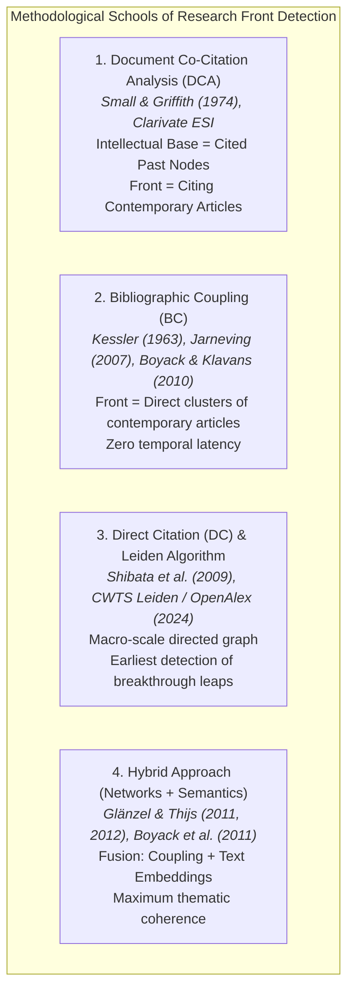

# Methodological Benchmark for Research Front Detection in Bibliometric Networks

### *Theoretical Foundations, Mathematical Formalizations, and Comparative Analysis*

---

## 1. Introduction and Epistemological Framework

The concept of a **Research Front** was originally introduced by **Derek John de Solla Price (1965)** in his seminal paper *"Networks of Scientific Papers"* (*Science*). Price postulated that scientific literature is neither homogeneously distributed nor grows as an amorphous mass; rather, each new scientific article selectively connects to a narrow, densely interconnected band of recent publications (the literature of the last 2 to 5 years). This "growing skin" or active strip of science constitutes the rapidly advancing epistemic frontier: the research front.

In contemporary scientometrics, a research front is defined as:
> **Operational Definition:** A dense cluster of documents, concepts, and authors sharing contemporary empirical problems, methodological frameworks, and theoretical resources, representing the active state of the art of a scientific specialty.

Across six decades of development in the Science of Science, **four main methodological schools** have consolidated to operationalize and map research fronts from citation networks:

---

## 2. The Four Methodological Schools

### 2.1. Document Co-Citation Analysis School (DCA)
- **Pioneers:** Henry Small (1973), Irina V. Marshakova (1973), Belver C. Griffith & Henry Small (1974).
- **Operational Mechanism:**
  Two earlier documents $d_i$ and $d_j$ are co-cited if a subsequent document $d_k$ includes both in its bibliographic reference list. The co-citation strength $C_{ij}$ is the total count of subsequent documents that jointly cite $d_i$ and $d_j$.
- **The Fundamental Structural Duality (Small & Griffith, 1974):**
  Small and Griffith established that co-citation analysis divides the literature into two coupled components:
  1. **Intellectual Base:** The cluster formed by highly co-cited past documents. It represents consolidated conceptual foundations, core theories, and consensus methodologies.
  2. **Research Front:** The set of recent articles citing the documents in the intellectual base cluster.
- **Canonical Implementation in Clarivate Essential Science Indicators (ESI):**
  Clarivate defines official *Research Fronts* as follows:
  1. *Highly Cited Papers* (the top 1% most cited articles by thematic field over the last 10 years) are selected.
  2. Pairs of highly cited articles with co-citation frequency above a discipline-specific threshold are identified.
  3. Co-citation clusters are formed via single-linkage or average-linkage clustering: these are the **Core Documents**.
  4. The **Research Front** consists of the core documents together with all recent articles citing them. The front's title is algorithmically generated from the most frequent keywords in the titles of the citing articles.
- **Structural Limitation — Citation Lag:**
  Co-citation analysis requires discoveries to independently accumulate citations before co-citation links can form. This introduces a **2- to 5-year lag**, making co-citation a retrospective method that maps consolidated paradigms well but struggles to detect nascent breakthrough areas in real time.

---

### 2.2. Bibliographic Coupling School (BC)
- **Pioneers:** M. M. Kessler (1963), Bo Jarneving (2005, 2007), Kevin W. Boyack & Richard Klavans (2010).
- **Operational Mechanism:**
  Two contemporary documents $d_A$ and $d_B$ are bibliographically coupled if they share one or more references in their respective bibliographies ($R_A \cap R_B \neq \emptyset$). The coupling strength is the number of shared references:
  $$B_{AB} = |R_A \cap R_B|$$
- **Direct Conceptualization of the Front:**
  Unlike co-citation, where the front is an entity indirectly derived from cited documents, in bibliographic coupling **the resulting clusters are composed directly of active contemporary articles**.
- **Decisive Advantage — Zero Temporal Latency:**
  An article's bibliographic references are permanently fixed at the moment of publication (or when uploaded to a preprint server such as arXiv or bioRxiv). Consequently, bibliographic coupling immediately assigns a new document to a research front **without waiting for it to accumulate citations**.
- **The Landmark Boyack & Klavans Benchmark (2010):**
  In their rigorous large-scale comparative study published in *JASIST*, Kevin Boyack and Richard Klavans directly compared co-citation, bibliographic coupling, and direct citation using two objective validation criteria:
  1. **Textual Coherence:** Vocabulary similarity among cluster members measured via BM25.
  2. **Grant Concentration:** Correlation between clusters and funding agency grants.
  *Conclusive Finding:* **Bibliographic coupling outperformed both co-citation and direct citation as the most accurate pure citation method for representing active research fronts.**

---

### 2.3. Direct Citation School (DC) and the Leiden Algorithm
- **Pioneers:** Richard Klavans & Kevin Boyack (2006, 2017), Naoki Shibata, Yuya Kajikawa, Yoshiyuki Takeda & Katsumori Matsushima (2008, 2009, 2011), Ludo Waltman & Nees Jan van Eck (2012, 2020), Vincent Traag, Ludo Waltman & Nees Jan van Eck (2019).
- **Operational Mechanism:**
  A directed graph $G = (V, E)$ is constructed where nodes are publications and directed edges represent explicit citations ($d_i \to d_j$). For clustering, the graph can be treated as undirected or weighted by extended flow (*extended direct citation*).
- **The Shibata et al. Benchmark (2009):**
  Shibata and colleagues compared direct citation, bibliographic coupling, and co-citation across three emerging technological fields (Gallium Nitride, Complex Networks, and Carbon Nanotubes).
  *Conclusive Finding:* **Direct citation networks detect emerging fronts earlier than bibliographic coupling and co-citation**, because pioneering research citing a canonical work is immediately connected to the giant component of the graph, facilitating early detection of nascent cores.
- **The Leiden Algorithm (Traag, Waltman & van Eck, 2019):**
  When partitioning massive direct citation networks, the traditional Louvain algorithm suffers from a severe defect: it tends to produce internally disconnected or poorly cohesive communities. The **Leiden algorithm** resolves this limitation through three iterative phases:
  1. Local moving of nodes.
  2. Refinement of the partition (guaranteeing that every subcommunity is connected).
  3. Aggregation of the network based on the refined partition.
- **The OpenAlex Topics Taxonomy (CWTS Leiden, 2024):**
  The Centre for Science and Technology Studies (CWTS) at Leiden University processed the global OpenAlex direct citation graph using the Leiden algorithm under the *Constant Potts Model* (CPM), generating an open hierarchical taxonomy of ~4,500 Topics grouped into 252 Subfields, 26 Fields, and 4 global Domains.

---

### 2.4. Hybrid / Multimodal School (Networks + Semantic Similarity)
- **Pioneers:** Wolfgang Glänzel & Bart Thijs (2011, 2012), Kevin Boyack et al. (2011).
- **Operational Mechanism:**
  Integrates structural citation topology with natural language semantics (titles, abstracts, MeSH descriptors, or dense embeddings such as SPECTER2 / SciBERT / Nomic).
  The combined adjacency matrix is commonly formulated as a convex linear combination:
  $$S_{ij}^{\text{hybrid}} = \lambda \cdot S_{ij}^{\text{network}} + (1 - \lambda) \cdot S_{ij}^{\text{text}}, \quad \text{with } \lambda \in [0, 1]$$
- **Advantages:**
  - Resolves vocabulary issues (synonymy and polysemy) through bibliographic constraints.
  - Mitigates citation sparsity in very recent articles through semantic proximity.

---

## 3. Comparative Table of the Four Schools

| Criterion | Co-Citation (DCA) | Bibliographic Coupling (BC) | Direct Citation (DC) | Hybrid Approach |
| :--- | :--- | :--- | :--- | :--- |
| **Foundational Reference** | Small & Griffith (1974) | Kessler (1963); Boyack & Klavans (2010) | Shibata et al. (2009); Traag et al. (2019) | Glänzel & Thijs (2012) |
| **Front Definition** | Recent documents citing the cluster of classics | Direct clusters of contemporary articles | High-density communities in the citation graph | Clusters jointly optimized by citations and text |
| **Node Nature** | Cited past documents (*Core*) | Contemporary documents | All documents in the graph | Contemporary documents |
| **Temporal Latency** | High (2 to 5 years) | **Zero (Immediate)** | Low | **Zero (Immediate)** |
| **Thematic Coherence** | Medium-High | **Maximum (Pure method)** | Medium (Density-sensitive) | **Absolute optimum** |
| **Detection Speed** | Slow | High | **Very High (Shibata et al.)** | Very High |
| **Computational Complexity** | $O(N_{\text{cited}}^2)$ | $O(N_{\text{recent}}^2)$ over sparse matrices | $O(|E|)$ over directed graphs | Medium-High |
| **Canonical Use** | Clarivate ESI, CiteSpace | VOSviewer, frontier mappings | CWTS Leiden, OpenAlex Topics | Advanced AI / NLP models |

---

## 4. Mathematical Formalizations of Similarity and Normalization

To construct a research front network, raw coupling or co-citation counts must be normalized so that articles with long reference lists (e.g., systematic reviews) do not artificially dominate the topology:

### 4.1. Salton's Cosine
Measures the relative affinity between two documents $i$ and $j$ by normalizing by the geometric mean of their reference list sizes ($|R_i|$ and $|R_j|$):
$$S_{ij} = \frac{|R_i \cap R_j|}{\sqrt{|R_i| \cdot |R_j|}}$$
- Range: $S_{ij} \in [0, 1]$.
- Property: If two articles cite the exact same references, $S_{ij} = 1.0$, regardless of absolute bibliography size.

### 4.2. Jaccard Index
Measures the proportion of shared references over the total union of references:
$$J_{ij} = \frac{|R_i \cap R_j|}{|R_i \cup R_j|} = \frac{|R_i \cap R_j|}{|R_i| + |R_j| - |R_i \cap R_j|}$$
- Range: $J_{ij} \in [0, 1]$. Tends to penalize length asymmetries more severely than Salton's Cosine.

### 4.3. Association Strength (Van Eck & Waltman, 2009)
The standard normalization metric used by VOSviewer. It represents the ratio between observed co-occurrence and expected co-occurrence under a random null model:
$$A_{ij} = \frac{C_{ij}}{\frac{s_i \cdot s_j}{2m}}$$
Where $s_i = \sum_k C_{ik}$ is the total strength of node $i$, and $m = \frac{1}{2} \sum_{i,j} C_{ij}$ is the total network weight.

---

## 5. Community Detection Algorithms for Research Fronts

### 5.1. Louvain Algorithm (Blondel et al., 2008)
Optimizes Newman-Girvan modularity:
$$Q = \frac{1}{2m} \sum_{i,j} \left[ A_{ij} - \frac{k_i k_j}{2m} \right] \delta(c_i, c_j)$$
- **Advantage:** Extremely fast and scalable.
- **Defect in Scientometrics:** Suffers from the resolution limit (inability to detect small clusters in large networks) and can produce internally disconnected subcommunities (*ill-connected communities*).

### 5.2. Leiden Algorithm (Traag, Waltman & van Eck, 2019)
Overcomes Louvain's pathologies by introducing an intermediate refinement phase. It can optimize either modularity or the **Constant Potts Model (CPM)** quality function:
$$\mathcal{H}_{CPM} = - \sum_{c} \left[ e_c - \gamma \binom{n_c}{2} \right]$$
Where $e_c$ is the number of internal edges in cluster $c$, $n_c$ is the number of nodes, and $\gamma$ is the resolution parameter.
- **Fundamental Advantage in Scientometrics:** CPM is resolution-limit-free (partitioning a subgraph does not depend on the size of the global graph) and guarantees that all detected communities are connected.

---

## 6. Operational Decision Matrix for the Agent

When a researcher requests identification or analysis of research fronts, the agent must select the strategy according to the following decision matrix:

| Study Objective | Recommended Strategy | Scientometric Justification |
| :--- | :--- | :--- |
| **Identify active fronts in the last 1–3 years (emerging front)** | **Contemporary Bibliographic Coupling (BC)** with Salton / Association Strength normalization | Zero citation latency. Requires no citation accumulation lag; directly clusters current papers ([Boyack & Klavans, 2010](https://doi.org/10.1002/asi.21419)). |
| **Map the theoretical base and foundational milestones of a discipline** | **Document Co-Citation Analysis (DCA)** with Core Document identification | Maps the structure of historical consensus and identifies the canonical classics sustaining the discipline ([Small & Griffith, 1974](https://doi.org/10.1177/030631277400400102)). |
| **Rapid macroscopic analysis of a subfield at national or global scale** | **Canonical OpenAlex Topics Taxonomy (CWTS Leiden)** | Leverages ~4,500 precomputed fronts across 464M works without recomputing multi-million-edge networks. |
| **Corpus with low citation density (e.g., regional or multidisciplinary literature)** | **Hybrid Approach (Coupling + TF-IDF / Nomic Semantic Embeddings)** | Text similarity compensates for sparse shared references ([Glänzel & Thijs, 2012](https://doi.org/10.1016/j.joi.2011.12.005)). |
| **Study the evolution, bifurcation, or fusion of an area over time** | **Longitudinal Front Chaining with AMI Metric and Alluvial Diagram** | Segments into chronological sliding windows and tracks evolutionary events ([Rosvall & Bergstrom, 2010](https://doi.org/10.1371/journal.pone.0008694)). |

---

## 7. Bibliographic References (APA 7th)

1. **Blondel, V. D., Guillaume, J.-L., Lambiotte, R., & Lefebvre, E. (2008).** Fast unfolding of communities in large networks. *Journal of Statistical Mechanics: Theory and Experiment*, 2008(10), P10008. https://doi.org/10.1088/1742-5468/2008/10/P10008
2. **Boyack, K. W., & Klavans, R. (2010).** Co-citation analysis, bibliographic coupling, and direct citation: Which citation approach represents the research front most accurately? *Journal of the American Society for Information Science and Technology*, 61(12), 2389–2404. https://doi.org/10.1002/asi.21419
3. **Boyack, K. W., Newman, D., Duhon, R. J., Klavans, R., Patek, M., Biberstine, J. R., Schijvenaars, B., Skupin, A., & Börner, K. (2011).** Clustering more than two million biomedical publications: Comparing the accuracies of nine text-based similarity approaches. *PLOS ONE*, 6(3), e18020. https://doi.org/10.1371/journal.pone.0018020
4. **Glänzel, W., & Thijs, B. (2012).** Using hybrid methods and "core documents" for representation, segmentation and mapping of science. *Journal of Informetrics*, 6(2), 316–329. https://doi.org/10.1016/j.joi.2011.12.005
5. **Griffith, B. C., Small, H. G., Stonehill, J. A., & Dey, S. (1974).** The structure of scientific literatures II: Toward a macro- and microstructure for science. *Science Studies*, 4(4), 339–365. https://doi.org/10.1177/030631277400400402
6. **Jarneving, B. (2007).** Bibliographic coupling and its application to research-front and other core documents. *Journal of Informetrics*, 1(4), 287–307. https://doi.org/10.1016/j.joi.2007.07.004
7. **Kessler, M. M. (1963).** Bibliographic coupling between scientific papers. *American Documentation*, 14(1), 10–25. https://doi.org/10.1002/asi.5090140103
8. **Klavans, R., & Boyack, K. W. (2006).** Identifying a better measure of active research fronts: Alternative co-citation analysis. *Scientometrics*, 66(2), 347–367. https://doi.org/10.1007/s11192-006-0025-4
9. **Marshakova, I. V. (1973).** A system of document connections based on references. *Nauchno-Tekhnicheskaya Informatsiya*, Ser. 2, 6, 3–8.
10. **Price, D. J. de S. (1965).** Networks of scientific papers. *Science*, 149(3683), 510–515. https://doi.org/10.1126/science.149.3683.510
11. **Shibata, N., Kajikawa, Y., Takeda, Y., & Matsushima, K. (2009).** Comparative study on methods of detecting research fronts using different types of citation. *Journal of the American Society for Information Science and Technology*, 81(2), 571–598. https://doi.org/10.1002/asi.20990
12. **Small, H. (1973).** Co-citation in the scientific literature: A new measure of the relationship between two documents. *Journal of the American Society for Information Science*, 24(4), 265–269. https://doi.org/10.1002/asi.4630240406
13. **Small, H., & Griffith, B. C. (1974).** The structure of scientific literatures I: Identifying and graphing specialties. *Science Studies*, 4(1), 17–40. https://doi.org/10.1177/030631277400400102
14. **Traag, V. A., Waltman, L., & van Eck, N. J. (2019).** From Louvain to Leiden: guaranteeing well-connected communities. *Scientific Reports*, 9(1), 5233. https://doi.org/10.1038/s41598-019-41695-x
15. **Van Eck, N. J., & Waltman, L. (2009).** How to normalize cooccurrence data? An analysis of some well-known similarity measures. *Journal of the American Society for Information Science and Technology*, 60(8), 1635–1651. https://doi.org/10.1002/asi.21075
16. **Waltman, L., & van Eck, N. J. (2012).** A new approach to modularity-based community detection for large-scale networks. *Scientometrics*, 94(3), 1181–1198. https://doi.org/10.1007/s11192-012-0707-4
