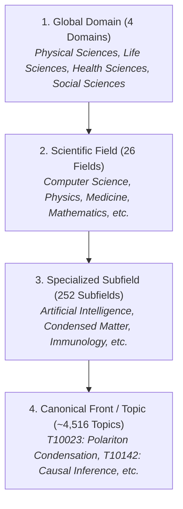

# Canonical OpenAlex Topics Taxonomy and CWTS Leiden Methodology

### *Multi-Level Hierarchical Structure, ClickHouse Mapping, and Query Rules*

---

## 1. Origin and CWTS Leiden Methodology

In January 2024, **OpenAlex** replaced its legacy "Concepts" system (inherited from Microsoft Academic Graph) with an open, hierarchical, and reproducible **Topics** taxonomy developed in direct collaboration with the **Centre for Science and Technology Studies (CWTS)** at Leiden University.

### 1.1. Construction Procedure
1. **Global Direct Citation Graph:** CWTS processed OpenAlex's global direct citation graph (over 250 million publications interconnected by explicit citations).
2. **Leiden Algorithm with CPM Model:**
   The Leiden algorithm (Traag, Waltman & van Eck, 2019) was applied by optimizing the *Constant Potts Model* (CPM) quality function across multiple modular resolution levels ($\gamma$). This guaranteed:
   - That all resulting clusters are internally connected (no isolated subcommunities).
   - Complete freedom from the resolution limit of traditional modularity.
3. **Labeling and Classification with Large Language Models (LLMs):**
   For each identified cluster, the most discriminative keywords were extracted and advanced language models were used to assign a formal descriptive title to the Topic.
4. **Text- and Citation-Based Classifier:**
   For recent works or preprints not yet linked by citations in the graph, a deep neural classifier was trained to predict the most probable Topic from the title, abstract, source venue, and outgoing citations.

---

## 2. 4-Level Taxonomic Hierarchy

The taxonomy organizes the entirety of global scientific knowledge into four strict hierarchical levels:

### 2.1. The 4 Global Domains
1. **Physical Sciences:** Physics, Astronomy, Chemistry, Computer Science, Mathematics, Engineering, and Earth Sciences.
2. **Life Sciences:** Molecular Biology, Biochemistry, Genetics, Neuroscience, Agricultural Sciences, and Ecology.
3. **Health Sciences:** Medicine, Dentistry, Pharmacology, Nursing, and Public Health.
4. **Social Sciences:** Economics, Sociology, Psychology, Education, Law, Humanities, and Arts.

---

## 3. Mapping in ClickHouse (`rag.works_flat`)

In the global columnar database `rag.works_flat` (464.8M records), the taxonomy levels are denormalized into high-performance native columns:

| Hierarchical Level | Primary Column (Text) | Identifier Column (ID) | ClickHouse Data Type |
| :--- | :--- | :--- | :--- |
| **Domain** | `domain_name` (or `domain`) | — | `LowCardinality(String)` |
| **Field** | `field_name` (or `field`) | — | `LowCardinality(String)` |
| **Subfield**| `subfield_name` (or `subfield`)| `subfield_id` | `LowCardinality(String)` |
| **Canonical Topic** | `topic` | `topic_id` (e.g., `T10023`) | `String` / `LowCardinality(String)` |
| **Primary Topic** | — | `primary_topic_id` | `String` |
| **All Topics** | — | `all_topics` | `Array(LowCardinality(String))` |

> [!TIP]
> **Columnar Optimization (ZERO JOINs):**
> When querying `rag.works_flat`, never perform a `JOIN` with external topic tables. Filter directly using `subfield_name = 'Artificial Intelligence'` or `topic_id = 'T10142'`. To check secondary topics, use the native function `has(all_topics, 'T10142')`.

---

## 4. When to Use OpenAlex Topics vs. Ad-Hoc Bibliographic Coupling

| Analysis Scenario | Recommended Choice | Technical Reason |
| :--- | :--- | :--- |
| **University- or Country-wide Mapping** | **OpenAlex Topics (`rag.works_flat`)** | Evaluates thousands of publications in seconds without reconstructing citation graphs. |
| **Thematic Concentration Sunburst Diagram** | **OpenAlex Hierarchy (Domain $\to$ Field $\to$ Subfield $\to$ Topic)** | 100% precomputed multi-level structure directly compatible with Plotly `go.Sunburst`. |
| **Delineating a Specific Emerging Research Front (micro-front)** | **Ad-Hoc Contemporary Bibliographic Coupling** | Fine granularity. OpenAlex Topics group ~50 to 200 papers per year; ad-hoc coupling isolates specific frontier clusters of 10 to 30 articles. |
| **Temporal Evolution of a Multidisciplinary Topic** | **Hybrid: Subfield/Topic Filtering + AMI Lineages** | Extracts the subfield literature and tracks annual bifurcations and merges using the AMI metric. |
