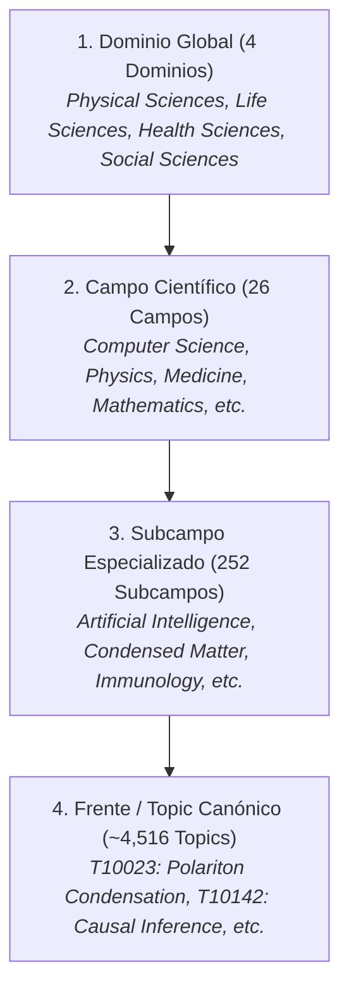

# Taxonomía Canónica de Topics de OpenAlex y Metodología CWTS Leiden

### *Estructura Jerárquica Multinivel, Mapeo en ClickHouse y Reglas de Consulta*

---

## 1. Origen y Metodología CWTS Leiden

En enero de 2024, **OpenAlex** reemplazó el sistema anterior de "Concepts" (heredado de Microsoft Academic Graph) por una taxonomía abierta, jerárquica y reproducible de **Topics**, desarrollada en colaboración directa con el **Centre for Science and Technology Studies (CWTS)** de la Universidad de Leiden.

### 1.1. Procedimiento de Construcción
1. **Grafo Mundial de Citas Directas:** El CWTS procesó el grafo global de citación directa de OpenAlex (más de 250 millones de publicaciones interconectadas por citas explícitas).
2. **Algoritmo Leiden con Modelo CPM:**
   Se aplicó el algoritmo Leiden (Traag, Waltman & van Eck, 2019) optimizando la función de calidad *Constant Potts Model* (CPM) a múltiples niveles de resolución modular ($\gamma$). Esto garantizó:
   - Que todos los clusters resultantes fueran internamente conexos (sin subcomunidades aisladas).
   - Ausencia total del límite de resolución de la modularidad tradicional.
3. **Etiquetado y Clasificación con Modelos de Lenguaje (LLMs):**
   Para cada cluster identificado, se extrajeron las palabras clave más discriminantes y se emplearon modelos de lenguaje avanzados para asignar un título descriptivo formal al Topic.
4. **Clasificador Basado en Texto y Citas:**
   Para obras recientes o preprints que aún no cuentan con citas en el grafo, se entrenó un clasificador neuronal profundo que predice el Topic más probable a partir del título, resumen, fuentes y citas salientes.

---

## 2. Jerarquía Taxonómica en 4 Niveles

La taxonomía organiza la totalidad del conocimiento científico mundial en cuatro niveles jerárquicos estrictos:

### 2.1. Los 4 Dominios Globales
1. **Physical Sciences (Ciencias Físicas y Matemáticas):** Física, Astronomía, Química, Ciencias de la Computación, Matemáticas, Ingeniería y Ciencias de la Tierra.
2. **Life Sciences (Ciencias de la Vida):** Biología Molecular, Bioquímica, Genética, Neurociencias, Ciencias Agrícolas y Ecología.
3. **Health Sciences (Ciencias de la Salud):** Medicina, Odontología, Farmacología, Enfermería y Salud Pública.
4. **Social Sciences (Ciencias Sociales y Humanidades):** Economía, Sociología, Psicología, Educación, Derecho, Humanidades y Artes.

---

## 3. Mapeo en ClickHouse (`rag.works_flat`)

En la base de datos columnar global `rag.works_flat` (464.8M de registros), los niveles de la taxonomía se encuentran desnormalizados en columnas nativas de alto rendimiento:

| Nivel Jerárquico | Columna Primaria (Texto) | Columna Identificador (ID) | Tipo de Dato en ClickHouse |
| :--- | :--- | :--- | :--- |
| **Dominio (Domain)** | `domain_name` (o `domain`) | — | `LowCardinality(String)` |
| **Campo (Field)** | `field_name` (o `field`) | — | `LowCardinality(String)` |
| **Subcampo (Subfield)**| `subfield_name` (o `subfield`)| `subfield_id` | `LowCardinality(String)` |
| **Topic Canónico** | `topic` | `topic_id` (ej. `T10023`) | `String` / `LowCardinality(String)` |
| **Topic Primario** | — | `primary_topic_id` | `String` |
| **Todos los Topics** | — | `all_topics` | `Array(LowCardinality(String))` |

> [!TIP]
> **Optimización Columnar (CERO JOINs):**
> Al consultar `rag.works_flat`, nunca se debe realizar un `JOIN` con tablas externas de temas. Filtrar directamente utilizando `subfield_name = 'Artificial Intelligence'` o `topic_id = 'T10142'`. Para verificar temas secundarios, emplear la función nativa `has(all_topics, 'T10142')`.

---

## 4. Cuándo Usar OpenAlex Topics vs. Acoplamiento Bibliográfico Ad-Hoc

| Escenario de Análisis | Elección Recomendada | Razón Técnica |
| :--- | :--- | :--- |
| **Mapeo a nivel de toda una Universidad o País** | **OpenAlex Topics (`rag.works_flat`)** | Evalúa miles de publicaciones en segundos sin necesidad de reconstruir grafos de citas. |
| **Diagrama Sunburst de Concentración Temática** | **Jerarquía OpenAlex (Domain $\to$ Field $\to$ Subfield $\to$ Topic)** | Estructura multinivel 100% precalculada y compatible con Plotly `go.Sunburst`. |
| **Delimitación de un Frente de Investigación Emergente Específico (micro-frente)** | **Acoplamiento Bibliográfico Contemporáneo Ad-Hoc** | Granularidad fina. Los Topics de OpenAlex agrupan ~50 a 200 papers por año; el acoplamiento ad-hoc permite aislar clusters específicos de 10 a 30 artículos de frontera. |
| **Evolución Temporal de un Tema Multidisciplinar** | **Híbrido: Filtrado por Subfield/Topic + Linajes AMI** | Se extrae la literatura del subcampo y se rastrean las bifurcaciones y fusiones anuales con la métrica AMI. |
