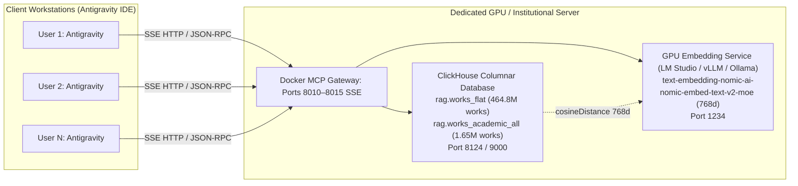
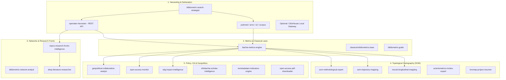

# SOS (Science of Science) MCP Services & Agent Skills

## Master User Manual for Google Antigravity & Gemini

> **Computational Scientometrics, Informetric Modeling, Massive Bibliographic Big Data, and Topological Neural Cartography**
> Laboratorio de Dinámica no Lineal, Departamento de Matemáticas, Facultad de Ciencias & Centro de Ciencias de la Complejidad (C3), Universidad Nacional Autónoma de México (UNAM)

---

## Table of Contents

1. [Section 1: Installation &amp; Setup (Basic vs. Advanced GPU Server)](#section-1-installation--setup-basic-vs-advanced-gpu-server)
   - [1.1. Basic One-Click Installation (Zero Database Infrastructure Needed)](#11-basic-one-click-installation-zero-database-infrastructure-needed)
   - [1.2. What Antigravity Executes in Basic Mode](#12-what-antigravity-executes-in-basic-mode)
   - [1.3. (Optional) Advanced Setup: Dedicated GPU Server, Local Embeddings &amp; Docker MCP Services](#13-optional-advanced-setup-dedicated-gpu-server-local-embeddings--docker-mcp-services)
2. [Section 2: Standalone Usage of Agent Skills with Slash Commands](#section-2-standalone-usage-of-agent-skills-with-slash-commands)
   - [2.1. Catalog of Scientific Skill Families](#21-catalog-of-scientific-skill-families)
   - [2.2. Workflows Combining Skills with Slash Commands](#22-workflows-combining-skills-with-slash-commands)
     - [Workflow A: `/plan` + Delineation &amp; Harvesting](#workflow-a-plan--delineation--harvesting)
     - [Workflow B: `/boost` + Research Fronts &amp; Deep Literature](#workflow-b-boost--research-fronts--deep-literature)
     - [Workflow C: `/goal` + Topological Trajectory Mapping (SOM)](#workflow-c-goal--topological-trajectory-mapping-som)
     - [Workflow D: `/browser` + Interactive Visualization Artifacts](#workflow-d-browser--interactive-visualization-artifacts)
     - [Workflow E: `/schedule` + Continuous Literature Surveillance](#workflow-e-schedule--continuous-literature-surveillance)
3. [Section 3: Scientific Master Templates &amp; the 2-Stage Protocol](#section-3-scientific-master-templates--the-2-stage-protocol)
   - [3.1. The 2-Stage Protocol (Exploration vs. Curation)](#31-the-2-stage-protocol-exploration-vs-curation)
   - [3.2. Detailed Guide per Template](#32-detailed-guide-per-template)
     - [Template 1: Original Research Article (IMRaD / IMRyD Format - Q1 Journal)](#template-1-original-research-article-imrad--imryd-format---q1-journal)
     - [Template 2: Institutional Evaluation Technical Report &amp; Peer Benchmarking](#template-2-institutional-evaluation-technical-report--peer-benchmarking)
     - [Template 3: Governance Policy Brief (S&amp;T Policy for Senior Decision-Makers)](#template-3-governance-policy-brief-st-policy-for-senior-decision-makers)
     - [Template 4: Scientific Intelligence Report &amp; Research Fronts Radar](#template-4-scientific-intelligence-report--research-fronts-radar)
4. [Appendix: Core Principles &amp; Inviolable Rules](#appendix-core-principles--inviolable-rules)

---

## Section 1: Installation & Setup (Basic vs. Advanced)

This project provides **38 specialized Agent Skills** and modular analytical engines designed for Antigravity (Google's agentic AI assistant) and Gemini.

To ensure universal portability, the ecosystem is built with a **Zero-Barrier Architecture**: **you do NOT need a local database server, ClickHouse cluster, or private OpenAlex snapshot to perform state-of-the-art scientometrics.**

---

### 1.1. Basic One-Click Installation (Zero Database Infrastructure Needed)

In this basic mode, Antigravity operates entirely via:

- **Public Scientific APIs:** Massive cursor-paginated literature extraction directly from the **OpenAlex REST API** (`openalex-harvester`), **PubMed NCBI E-utilities** (`pubmed-harvester`), **arXiv Atom API** (`arxiv-harvester`), and **Semantic Scholar Graph API** (`semantic-scholar-harvester`).
- **Local User Data Files:** Direct ingestion of existing Parquet, CSV, RIS, or KnoMap (`.knoMap`) files.
- **Full Autonomous Computation:** Indicator matrices (42+ metrics), classical bibliometric laws, Leiden network clustering, citation snowballing, Kohonen Self-Organizing Maps (SOM), and publication-ready templates.

#### Copy-Paste Basic Prompt for Antigravity:

Open Antigravity in your workspace and paste the following prompt (it automatically clones the repository if you have not already done so):

```markdown
Hello Antigravity. I want to install and activate the SOS (Science of Science) Agent Skills in BASIC / STANDALONE mode (zero database infrastructure required). Please perform the following steps:

1. Repository & Skills Discovery:
   - Check if this workspace already contains the repository `sos-mcp-services`. If not, clone it using:
     `git clone https://github.com/chilti/sos-mcp-services.git`
   - Locate the `.agents/skills/` directory inside `sos-mcp-services`.
   - Index all 38 skills and make them accessible in my active Antigravity environment (link or copy them into my workspace `.agents/skills/` or global Antigravity skills directory `~/.gemini/antigravity/skills/`).

2. Python Runtime & Scientific Libraries:
   - Use an active Python virtual environment with Python >= 3.10 (or create a local one: `python3 -m venv .venv && source .venv/bin/activate`).
   - Ensure standard scientific dependencies are installed: `pip install -r sos-mcp-services/requirements.txt` (or verify `pandas`, `pyarrow`, `duckdb`, `numpy`, `scipy`, `scikit-learn`, `networkx`, `matplotlib`, `plotly`).
   - Note: Do NOT require or configure any ClickHouse database connection, Docker containers, or private OpenAlex database snapshot servers.

3. Verification:
   - Run a quick syntax and CLI check on:
     * `tlachia-metrics-engine/scripts/tlachia_metrics_cli.py --help`
     * `classical-bibliometrics-laws/scripts/bibliometric_laws_cli.py --help`
     * `openalex-harvester/scripts/openalex_harvest_cli.py --help`
     * `som-methodological-expert/scripts/som_pipeline_cli.py --help`
   - Confirm that all tools are ready to harvest via public REST APIs (OpenAlex, arXiv, PubMed, Semantic Scholar) and process local Parquet/CSV datasets.
   - Report when the environment is ready for scientometric research.
```

---

### 1.2. What Antigravity Executes in Basic Mode

When you paste the basic prompt, Antigravity performs a lightweight setup:

1. **Loads the 38 Skill Definitions:** Automatically scans each `SKILL.md` in `.agents/skills/` and makes them available for natural language triggering and slash command execution.
2. **Binds the Execution Environment:** Configures CLI calls to run with Python >= 3.10, ensuring all data wrangling (`pandas`, `pyarrow`), clustering (`scikit-learn`), and plotting (`plotly`, `matplotlib`) execute without system permission issues.
3. **Applies Universal Language Invariant:** Sets default plot/report labels to English (`--lang en`), while supporting Spanish (`--lang es`) whenever the user interacts in Spanish.
4. **Keeps Everything Local:** All harvested papers, indicator matrices, and reports are saved to your active workspace directory (`./corpus.parquet`, `./matrices/`, `./reportes/`) under the **Workspace-First** principle.

---

### 1.3. (Optional) Advanced Setup: Dedicated GPU Server, Local Embeddings & Docker MCP Services

> [!TIP]
> **Who is this for?** Research groups, university laboratories (such as C3-UNAM), or institutional clusters with dedicated server hardware (NVIDIA GPUs with CUDA support, >= 32 GB RAM, and high-speed NVMe storage). This mode scales the ecosystem to support multiple concurrent Antigravity clients across a local or campus network.

In this advanced deployment, the GPU server hosts three high-performance capabilities:

1. **Local Dense Vector Embeddings (768d Nomic MoE):** Powers semantic search (`openalex-mexico-semantic-search`) and hybrid graph retrieval (`graphrag-scientific-intelligence`) locally with zero token fees and complete query privacy.
2. **ClickHouse Analytical Cluster:** Hosts the full 569M works snapshot in `rag.works_flat` and `rag.works_academic_all` for sub-second, zero-join aggregations.
3. **Containerized MCP Microservices (HTTP/SSE Transport):** Serves the 6 MCP microservices over Docker so multiple Antigravity workstations can connect remotely without duplicating environments.



#### Step 1: Configure Environment on the GPU Server (`.env`)

Create or update your `.env` on the GPU host:

```bash
# ClickHouse Analytical Cluster
CLICKHOUSE_HOST=127.0.0.1
CLICKHOUSE_PORT=8124
CLICKHOUSE_USER=rag_user
CLICKHOUSE_PASSWORD=your_secure_password
CLICKHOUSE_DATABASE=rag

# GPU Local Embedding Service (LM Studio / vLLM / Ollama)
LM_STUDIO_URL=http://127.0.0.1:1234/v1/embeddings
LM_STUDIO_API_KEY=sk-local-token
EMBEDDING_MODEL=text-embedding-nomic-ai-nomic-embed-text-v2-moe

# MCP Transport Mode
MCP_TRANSPORT=sse
```

#### Step 2: Launch the 6 MCP Microservices via Docker Compose

Run the included automated launch script:

```bash
cd sos-mcp-services
./start_mcp_services.sh
```

This launches the 6 isolated containers exposed over Server-Sent Events (SSE):

- **`knomap-mcp`:** `http://<GPU_SERVER_IP>:8010/sse` (Neural SOM, U-Matrix, InCites, PathSOM)
- **`sinapsisai-mcp`:** `http://<GPU_SERVER_IP>:8011/sse` (Neo4j graph, SNII registry, Qdrant)
- **`plmetrix-mcp`:** `http://<GPU_SERVER_IP>:8012/sse` (Lotka, Bradford, Price kinetics, H/G indices)
- **`revistaslatam-mcp`:** `http://<GPU_SERVER_IP>:8013/sse` (Latindex 2.0 audit, Diamond OA, endogamy)
- **`topics-mcp`:** `http://<GPU_SERVER_IP>:8014/sse` (Research Fronts, Leiden CPM, AMI alluvial diagrams)
- **`openalex-mcp`:** `http://<GPU_SERVER_IP>:8015/sse` (High-speed ClickHouse gateway, 569M works)

#### Step 3: Connect Client Antigravity Instances to the GPU Server

On each client workstation running Antigravity, configure `~/.gemini/antigravity/mcp_config.json` with the remote SSE endpoints (replace `<GPU_SERVER_IP>` with your host's LAN or VPN IP):

```json
{
  "mcpServers": {
    "sos_knomap": {
      "url": "http://<GPU_SERVER_IP>:8010/sse"
    },
    "sos_sinapsisai": {
      "url": "http://<GPU_SERVER_IP>:8011/sse"
    },
    "sos_plmetrix": {
      "url": "http://<GPU_SERVER_IP>:8012/sse"
    },
    "sos_revistaslatam": {
      "url": "http://<GPU_SERVER_IP>:8013/sse"
    },
    "sos_topics": {
      "url": "http://<GPU_SERVER_IP>:8014/sse"
    },
    "sos_openalex": {
      "url": "http://<GPU_SERVER_IP>:8015/sse"
    }
  }
}
```

Now, every client Antigravity agent can invoke tools like `mcp_sos_openalex_*`, query the 569M works snapshot in ClickHouse, and compute 768-dimensional local embeddings powered by the central GPU server.

---

## Section 2: Standalone Usage of Agent Skills with Slash Commands

The repository includes **38 modular Agent Skills**. Each skill is a self-contained expert with its own execution CLI, mathematical documentation (`references/*.md`), and bilingual output engine (`--lang en` / `--lang es`).

### 2.1. Catalog of Scientific Skill Families



---

### 2.2. Workflows Combining Skills with Slash Commands

Antigravity supports slash commands (`/plan`, `/boost`, `/goal`, `/browser`, `/schedule`, `/compact`, `/grill-me`) that elevate skill execution into autonomous, rigorous scientific workflows.

#### Workflow A: `/plan` + Delineation & Harvesting into Parquet

* **Goal:** Formulate an ISSI-audited multi-stage search strategy (Huang & Porter) and harvest the target corpus directly into a canonical `./corpus.parquet` table.
* **Prompt Example:**

```markdown
/plan Delineate the global scientific output on "Solid-State Sodium Batteries" using the skill `bibliometric-search-strategist`. 
Follow the GLOBAL guideline (ISSI):
1. Extract conceptual seed blocks (keywords, title phrases, and core CWTS/OpenAlex topics).
2. Harvest the records using `openalex-harvester` (with cursor pagination) or ingest my existing bibliographic table into `./corpus.parquet`.
3. Run `tlachia-metrics-engine` to compute the baseline 42-indicator summary table in `./matrices/summary.parquet`.
```

#### Workflow B: `/boost` + Research Fronts & Deep Literature

* **Goal:** Detect emerging communities via Leiden partitioning on bibliographic coupling networks and extract the substantive scientific discoveries of core papers without hallucinations.
* **Prompt Example:**

```markdown
/boost Analyze the intellectual structure and active research fronts in `./corpus.parquet` using `topics-research-fronts-intelligence` and `deep-literature-researcher`.

Required execution:
1. Build a bibliographic coupling network with Leiden CPM partitioning.
2. Track longitudinal alluvial lineages (AMI) across 3-year periods to detect Persistence, Split, Merge, and Genesis events.
3. Identify the top 3 core papers (highest in-cluster centrality and citation density) for the 5 largest fronts.
4. Synthesize what specific experimental architectures, chemical compositions, or physical mechanisms are reported in those papers (do not merely list metadata—explain the science).
5. Generate `./reportes/alluvial_lineages.html` and `./reportes/fronts_summary.csv`.
```

#### Workflow C: `/goal` + Topological Trajectory Mapping (SOM)

* **Goal:** Train an unsupervised neural network (Kohonen Self-Organizing Map) to trace the historical multi-indicator trajectory of leading countries or institutions over a 15-year horizon.
* **Prompt Example:**

```markdown
/goal Execute a complete neural trajectory mapping over `./matrices/by_country_annual.parquet` using `som-trajectory-mapping` and `som-methodological-expert`.

Execution requirements:
1. Apply Centered Moving Average (CMA, window=3) to smooth indicator noise.
2. Train a 2D hexagonal toroidal SOM grid sized via SVD ratio ($N \times M \approx 25N$).
3. Trace continuous parametric cubic spline trajectories for the top 5 focal countries (e.g., USA, China, Germany, Japan, South Korea).
4. Identify topological inflection points, community maturation phases, and metric paradoxes (such as volume surging while normalized FWCI declines).
5. Persist `./reportes/som_trajectories.png` and `./reportes/som_dashboard.html` with default English labels (`--lang en`).
```

#### Workflow D: `/browser` + Interactive Visualization Artifacts

* **Goal:** Launch and visually inspect interactive HTML dashboards (Plotly / KnoMap Force Graph / PyVis networks) inside Antigravity's browser subagent.
* **Prompt Example:**

```markdown
/browser Generate the Open Access and APC economic breakdown using `open-access-monitor`, render the interactive dashboard with `openalex-mexico-visualizer`, and open `./reportes/oa_dashboard.html` in the browser tab to verify that tooltips, donut slices, and KPI cards render correctly.
```

#### Workflow E: `/schedule` + Continuous Literature Surveillance

* **Goal:** Set up recurring background harvesting to detect emerging preprints or publications on a priority topic every Monday.
* **Prompt Example:**

```markdown
/schedule Run a weekly surveillance query every Monday at 08:00 AM using `arxiv-harvester` and `openalex-harvester` for the topic "Perovskite Solar Cells Degradation". 
Append new records to `./corpus_monitoring.parquet`, flag papers with FWCI > 2.0 or top 10% percentile, and send me a concise executive alert in chat.
```

---

## Section 3: Scientific Master Templates & the 2-Stage Protocol

The repository provides **4 Master Templates** (`template-*`) modeled after the human research workflows of the **Laboratorio de Dinámica no Lineal (Departamento de Matemáticas, Facultad de Ciencias) & Centro de Ciencias de la Complejidad (C3), UNAM** research group (*Sixty Years of Research on Polaritons*, 2025; *Specialization Indicators in Scientometrics*, 2026; *Neural Longitudinal Mapping*, 2024–2025).

### 3.1. The 2-Stage Protocol (Exploration vs. Curation)

Scientific discovery is an empirical, iterative process. Therefore, every template strictly enforces two separate stages:

```
┌────────────────────────────────────────────────────────────────────────┐
│ STAGE I: LABORATORY PHASE (Workspace-First Empirical Exploration)      │
│  - Harvest `./corpus.parquet` via ZERO-JOIN ClickHouse engines.        │
│  - Compute full 46-column matrix (42 indicators + 4 meta) in Parquet.  │
│  - Run competing analytical techniques:                                │
│      * Classical laws (Lotka, Bradford, Price doubling time).          │
│      * Networks (Bibliographic coupling vs. Co-citation vs. Topics).   │
│      * 3 SOM Variants (Static, Trajectories, Longitudinal Warm-Start). │
│      * Substantive inspection of core papers per cluster.              │
└───────────────────────────────────┬────────────────────────────────────┘
                                    │
                                    ▼
┌────────────────────────────────────────────────────────────────────────┐
│ STAGE II: SCIENTIFIC CURATION & PRUNING PROTOCOL                       │
│  - Narrative Thread Selection: 3 to 5 core analytical blocks.          │
│  - Methodological Competition: Discard noisy networks / weak fits.     │
│  - Zero Empty Columns: Never print tables with N/D or N/A columns.     │
│  - Strict Academic Tone: Absolute ban on superlatives / hype words.    │
│  - Anti-Scaffolding Leakage: Zero internal prompts/scripts in prose.   │
│  - Produce publication-ready manuscript in the user's language.        │
└────────────────────────────────────────────────────────────────────────┘
```

---

### 3.2. Detailed Guide per Template

#### Template 1: Original Research Article (IMRaD / IMRyD Format - Q1 Journal)

* **Skill Name:** `template-articulo-cientifico-imryd`
* **Target Venues:** *Journal of Informetrics*, *Scientometrics*, *Quantitative Science Studies*, *Research Evaluation*.
* **Recommended Slash Command Flow:**
  1. `/grill-me` $\to$ Align research questions ($RQ_1 \dots RQ_k$), domain boundaries, and target journal.
  2. `/boost` $\to$ Execute Stage I exploration and Stage II curation.
  3. `/compact` $\to$ Clean conversation memory before drafting the full manuscript text.
* **Full Prompt Example:**

```markdown
/grill-me I want to draft an original scientific research manuscript using `template-articulo-cientifico-imryd` on the global evolution of "Quantum Computing Architectures (Superconducting vs. Trapped Ions vs. Photonic)" from 2000 to 2025. 

Interview me regarding:
1. Research questions and core hypotheses.
2. Data sources (harvesting via `openalex-harvester` into `./corpus.parquet` vs. ingesting an existing Parquet/CSV dataset).
3. The analytical families to test in the laboratory phase (classical growth kinetics, Leiden bibliographic coupling, core paper reading, and Kohonen SOM).
4. The target journal (e.g., Scientometrics or Journal of Informetrics).
```

*(Once aligned, proceed with:)*

```markdown
/boost Proceed with Stage I (Laboratory Exploration) and Stage II (Curation & Drafting) of `template-articulo-cientifico-imryd`. 
Save intermediate matrices in `./matrices/`, log curation decisions in `./reportes/exploration_log.md`, and write the complete manuscript in `./manuscript_quantum_computing.md` with full IMRaD sections and zero empty table columns.
```

---

#### Template 2: Institutional Evaluation Technical Report & Peer Benchmarking

* **Skill Name:** `template-informe-tecnico-institucional`
* **Target Audience:** University Rectors, Institute Directors, Technical Councils, and Scientific Advisory Boards (INB UNAM, ICN, INCan style).
* **Recommended Slash Command Flow:**
  1. `/grill-me` $\to$ Clarify institutional ROR, internal departments, and homologous international peers.
  2. `/goal` $\to$ Execute the full pipeline without interruptions.
* **Full Prompt Example:**

```markdown
/goal Prepare an authoritative Institutional Scientometric Technical Report using `template-informe-tecnico-institucional` for the "Instituto de Neurobiología (INB), UNAM" covering the period 2014–2024.

Execution steps:
1. Load or harvest the institutional corpus into `./corpus_inb.parquet` (using canonical ROR `https://ror.org/01tmp8f25` via `openalex-harvester` or an existing departmental Parquet table).
2. Prepare comparative Parquet tables for 4 specialized homologous institutions of comparable scale (e.g., Montreal Neurological Institute, Instituto Cajal CSIC, Max Planck Institute for Brain Research, and Instituto de Fisiología Celular UNAM).
3. Check hyperauthorship: if works with >20 authors are negligible (<2%), report autonomous output and do not force an empty tripartite table.
4. Compute the 42-indicator battery into `./matrices/inb_benchmarking.parquet` and train both:
   a) A Static SOM benchmarking INB against national and international peers.
   b) A CMA+Splines Trajectory SOM tracing INB's historical path.
5. Audit Open Access routes, commercial APC expenditure (USD), and institutional collaboration networks.
6. Draft the formal technical report in `./reportes/informe_tecnico_inb_2024.md` with executive traffic-light indicators (🟢, 🟡, 🔴).
```

---

#### Template 3: Governance Policy Brief (S&T Policy for Senior Decision-Makers)

* **Skill Name:** `template-policy-brief-gobernanza`
* **Target Audience:** Science Ministers (SECIHTI), University Rectors, Parliamentary Committees, and Research Funding Agencies.
* **Format:** Concise, impactful, evidence-based executive document (2 to 4 pages).
* **Recommended Slash Command Flow:**
  1. `/grill-me` $\to$ Clarify the public policy trade-off and recipient body.
  2. `/plan` $\to$ Ensure adherence to the strict 4-section, 3-table format.
* **Full Prompt Example:**

```markdown
/grill-me I need a high-level Governance Policy Brief using `template-policy-brief-gobernanza` addressing "Commercial APC Expenditure vs. Strengthening Diamond Open Access Infrastructure".

Interview me on:
1. The decision-making audience (e.g., Ministry of Science, University Rectorate, or Funding Agency).
2. The empirical scope (harvested into `./corpus.parquet` via `openalex-harvester` with country/institutional filters or an existing national Parquet dataset).
3. The specific policy instruments to propose in the final recommendations matrix.
```

*(Once aligned, execute:)*

```markdown
/plan Generate the Policy Brief in `./reportes/policy_brief_apc_soberania.md`:
1. Extract observed `apc_paid_usd` and list prices across commercial publishers vs. Diamond repositories using `open-access-monitor`.
2. Train a SOM with `som-methodological-expert` identifying institutional clusters (Frontier vs. Regional Relevance vs. Vulnerable).
3. Structure the document strictly within 4 pages: Executive Synthesis, Quantitative Diagnosis (Table 1), SOM Evidence Against Ranking Reductionism (Table 2), Strategic Trade-Offs, and Actionable Recommendations Matrix (Table 3).
```

---

#### Template 4: Scientific Intelligence Report & Research Fronts Radar

* **Skill Name:** `template-radar-frentes-investigacion`
* **Target Audience:** Research Groups, Corporate R&D, Technology Observatories, and Foresight Panels.
* **Recommended Slash Command Flow:**
  1. `/plan` $\to$ Outline multimodal network comparison (coupling vs. co-citation vs. Topics).
  2. `/boost` $\to$ Deeply analyze alluvial lineages and synthesize core paper findings.
* **Full Prompt Example:**

```markdown
/boost Produce a comprehensive Scientific Intelligence & Technology Radar Report using `template-radar-frentes-investigacion` for "Direct Air Carbon Capture and Storage (DACCS)".

Required laboratory and curation steps:
1. Ingest `./corpus.parquet` (harvested via `openalex-harvester` or existing bibliometric Parquet).
2. Multimodal Front Detection: compare Leiden partitions under Bibliographic Coupling vs. OpenAlex Topics taxonomy. Retain the representation with higher modularity ($Q$).
3. Alluvial Lineage Tracking: compute Adjusted Mutual Information (AMI) across 3 temporal windows (2015–2018, 2019–2021, 2022–2025) and classify Persistence, Split, Merge, and Genesis events.
4. Core Papers Review: inspect the top 3 central papers in each active front and explain the sorbent materials, thermodynamic cycles, and energy requirements discussed.
5. Multidimensional SOM: project fronts across output volume, FWCI, % Top 10%, international collaboration, and patent citation velocity.
6. Save the final report in `./reportes/radar_tecnologico_daccs.md` accompanied by `./reportes/alluvial_lineages.html`.
```

---

## Appendix: Core Principles & Inviolable Rules

Every skill and script in this repository operates under five foundational principles:

1. **Workspace-First Principle:**

   - Raw data are harvested into `./corpus.parquet`.
   - Indicators and time series are computed into `./matrices/*.parquet` (46 untruncated columns: 42 numerical indicators + 4 metadata fields).
   - Reports, HTML dashboards, and PNG cards are saved to `./reportes/`.
   - LLMs never compute statistics in their context window from raw text; they consume verified columnar files.
2. **Data Integrity & Standardized Columnar Schemas:**
   - Raw bibliometric literature is always represented as a canonical document table in **Parquet format** (`./corpus.parquet`) with verified fields (`publication_year`, `cited_by_count`, `is_oa`, `oa_status`, `fwci`, `percentile`, `author_names`, `institution_names`, `topics`).
   - All multi-indicator matrices are stored as Parquet files (`./matrices/*.parquet`) to guarantee columnar speed, zero data truncation, and perfect type safety across runs.
   - If utilizing the optional Advanced Mode with ClickHouse, queries must strictly respect the ZERO-JOIN policy using native array functions.
3. **Zero-Empty-Columns (`N/D` / `N/A`) Rule in Tables:**

   - If an indicator is unavailable for a given dataset, the column must be omitted from the output table rather than populated with placeholder strings.
4. **Sober Scientific Tone (Anti-Superlative Rule):**

   - No hyperbolic marketing adjectives (*"revolutionary"*, *"unprecedented"*, *"spectacular"*, *"astonishing"*). Writing must remain objective, rigorous, and evidence-grounded.
5. **Universal Language Rule:**

   - Scripts default to English labels and figures (`--lang en`).
   - When users interact in Spanish, the agent passes `--lang es` to all CLIs and writes all narrative prose, section titles, and tables in Spanish.
   - Downstream data schemas, column names, and API keys remain 100% standardized and unchanged across languages.
